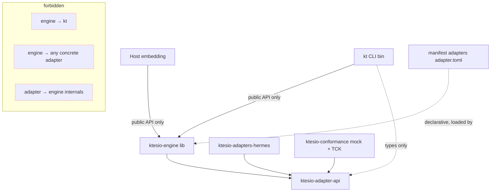
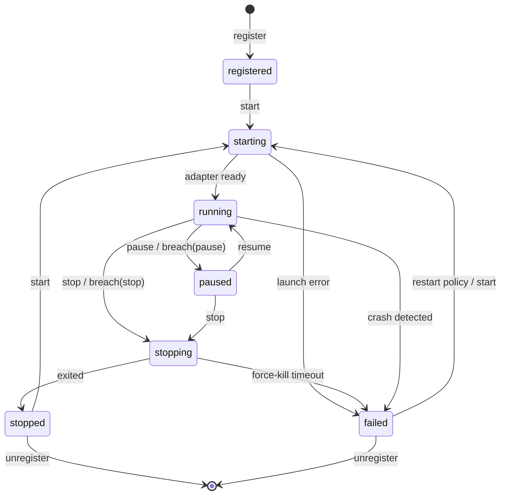
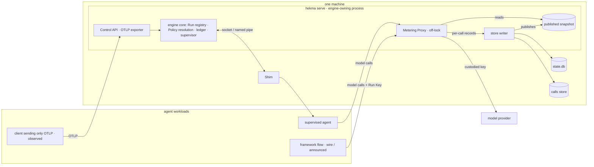
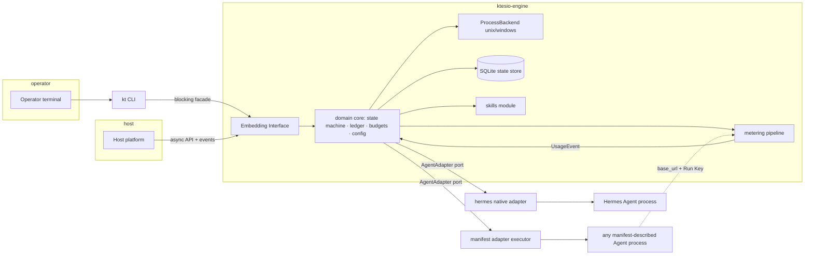

# Architecture Spine — Hekma, the control plane for agent workloads

## Design Paradigm

**Hexagonal (ports & adapters) around a supervised-process core.** The engine core is pure domain — lifecycle state machine, Usage Ledger, budget evaluation, config resolution — and knows nothing about any specific Agent, OS, or frontend. All variability enters through ports:

- **Downward port:** `AgentAdapter` (the Adapter Contract) — how Agents plug in.
- **Upward port:** the Embedding Interface — the `ktesio-engine` crate's public API; `kt` and Hosts are peer consumers of it.
- **Side ports:** `MeteringSource`, `MemoryBacking`, `StateStore`, `ProcessBackend` (per-OS), `SecretResolver`.

*(Amended 2026-10-30 — control-plane pivot.)* The core now governs **Runs** (PRD Glossary), not only the processes it starts: a Run at any Control Depth (`observed` < `wire` < `announced` < `supervised`) has one identity, one ledger and one Policy resolution, all in the domain core (AD-25). Two runtime parts sit beside it and never take its locks: the **Metering Proxy**, the shared data path every `wire` and deeper Run's model calls cross (AD-26), and one **Shim** per supervised process, which keeps that process alive across Service Host restarts (AD-23). The core publishes what the data path needs as an immutable snapshot; the data path sends back per-call records. Crate and type names below still read `ktesio-*` from the original authoring; the code says `hekma-*` (full rename is separate housekeeping).

Layer ↔ code mapping: core = `ktesio-engine::domain`, ports = `ktesio-engine::ports` + `ktesio-adapter-api`, adapters/frontends = `ktesio-adapters-*`, `ktesio-engine::backends::{unix,windows}`, `kt`.

## Invariants & Rules



### AD-1 — Hexagonal core; domain logic lives only in the engine core
- **Binds:** all
- **Prevents:** business rules (budget math, state transitions, config precedence) duplicating or diverging across CLI, adapters, or OS backends — the failure that breaks SM-1's "identical controls."
- **Rule:** `ktesio-engine::domain` has no dependency on any adapter crate, OS-conditional code, or terminal/UX crate. Anything agent-, OS-, or frontend-specific enters through a port trait.

### AD-2 — Workspace shape and the public-API boundary
- **Binds:** all; FR-31, FR-32, §7 (PRD)
- **Prevents:** `kt` reaching engine internals, and third-party adapter authors depending on the whole engine.
- **Rule:** Cargo workspace with exactly these publishable crates: `ktesio-engine` (lib; its public API *is* the Embedding Interface), `ktesio-adapter-api` (contract types/traits, independently semver'd), `ktesio-adapters-hermes`, `ktesio-conformance` (TCK + mock adapter), `kt` (bin). `kt` depends only on `ktesio-engine`'s public API (+ `ktesio-adapter-api` types). CI enforces: crate-visibility compilation + a semver-check job on `ktesio-engine` and `ktesio-adapter-api`.

### AD-3 — Two adapter kinds, one trait
- **Binds:** FR-1, FR-27..30, §4.7
- **Prevents:** a second, incompatible extension mechanism emerging (dylibs, embedded scripting) and per-agent one-off integration code inside the engine.
- **Rule:** every Agent integrates as an `AgentAdapter` implementation of exactly one kind: **native** (Rust impl compiled into the workspace: `hermes`, conformance `mock`) or **manifest** (a directory with `adapter.toml` declaring lifecycle exec/args/env templates, capability declaration, metering-source config, interaction wiring — loadable by path at registration). No dynamic library loading. The generic manifest executor lives in the engine; manifests carry no code. The manifest schema is itself part of the Adapter Contract: its types and validation are defined only in `ktesio-adapter-api` and versioned under the same contract semver — the engine executor consumes that crate's parsed form and never defines its own schema.

### AD-4 — Per-OS process control via `ProcessBackend`; capabilities are (capability × OS)
- **Binds:** FR-5..9, NFR-1, NFR-2
- **Prevents:** Unix-shaped supervision silently lying on Windows (especially pause).
- **Rule:** all process operations go through the `ProcessBackend` port. Unix backend: spawn into a dedicated process group; stop = SIGTERM → SIGKILL after the graceful window (default 30s, per-instance configurable); pause via SIGSTOP/SIGCONT only when the adapter declares `pause: guaranteed-via-signal`. Windows backend: one Job Object per Agent Instance; stop = graceful request → `TerminateJobObject`; pause is adapter-cooperative only. Capability Declarations are keyed per OS; the engine surfaces the *effective* (current-OS) declaration everywhere capabilities are shown.
- **Projection clause (post-impl refinement from 1-3 review F3, ratified by Islam 2026-07-04):** the persisted adapter snapshot in the Agent Home stores the **full** per-OS Capability Declaration, NOT a register-time single-OS projection. The effective (current-OS) declaration is projected onto the **running** OS at READ time (`effective_capabilities` / `kt agent show`), not frozen to the registering OS. This keeps the state directory portable — a home registered on one OS projects correctly when later read on another.

### AD-5 — Write-ahead spawn records; orphan adoption on start
- **Binds:** FR-9, FR-10, NFR-1
- **Prevents:** orphan agent processes after an engine crash, and PID-reuse false adoption.
- **Rule:** before exec completes, persist {instance id, PID, process start-time fingerprint}. On engine start, reconcile every record against live processes: fingerprint match → adopt supervision; no match → mark `failed` with last-known cause. No spawn without its record committed first.

### AD-6 — SQLite is the one state store; Agent Homes hold bulky artifacts
- **Binds:** FR-10, FR-18..22, NFR-4
- **Prevents:** concurrent `kt`/embedded-host access corrupting JSON state files; ledger data loss on crash.
- **Rule:** all registry, lifecycle, budget, and Usage Ledger state lives in one SQLite database (rusqlite, bundled SQLite, WAL, `synchronous=NORMAL`) under the engine state dir. Usage Ledger = append-only `usage_events` + rollup aggregates; one transaction per usage event (durability loss bound ≤1s, superseding the PRD's ≤5s placeholder). Logs, memory dirs, Skill Sets, and effective-config snapshots are files inside the Agent Home — never blobs in the DB.

### AD-7 — One metering/enforcement pipeline
- **Binds:** FR-18..23, SM-2
- **Prevents:** budget checks scattered across call sites, each with its own race against the ledger.
- **Rule:** `MeteringSource` → UsageEvent → ledger transaction → `BudgetEvaluator` (inside the same commit path) → BreachDecision → the supervisor (process actions) or the published disposition snapshot (wire actions, AD-26) executes the Breach Action — default **`warn`** since 2026-10-30 (was `pause`) — and the breach event is emitted. No other code path may mutate the Usage Ledger or trigger Breach Actions. A **Run** is the PRD Glossary Run (AD-25): for a supervised Agent Instance, the span from an operator `start` to the next operator `stop` or terminal failure, *including* Restart Policy relaunches; "per-run" budget scope means exactly that Run. Every UsageEvent carries at minimum {run id, instance id when supervised, input, output, cached tokens, metering source, per-call id when from the proxy, timestamp}. The `engine-observed` source is the shared Metering Proxy (AD-26), which replaces the per-instance loopback listener. `[ASSUMPTION: OpenAI-compatible usage JSON covers the v1 targets; other provider schemas are Deferred.]`
- **Breach default and upgrade (2026-10-30, PRD FR-21):** the default Breach Action has exactly one source, the **default Policy** (AD-25); no config layer carries a default `budget.breach_action`, and the code's `#[default]` is used only to seed that Policy. On the first open after the upgrade (a state.db migration step), every instance whose *instance* and *kind* layers carry no `budget.breach_action` gets `pause` written at the instance layer, plus a store marker (not a config key). The marker renders the "kept on pause by upgrade" note in the Fleet listing and on the instance's Runs until the key is set again, and the migration emits one `breach_default_upgraded` event listing the instances written. Registration responses and events name the effective Breach Action. The default changes only in a semver-breaking Embedding Interface release (AD-2) or a Control API minor version (PRD §7 item 4), each with a release note. A malformed `breach_action` fails closed to `pause` with a surfaced diagnostic, never to the new default. *Crash order (readiness 2026-10-30):* the migration first commits a pending-upgrade list in state.db, then writes each instance's `config.toml` idempotently under its lock, then in one transaction sets the markers, emits the event and clears the list; a restart resumes from the list. An instance whose `config.toml` is missing or unwritable keeps `pause` through its marker and gets a diagnostic, never the new default.
- **`block` before the shared proxy (readiness 2026-10-30):** until the published snapshot carries dispositions to the shared proxy (stories 23-1 and 23-4), `block` is a lock-free per-instance flag on today's listener, set only by the pipeline — the Supervisor today, the store writer after AD-27 lands — and rebuilt from the durable breach record on engine restart and adoption, as the latch is. `block` is refused at configuration on an instance with no listener (self-reported metering only). Its refusal response (status code that common SDKs do not retry, a JSON error body with a stable type and code naming dimension and scope, never content) is chosen in story 19-2's spec as the first slice of `proxy-wire v1`; 23-1 documents it unchanged, carries `block` into the snapshot so the fence never lapses, and 23-4 reuses it for `reject`.
- **Amended 2026-09-30:** see *Amendments (2026-09-30)* after AD-20.

### AD-8 — Estimate honesty is type-enforced
- **Binds:** FR-23, SM-C3
- **Prevents:** an unlabeled dollar figure ever reaching a human or a Host.
- **Rule:** exactly one rendering module owns currency formatting; its input type requires an `EstimateLabel` (`estimated` | `reconciled`). No other module formats currency (review + grep-lint enforced).
- **Amended 2026-09-30:** see *Amendments (2026-09-30)* after AD-20.

### AD-9 — Layered TOML config with persisted provenance
- **Binds:** FR-11..13
- **Prevents:** per-agent config dialects and unanswerable "what actually applied?" debugging.
- **Rule:** TOML at every layer; precedence engine-defaults < adapter (kind) defaults < Agent Home instance config < invocation overrides. Start resolves to an `EffectiveConfig` snapshot persisted in the Agent Home, every value tagged with its source layer. Unknown keys are rejected except under the pass-through namespace `agent.*`, delivered verbatim and rendered as unvalidated.

### AD-10 — Secrets are indirections resolved through `SecretResolver`; `SecretString` everywhere after
- **Binds:** FR-14, NFR-6
- **Prevents:** plaintext keys in config files, logs, events, or `--json` output.
- **Rule:** config references secrets as `secret:NAME`; v1 resolvers: process env and the engine secrets file (mode 0600). Resolved values live only in a `SecretString` newtype that redacts `Display`/`Debug` and is skipped/masked in serialization. OS-keychain is a Deferred resolver behind the same port.

### AD-11 — `MemoryBacking` port with two v1 impls
- **Binds:** FR-15..17
- **Prevents:** memory wiring becoming per-agent bespoke glue.
- **Rule:** `filesystem` (engine-managed directory inside the Agent Home; survives restarts byte-identically) and `native` (delegation marker; engine guarantees only Agent Home persistence). Attach/detach permitted only while the Agent Instance is not `running`. The backing descriptor is handed to the adapter at start; richer backings are Deferred behind this port.
- **Delivery clause (Story 5-1 ruling — architect 2026-07-30, decision delegated by Islam):** "handed to the adapter at start" is realized through the AD-9 config seam, NOT through the Adapter Contract: the engine injects the managed path at a reserved engine-namespace unified-config key as an **invocation-override** layer at every start, and the adapter's existing declared `[config]` mapping delivers it into the agent's native mechanism. No `ktesio-adapter-api` change, no `CONTRACT_VERSION` bump, no `SpawnSpec`/`StartLaunch` field — the engine never mints a contract token outside the contract crate. Consequence, binding on every statement of memory guarantees (FR-17/NFR-7): delivery is **offered, not imposed**, and the three levels are never collapsed — (1) *guaranteed*: the managed directory exists inside the Agent Home, survives stop/start and engine restarts byte-identically, and travels with the home; (2) *offered*: the path is injected at the reserved key at every start; (3) *delegated*: whether the agent receives it (the adapter must declare a mapping for that key — an unmapped key is a silent no-op, story 2-2 Decision 6) and what the agent writes there. Because (3) is the adapter's choice, the engine MUST report which side of it an instance is on: a start with a `filesystem` backing attached and no declared target for the reserved key emits a diagnostic notice (stderr, AD-12), and the backing read reports the undelivered state — silence there would be the guarantee-theater this AD exists to prevent. The injected override is NOT persisted into the `effective-config.json` snapshot: it is a delivery mechanism, not operator configuration (the same honest-provenance rule story 3-4 already applies to the ephemeral loopback `base_url`). Attach/detach are non-transition operations permitted only in a TERMINAL persisted state (`registered`/`stopped`/`failed`), with no `--force` escape; detach is metadata-only and never deletes operator data.

### AD-12 — Interaction and log capture are engine-owned
- **Binds:** FR-24..26, NFR-5
- **Prevents:** per-adapter log formats and lost output while detached.
- **Rule:** the adapter trait exposes an `InteractionChannel` (manifest kind default: stdin pipe in, stdout/stderr capture out; hermes maps to its native channel). The engine captures agent stdout/stderr into per-instance rotated files (10MB × 3), every line timestamped and attributed (`agent-out` | `agent-err` | `engine`). stdout of `kt` is command output; diagnostics go to stderr (ADOPTED).
- **Amended 2026-09-30:** see *Amendments (2026-09-30)* after AD-20.

### AD-13 — Async-first engine on tokio; blocking facade for sync callers
- **Binds:** all engine internals; FR-33, FR-34
- **Prevents:** hand-rolled cross-platform thread supervision (higher risk than the dependency) and a Host-hostile blocking API.
- **Rule:** engine internals run on tokio (multi-thread). The Embedding Interface exposes async methods plus a thin `blocking()` facade; `kt` uses the facade. No engine API may require a TTY or prompt (FR-34) — interactivity lives in `kt` only.

### AD-14 — One event schema, two consumers
- **Binds:** FR-8, FR-9, FR-21, FR-26, FR-33
- **Prevents:** the CLI's `--json` and the Host event stream drifting into two dialects.
- **Rule:** engine events (state transitions, crash/restart, usage updates, breaches) are versioned serde structs published over the subscription API; `kt --json` serializes the same structs. Schema changes follow the Embedding Interface semver rules (AD-2).
- **Amended 2026-09-30:** see *Amendments (2026-09-30)* after AD-20.

### AD-15 — Lifecycle state machine is data
- **Binds:** FR-5..9; PRD Glossary states (ratified: `registered starting running paused stopping stopped failed`)
- **Prevents:** transition logic duplicating across commands and drifting per adapter.
- **Rule:** one transition table (state × command → state | error) in engine core, exhaustively unit-tested; every transition emits the AD-14 event with prior state, new state, cause, timestamp. Restart Policy executor: exponential backoff 1s base, ×2, 60s cap; crash-loop stop after 5 consecutive failures — all per-instance configurable.
- **Amended 2026-09-30:** see *Amendments (2026-09-30)* after AD-20.



### AD-16 — Skills provisioning reuses the proven install/lock modules, scoped to the Agent Home
- **Binds:** FR-35..37
- **Prevents:** a second skills implementation diverging from the battle-tested one; legacy users breaking silently.
- **Rule:** `manifest.rs`/`lockfile.rs`/`git.rs`/`install_target.rs` logic relocates into `ktesio-engine::skills` (git stays shell-out — ADOPTED). A Skill Set is `skills.json` + `skills.lock` *inside the Agent Home*. Legacy project-scoped commands become shims over the same module and emit exactly one deprecation notice per invocation to stderr, through the removal window (PRD FR-38/39).
- **Correction (Epic 9, 2026-07-13/14 — ratified by Islam 2026-07-14):** Epic 9 removed the legacy skill-manager surface and every module this Rule planned to relocate (`manifest.rs`/`lockfile.rs`/`git.rs`/`install_target.rs`, plus `skills_sh.rs`/`skill.rs`/`discovery.rs`) outright, with no shim layer and no deprecation-notice window (commits `42896b7`, `45d203e`). This Rule's premises no longer hold: there is nothing left to *relocate*, and no *legacy commands* left to *shim*. Restated: `ktesio-engine::skills` is **built new** (git stays shell-out — ADOPTED; the deleted modules, recoverable in git history at/before `42896b7`, may inform the design — the manifest/lockfile split, commit-locking shape, shell-out approach — but are not reused as code, since they predate the hexagonal engine boundary, tokio, and the SQLite state store and would not compile inside it unchanged). A Skill Set remains `skills.json` + `skills.lock` **inside the Agent Home** — the per-instance file shape is a design choice independent of where the code that reads/writes it came from, and survives unchanged. The legacy-shim clause is **struck**: Epic 9 already resolved the deprecation/removal question via a clean release-boundary break (FR-37/38 amended in `epics.md`); Story 8-4, which implemented this clause, is superseded. **Prevents** is restated too: no longer "legacy users breaking silently" (Epic 9's CHANGELOG/RELEASE_NOTES already state the removal loudly, at 0.6.0, before any user upgrades into it) — instead, this AD now exists to prevent a from-scratch implementation skipping the reproducibility/integrity rigor (commit-locking, byte-reproducible re-provisioning, per-instance scoping, integrity checking) that the deleted implementation already proved out and that FR-35/36 still require.

### AD-17 — Coarse global locking is a recorded decision, with a bounded-work rule
- **Binds:** every engine operation; NFR-1, NFR-4; AI-63
- **Prevents:** the Epic-4 bug class recurring — an operation with no upper bound on its duration performed while every instance's every operation is serialized behind the same locks. Two independent CRITICALs (4-1's unbounded stdin write, 4-2's unbounded post-SIGKILL wait) walked into it separately *because the lock model was an implementation fact rather than a recorded decision*, so nothing told either story it was standing on a shared chokepoint.
- **Rule:** v1 serializes engine state behind **two** coarse mutexes in `EngineInner` — `Mutex<Registry>` (which owns the single rusqlite connection) and `Mutex<Supervisor>` — acquired registry-first and held for the whole synchronous operation, for ALL instances. That is ADOPTED for v1 (it makes the state machine and the ledger trivially race-free) with one binding constraint: **no operation whose duration scales with external state — filesystem tree size, file size, process behavior, network — may be added under these locks without an explicit bound.** New work either carries a bound (a deadline or byte cap, as `STDIN_WRITE_TIMEOUT` and `KILL_CONFIRM_TIMEOUT` do), or runs off-lock (as the attributed output-log tailer thread does), or is refused. Bounded single-entry metadata work (`create_dir_all` of one directory, a stat, a rusqlite read/write) is acceptable; recursive tree walks, whole-file reads of monotonically growing files, and waits on a process are not. The ~17 unbounded sites inventoried by AI-63(a) are recorded **debt, not licence** — no new story may cite them as precedent. The replacement model (per-instance locks vs an actor/dedicated-writer task per supervised process, with the global locks reduced to bookkeeping) is AI-63(b) and MUST be decided **before Epic 7's daemon/embedding work begins**, since a long-lived daemon removes the short-lived CLI-invocation lifetime that currently masks the cost.

### AD-18 — The coarse two-mutex model is ratified; the per-instance successor is designed and deferred behind named reopen triggers
- **Binds:** every engine operation; AD-17 (retained verbatim — its bounded-work rule is this model's load-bearing discipline); NFR-1, NFR-4; resolves AI-63(b); discharges the AD-17 "MUST be decided before Epic 7" gate (moot on arrival: Epic 7 shipped 2026-09-14 without the incident the gate guarded against) and epic-5 retro item B5.
- **Prevents:** a lock-model rewrite being started on argument instead of measurement, and new load (per-call, per-Run) silently entering the coarse locks.
- **Decides:** the engine keeps the **coarse two-mutex model** — `Mutex<Registry>` + `Mutex<Supervisor>`, global serialization, race-safety by construction (AD-17's Rule). The per-instance serialization proposal (`_bmad-output/planning-artifacts/ai-63b-lock-model-decision-2026-08-27.md`: 4 candidates, 3-lens evaluation, 7-step staged migration) is **rejected-for-now and archived as the standing replacement plan — designed, not disproven.**
- **Evidence (ratified by Islam, 2026-09-19):** (1) story 7-5 measured coarse-model contention at ~0.7% per instance against NFR-4's 2% budget (40–170× headroom) — the proposal's own reopening clause is measurement-gated ("that measurement, not an argument, reopens this decision") and the measurement passed; (2) AI-20's 2026-09-15 ratification declined the daemon/persistent-engine-session concurrency that made per-instance locking an Epic-7 fitness requirement; (3) epics 7–12 shipped with no lock-class incident.
- **Accepted costs (bounded and disclosed, never silent):** AI-59's bounded 5s stdin-write stall — fleet-wide within one engine lifetime, and the CLI's one-engine-per-command shape isolates across commands; the ≤35s `KILL_CONFIRM_TIMEOUT` window; bounded-but-large filesystem work under the locks (Agent Home deletion). Agent latency never holds engine locks — an agent thinking/reasoning is its own process's work. The engine's Metering Proxy *is* in the request path of every `wire` and deeper Run (AD-26), and it takes no engine lock and no SQLite connection there, so agent and provider slowness still block nothing under either model.
- **Reopen triggers (any one reopens this decision; the archived plan reactivates as-written):** (1) ratification of a daemon / persistent-engine-session / concurrent embedded host (AI-20's successor); (2) a 7-5-style measurement over the NFR-4 budget under active contention; (3) a cross-instance invariant defect under the coarse model; (4) sustained fleet-scale growth moving the measured contention term. The archived proposal's Steps 0–4 are zero-interleaving-risk and may still be executed on their own merits without reopening this decision.
- **Amended 2026-09-30:** see *Amendments (2026-09-30)* after AD-20.
- **Amended 2026-10-30:** reopen trigger (4) fires (control-plane scale: a shared proxy for many Runs, 1M-Run reads); see *Amendments (2026-10-30)*.
- **Carried debt (model-independent — pays under either model, tracked in deferred-work):** the archived proposal's Step 0 free wins (hoist `EnginePaths` out of `Registry`; move the whole-file agent-log reads off the guard; bound the bare `child.wait()` in the unix Drop) and Step 7 companions (usage-total rollups bounding the `usage_events` scans; deduplicate `fleet_entry_for`'s double `effective_config` fold; `agent.log` rotation). AD-17's bounded-work rule and the AI-63(a) inventory remain **debt, not licence**.

### AD-19 — The engine speaks ACP as a client for the builtin `acp` kind
- **Binds:** the `acp` builtin kind end to end; AD-4 (no per-OS cfg outside `backends/` — ndJSON/JSON-RPC framing is OS-uniform), AD-7 (metering), AD-8 (estimate honesty), AD-12 (engine-owned interaction/log capture), AD-13 (tokio tasks, bounded lock holds per AD-17/AD-18), AD-18; NFR-6 (no sandbox claims), NFR-8 (lean dependencies); resolves Epic 14 (Sprint Change Proposal 2026-09-19-acp, decisions D1–D8).
- **Prevents:** per-agent bespoke integration cost for every ACP-speaking agent (the friction this AD exists to delete); the frozen adapter contract v1 being re-opened for a transport concern (builtins do not negotiate — epic-6 retro B3 precedent); billing-grain dishonesty via ACP (the protocol's `usage_update` is CONTEXT-grain — used/size — and must never be minted into the billing ledger); silent loss of cached tokens (the pipeline-wide gap: parse ignored `prompt_tokens_details`, `Rate` had no cached price, the ledger no column).
- **Rule:** the engine runs an ACP **client** over the child's stdio — newline-delimited JSON-RPC 2.0 (UTF-8, one message per line, stdout purity), hand-rolled over `serde_json` (NO new crates; the official SDK rejected for v1 under NFR-8 — churn vs. the single-integer protocol version; revisit when the End-Turn Token Usage RFD lands). Client capabilities advertised = the protocol default (no fs/terminal/elicitation; D3); incoming `session/request_permission` is answered denied + one surfaced diagnostic. Version posture: negotiate at `initialize` (client offers its latest; tolerate the pinned set {1}; counter outside it → close with a surfaced, traffic-free error). Lifecycle mapping: `send` = one `session/prompt` (returns after the bounded write; the turn completes asynchronously — `send`'s latency contract stays constant-time; a second concurrent prompt is refused with a surfaced in-flight error); `session/cancel` precedes the normal stop ladder; pause/resume keeps process semantics; the ACP session id persists with the spawn record and re-adoption resumes via `session/load` when the agent advertises it, else `session/new` + honest note (composes with epic-12 detach). Metering is tiered, never fabricated: T1 `usage_update` → surfaced context metric (log + `show --json`), T2 the engine-observed base-URL channel, T3 the optional stderr sentinel — the billing ledger (input/output/**cached**) is fed only by T2/T3; the honest `—` cell survives only as the surfaced last resort naming the tiers attempted (AI-18, AD-8). Cached tokens are first-class across parse → ledger (additive nullable column) → rate (optional cached rate; unset prices at the input rate — documented conservative default) → budgets → surfaces, for every kind. The bespoke `hermes` kind deprecates by announcement once the acp kind reaches parity (14-5); its removal is a future MAJOR-release decision under the CLI-surface policy — never this epic's.
- **Amended 2026-09-30:** see *Amendments (2026-09-30)* after AD-20.

### AD-20 — The Service Host is a shim over the public engine API
- **Binds:** FR-41, FR-50, FR-52, FR-55, FR-57, FR-60; AD-2, AD-13, AD-14, AD-17/AD-18, AD-22, AD-23; PRD §8 (a self-hosted control plane, never a hosted service), §6 Privacy, §7 item 4, NFR-6, NFR-8, NFR-9.
- **Prevents:** supervision gaps between commands for Hosts that cannot link Rust; a second
  business-logic implementation growing inside a transport layer; a network surface that leaks
  secrets or content.
- **Rule:** a new host crate depends only on `hekma-engine`'s public API — one AD-2 boundary-gate
  entry — and serves a local HTTP/JSON Control API. The `hekma` CLI stays synchronous; the engine
  library stays transport-agnostic (the engine also owns the Metering Proxy listener, AD-26, the handoff channel and Shim connections, AD-23). Around that:
  - **Ownership:** one Service Host owns a state directory, enforced by a lock.
  - **Binding and auth:** the bind address is explicit, loopback by default. A non-loopback bind
    requires TLS (`tokio-rustls`, already in-tree) and is refused at start without it *(amended
    2026-10-30)*. Auth goes through one credential resolver with classes — operator/Host bearer,
    announce-scoped credential, Run Key, refresh credential, Node credential (AD-24) — each looked
    up by hash (AD-22); the single constant-time bearer compare becomes one class of it.
  - **What it never returns:** no secret reveal and no raw agent output unless explicitly enabled.
  - **Events:** live over SSE, and by pull on a global cursor (AD-14 amendment).
  - **Shutdown:** SIGTERM drains, then stops within a bound — unless the host runs in **Handoff
    Mode** (AD-23): then it releases every Shim without stopping it, hands the Metering Proxy's
    listening socket to its successor on a graceful restart (AD-26), and exits; dropping the engine
    never kills a Shim-owned process. The host may own process signals; the engine library still
    may not (the embed-clean audit is unchanged).
  - **One data-path owner (2026-10-30, ruled by Islam):** while a Service Host holds `host.lock`, it alone runs the Metering Proxy, the store writer and the snapshot publisher (AD-25..AD-27); the `hekma` CLI routes every mutation through the Control API and never commits to state.db itself. When no Service Host runs, the first CLI command that needs a write or the proxy **auto-starts a local, loopback-only `hekma serve`** in the background (the tmux-server pattern, ruled by Islam 2026-10-30) and routes through it; read-only commands open state.db read-only. Concurrent CLI commands therefore share one owner, and agents outlive the terminal. `SO_REUSEPORT` is never set.
  - **Credential authority matrix (2026-10-30):** operator/Host bearer → every Control API route, never accepted by the proxy and never handed to an agent; announce-scoped credential (one per endpoint binding) → create a Run, set its Caller labels, heartbeat or close only Runs it created, and OTLP intake (AD-28); Run Key → the proxy, and on its own Run and its children: heartbeat, close, open a child Run, tighten limits — nothing else; refresh credential → rotate its own Run Key only; proxy-access credential (per endpoint binding, hashed) → the Metering Proxy beyond loopback only, presented in the API-key slot, not a Scent-Check identity, swapped for the binding's custodied key; Node credential (AD-24) → Hub rollup and routed verbs only. A credential presented on a surface its class does not allow is refused with a typed error, and a class never acts on another Run.
  - **Shim and handoff protocol versions (2026-10-30):** Shim RPC and the handoff channel carry a protocol version in their first message; a Service Host accepts its own and the previous minor version, and reports — never kills — a Shim it cannot speak. Downgrade across a state.db migration is unsupported.
  - **Upgrade and restart sequence (2026-10-30):** an in-place upgrade (`hekma serve --upgrade` or a signal) launches the successor itself; the successor connects to a handoff channel inside the state directory (AD-23's access rules), and the predecessor stops accepting, flushes and closes its store writer; the successor then receives the listening socket and the `host.lock` transfer, migrates state.db, reattaches Shims, and only then does the predecessor exit. A service-manager restart (stop, then start) gets no-refused-connections only through socket activation (systemd, launchd); otherwise connections are refused until the new process binds, and clients see that as retryable.
  - **Run and Policy resources (2026-10-30):** `/v0/runs` (keyset-paginated list with `selector`,
    `limit`, `cursor`), `/v0/runs/{id}` and its verbs, announce / heartbeat / close endpoints under
    the announce-scoped credential, and `/v0/policies` CRUD, `/v0/runs/{id}/labels` for bound labels, and `/v0/bindings` for
    endpoint bindings with their routes and per-binding announce and proxy-access credentials
    (a credential is shown once at issue and stored as a hash) — all under the operator bearer
    only, each change an event *(readiness 2026-10-30, ruled by Islam)*. Multi-Run verbs resolve the matched set
    first and act on a set token (PRD FR-50). `/v0/instances` stays as the supervised projection.
    Handlers stay thin projections; Selector and Policy evaluation live in the engine core (AD-1,
    AD-25). SSE frames carry `id: <outbox seq>` for resume and accept a server-side `selector`.
  - **Versioning:** the Control API carries its own version, unstable `0.x` until a second Host
    validates it.
  - **Settled (2026-10-19, story 17-1):** crate name `hekma-host`; HTTP stack **axum 0.8**
    (NFR-8: rides the hyper/http/tokio stack already in-tree; the actual `cargo tree` diff is
    recorded in 17-3's PR — where axum enters — per the 17-2 spec's erratum, hyper-direct the
    honest fallback); AD-18 **re-ratified coarse** on
    measurement. Provenance: `_bmad-output/planning-artifacts/host-mode-decisions-2026-10-19.md`
    (ratified by Islam, 2026-10-19). See *Amendments (2026-10-19)*.

### AD-21 — The host owns a minimal OTLP/HTTP+JSON metrics exporter; the engine stays telemetry-free
- **Binds:** FR-46; AD-2 (no new crate), AD-8 (estimate honesty crosses into telemetry), AD-10
  (header secrets), AD-14 (third consumer, same schema), AD-17/AD-18 (bounded-work rule on the
  flush task), AD-20 (host scope), PRD §6 (2026-10-23 amendment), NFR-8 (zero new runtime deps).
- **Prevents:** the heaviest dependency in workspace history (`opentelemetry` +
  `opentelemetry-otlp` + transitive) entering for a metric-only v1; telemetry back-pressure ever
  stalling supervision; an unlabeled dollar figure reaching a dashboard (AD-8's failure mode, one
  Grafana panel away); a second event dialect (metrics minted from anything other than the AD-14
  structs).
- **Rule:** the exporter is a module inside `hekma-host` (`src/otlp/`), not a new crate, not in
  the engine — the host is the telemetry adapter exactly as it is the HTTP adapter (AD-20). It
  subscribes **read-only** to the public event bus and derives every metric from the existing
  versioned AD-14 payloads; no new event kinds, no engine API change, no engine instrumentation.
  Around that:
  - **Hand-rolled, zero new runtime deps (option (a), ratified by Islam 2026-10-23).** OTLP/HTTP+JSON
    is a POST of a JSON metrics batch to `<endpoint>/v1/metrics`, serialized with in-tree
    `serde_json` over the hyper+rustls client plumbing the metering channel already proved. House
    precedents: AD-19's hand-rolled ACP client under the identical NFR-8 argument; 17-4's std-only
    SHA-256. The `cargo tree` diff is zero crates. *Alternatives:* **(b)** the otel SDK — rejected
    for v1, the standing alternative; reopen triggers: a real traces consumer (post-19.4) or a
    vendor must-have the hand-rolled path cannot meet. If a second consumer ever appears, that is
    the moment for a `TelemetrySink` port and possibly the SDK behind it. **(c)** a Prometheus
    scrape endpoint — rejected by Islam 2026-10-23 (standard OpenTelemetry chosen); an OTel
    Collector in front of Hekma can still bridge to Prometheus.
  - **Transport: OTLP/HTTP+JSON, never gRPC.** gRPC means tonic/prost — a second wire stack, a
    proto toolchain in CI, the largest dep delta available. Binary `application/x-protobuf`
    encoding is Deferred (volume-triggered).
  - **Never blocks supervision.** Publish-after-commit comes free from the bus contract; a
    `Lagged(n)` observation becomes a surfaced drop count (`hekma.otlp.dropped` + a self-metric
    and a restart note — AI-18), never an error into supervision. The flush task is host-side,
    off every engine lock; each POST carries an explicit timeout (AD-17); queue overflow drops
    oldest with a surfaced note. **No durable telemetry persistence** — the outbox stays the only
    durable/acknowledged export surface (AD-14). In-flight points lost on crash are surfaced once
    at restart; ledger-sourced re-derivation is Deferred behind a trigger.
  - **Naming: OTel GenAI semconv first, `hekma.*` only where no semconv exists.**
    `gen_ai.client.token_usage` (with `gen_ai.token.type` input/output/cached) and
    `gen_ai.client.operation_duration` — the latter emitted only once per-call latency exists
    (Story 19.4); absent, never fabricated from run-walltime. `hekma.budget.breaches`,
    `hekma.agent.state`, `hekma.usage.cost`, `hekma.otlp.dropped` in the `hekma.*` namespace.
    **Every currency-bearing metric carries `estimate_state: estimated|reconciled`** — a
    reconciled figure is a NEW data point on the `reconciled` series, never a replacement
    (AD-8).
  - **Resource attributes:** minimal — `service.name=hekma-host`, `service.version`,
    `service.instance.id` (from the state-dir lock identity). No topology detection; that is the
    collector's layer.
  - **Config (one surface, both `hekma serve` and `hekma-host`):** `--otlp-endpoint` (default:
    off — the exporter exists only when configured, like `--listen`), `--otlp-headers` where any
    value may be `secret:NAME` resolved at startup through `SecretResolver` (unresolvable = typed
    startup refusal; values live as `SecretString` — AD-10), `--otlp-flush-interval` (bounded,
    default 10s). Cumulative temporality with an honest restart-reset, stated in docs.
  - **Versioned exposition.** Metric names, types, attributes and units are pinned in
    `docs/telemetry.md` under an `otlp-metrics v1` marker with the Control-API additive-only-
    until-frozen discipline; renames/drops are versioned release-surface changes (AI-55).
  - **Scope: metric-only v1.** Traces/spans are Deferred.
  - **Amended 2026-10-30 (`otlp-metrics v2`, PRD FR-59):** see *Amendments (2026-10-30)*.

### AD-22 — The Run Key is the provider key the agent holds; tokens are opaque and hashed at rest
- **Binds:** FR-51, FR-52, FR-53, FR-54; AD-10, AD-20 (credential matrix), AD-26; PRD §8 (no sandbox claim), NFR-6.
- **Prevents:** the real provider key reaching an agent process; two token formats between the proxy, the Control API and the helpers; a revocation that does not apply on the next call; an agent breaking because its API key expired mid-run.
- **Rule:** **the Run Key is the virtual provider key** (ruled by Islam 2026-10-30): one token per Run, which the client presents in its provider API-key slot (`Authorization: Bearer` or `x-api-key`); the proxy identifies the Run from it and swaps in the real key. Hekma delivers it to a supervised agent through a reserved invocation-override key mapped to the agent's API-key variable (the `metering.base_url` pattern; no Adapter Contract change), and returns it from announce (AD-26, AD-28). A Run Key is valid for its Run's life and is revoked when the Run ends or on demand; it does not expire on a clock. Rotation is optional, through the separate **refresh credential**, which goes only to the announcing process or to the process the Shim launched (a relaunch gets a fresh one). Possession is the binding; there is no OS attestation, and the docs say so.
  - **Token format and handling:** `hk_run_`, `hk_ref_` and `hk_ann_` tokens are 256 random bits from the OS CSPRNG (`getrandom`), Crockford base32, held in `SecretString` from mint to delivery, shown to their holder once, and stored only as an unsalted SHA-256 hash (adequate for 256-bit tokens) using the engine's existing std-only SHA-256 — no `sha2` edge in the engine. Records, logs and events name a token by its **token id** (the first 12 hex chars of its hash), never the token. Tokens never travel in a URL path or query string, and a token may be delivered only through an `Env` mapping — `File` and `Flag` targets are refused for it, as they are for custodied keys.
  - **Key custody** (the default for a supervised Run whose provider key is configured through Hekma): the custodied key is resolved through `SecretResolver` for the proxy only, never enters the adapter config mapping, and is bound to its configured upstream origin over `https`; the proxy never sends it to another origin, including on reroute. Custody forces the child environment allowlist on and strips provider variables from the inherited environment. The proxy inserts only the custodied key named by the call's Run's instance config or its endpoint binding — never for an unattributed call — and refuses a request whose `Host` is not loopback or Operator-configured, or whose `Origin` (when present) is not on an Operator allow-list (DNS-rebinding guard). An agent whose provider key Hekma does not hold sends its own key and gets no `metering.base_url` override: a `self-reported` adapter is `supervised (no wire)` (PRD FR-49); an `engine-observed` adapter in that state has no viable Metering Source and is refused at start with a remediation (configure the key through Hekma), per FR-19.
  - **Stated limit:** custody keeps the key out of the agent's environment, arguments and Agent Home; it does not stop a hostile process running as the same OS user from reading the secrets file. Running agents as a separate user stays Deferred. The loopback proxy authenticates its callers, not itself: on a shared host another OS user can bind its port while no owner holds it, so the docs recommend socket activation or a single-user host.

### AD-23 — One Shim per supervised process; Handoff Mode releases, never kills
- **Binds:** FR-41, FR-54, FR-55, NFR-1, NFR-9; AD-4, AD-5, AD-12, AD-20; amends AD-4/AD-5/AD-12 per OS (see *Amendments (2026-10-30)*).
- **Prevents:** a Service Host restart, upgrade or crash killing agents; a single supervisor daemon becoming the new single point of failure; pid-based re-adoption that loses ACP pipes and Windows job semantics; another local user driving an agent through its Shim.
- **Rule:** every supervised process is launched and owned by its own **Shim** — `hekma shim`, an internal, hidden subcommand of the same binary (not a CLI surface; its protocol is versioned, AD-20) whose logic lives in `hekma-engine::shim` (OS parts under `backends/`), so a Host embedding the engine can point at any binary that calls it. The Shim detaches from the Service Host's session (`setsid` on Unix; `DETACHED_PROCESS` plus a new process group on Windows) so terminal signals never reach it. It owns the process group (Unix, as the reaping parent; `PR_SET_CHILD_SUBREAPER` on Linux, with the Shim — not the engine — reaping) or the Job Object with kill-on-close (Windows), the stdin/stdout pipes, the raw-log redirects, the `output.log` tailer, and **bypass detection** for its process tree (PRD FR-54: per OS in `backends/`, comparing the tree's TCP connections against the resolved provider-host list; an OS without an implementation reports "unavailable"). The engine reaches a Shim through a **third `ProcessBackend` implementation** whose handle is a socket / named-pipe client: spawn asks the Shim, stop/pause/poll are RPCs, adopt reconnects, and exit is pushed by the Shim.
  - **Access control:** Shim sockets live in a `0700` directory inside the state directory, with paths kept under the `sun_path` limit (a short hashed name); the Shim checks the peer's uid (`SO_PEERCRED` / `getpeereid`), and on Windows the pipe's DACL admits only the owning user. Each Shim has its own random connection secret, stored hashed in its spawn record, which the engine presents on connect.
  - **With no engine connected,** a Shim keeps its process running and buffers its exit status and output; it never relaunches, writes state.db or mints credentials. The next engine applies the Restart Policy on reattach.
  - The spawn record (AD-5) gains the Shim's endpoint, fingerprint and connection-secret hash, and is committed **before** the Shim launches the child. The adoption owner/lease columns become the **ownership claim**, so they never collide with the PRD's Run Lease; the compare-and-set claim is kept and Shim liveness replaces `probe_alive`.
  - **Handoff Mode** (PRD FR-55): on SIGTERM the Service Host releases its Shim connections without stopping them, persists holds and Leases, and exits; the next Service Host reattaches to every live Shim. A hold belongs to its Run, not to a connection (ruled by Islam 2026-10-30): a held call's connection may end with one retryable error, and the retried call is held again. Handoff Mode is the default once FR-55 ships; drain-and-stop stays configurable. Without it, drain-and-stop and orphan cleanup apply (NFR-9).
  - The docs and a startup check state what Handoff Mode needs: systemd `KillMode=process` or `none` (`control-group` and `mixed` both kill Shims), and on Windows an outer job that allows `CREATE_BREAKAWAY_FROM_JOB` for every job in the chain. Where the Service Host cannot tell, it says Handoff Mode is unverified and never reports a handoff as successful for a process that did not survive.

### AD-24 — Nodes and Hub *(reserved; drafted with Epic 25)*
- **Binds:** FR-58, AD-20, AD-21.
- **Prevents:** Epic 25 work starting without a stable decision number, or a Hub reusing the outbox's single ack cursor.
- **Rule:** reserved — nothing is decided beyond PRD FR-58's consequences and the Node credential class in AD-20's matrix; no story may build Hub behaviour until this AD is drafted. Inputs it must settle: rollup endpoint and cursor, Hub merge, Hub-routed verbs with Selectors, per-Node auth, partition behaviour.

### AD-25 — Runs, labels and Policies are core entities; one owner writes them, one publisher serves the data path
- **Binds:** FR-1, FR-18..FR-22, FR-43, FR-45, FR-49, FR-50, FR-52, FR-60; AD-1, AD-6, AD-7, AD-14, AD-15, AD-18, AD-27.
- **Prevents:** a second Run concept growing in the host or the proxy; Policy resolution diverging between CLI, Control API and proxy; lost updates between two snapshot publishers; per-call lookups contending with supervision locks; Run identity colliding across processes.
- **Rule:** the **Run registry** lives in the engine core, separate from `Supervisor`, which keeps only supervised process handles. All Run state is durable in state.db (AD-27) and has **one writer, the store writer**: Run rows {run id, Control Depth, wire-path flag, Run Status, Anomaly flags, optional parent run id (same Node, ≤ 8 levels, no cycles), optional instance id, Lease expiry, timestamps}; labels {key, value, source ∈ bound|caller}; explicit Run limits with their source (operator, Host, Caller); latches; holds; dispositions; bindings (endpoint labels, routes); token hashes. Lock order is fixed: `Registry` → Run registry → `Supervisor`; a Supervisor transition that changes a Run's status sends the change to the writer instead of taking the Run registry lock.
  - **Run ids** are ULIDs (48-bit ms time + 80 random bits from `getrandom`) rendered `run_` + 26 uppercase Crockford base32 chars; legacy `run-<nanos>-<nonce>` ids stay valid as-is. Depth changes keep the id and emit an event; a Restart Policy relaunch keeps the Run. `supervised (no wire)` serializes as depth `supervised` with `wire_path: false` in every surface.
  - **Dispositions:** a Run has a set of active disposition reasons {hold, reject, reroute, breach}; the effective one is the highest — reject (and breach `block`) > hold (and breach `pause`) > reroute > pass. Each verb clears only its own reason; only raising or resetting a ceiling clears a breach reason.
  - **Identity mapping:** `run_identities {binding, external id → run id, UNIQUE(binding, external id)}` resolves identity headers, announces and OTLP to one Run, inside the writer, so concurrent first calls never duplicate a Run (PRD FR-52 "stays one Run").
  - **Run Status and Anomalies are stored, not derived on read:** the writer applies Supervisor projections (AD-15 amendment), Lease and inactivity sweeps (a sweeper task in the data-path owner), and proxy-reported conditions (unscented, policy fallback, bypass from the Shim), so exception-first listing is an index read.
  - **Child Runs** (PRD FR-43, FR-49): a child opened inside a supervised process is at most `announced` and its usage rows carry the hosting instance id; instance totals sum rows by instance, Run rollups by run, ancestor rollups through the parent chain — never by re-summing subtrees. Every ancestor's ceilings apply; a breach applies its level's Breach Action over the Runs beneath; `stop`/`pause` of the process-owning Run cascades to its in-process children with causes `parent-stopped`/`parent-paused`; other children outlive their parent's end.
  - **Policy resolution is one pure function in the domain core:** explicit Operator/Host limits on the instance or Run first; then, per limit, the matching Policy with the most specific Selector (strict superset of terms), ties to the tightest value; then the **default Policy**, a stored, editable Policy row named `default` (no ceiling, Breach Action `warn`, Scent-Check Mode `off` until story 22-3 decides PRD Q9 — 22-3 never overwrites a default Policy the Operator has edited — and the default Rate table); Caller-set limits apply only while tighter. Policy Selectors match bound labels only. A Breach Action set directly where the depth cannot execute it is refused at configuration; one inherited from a Policy resolves to `warn` plus an Anomaly, and Policy create/change returns the count of Runs falling back. **Rates** resolve the same way: instance Rate, then a Policy's Rate, then the default Policy's model-keyed Rate table — so wire Runs have a Rate source. Every surface calls this function; none re-implements it.
  - **Bound labels (readiness 2026-10-30, ruled by Islam):** bound labels come from the instance `labels` config key (a map merged per key across the FR-11 layers, higher layer wins; an invocation override cannot bind labels), which supervised Runs inherit; from a Run Key (AD-22); from an endpoint binding (AD-26); and from the Operator-only `hekma label` verb and its Control API call (AD-20). A label change is an event and re-resolves the Run's Policies.
  - **Policy edits (readiness 2026-10-30, ruled by Islam — interim answer to PRD Q11):** Policies have no versions until PRD theme D; a create, change or delete re-resolves every matched non-ended Run in the writer's next batch (follow the latest). Lowering a ceiling below a Run's usage breaches at once; raising one clears the breach reason and re-arms the latch, as `hekma budget` does.
  - **The published snapshot:** the store writer is the only publisher. After each committed batch that changes what the data path needs, it publishes a new snapshot — structurally shared or sharded so a publish costs O(changed entries), holding only non-ended Runs — behind an atomic pointer swap, before the mutation returns to its caller. The Metering Proxy reads only the snapshot; it never takes an engine mutex and never opens SQLite.

### AD-26 — One shared Metering Proxy per data-path owner, off-lock, with a versioned wire contract
- **Binds:** FR-19, FR-21, FR-43, FR-51, FR-53, FR-54, FR-56, NFR-4, NFR-9; AD-7, AD-17, AD-18, AD-20, AD-22, AD-25, AD-27.
- **Prevents:** per-instance listeners that attribute calls by socket; two engines binding one port; hold/reject logic scattered across call sites; the request path taking engine locks; header names and error bodies drifting between proxy, helpers and docs.
- **Rule:** exactly **one** Metering Proxy listener per data-path owner (AD-20) on a fixed port, loopback by default, TLS plus a credential required beyond loopback. It replaces the per-instance `ObservedListener`. Per call, in `forward()` after the request head and before the outbound request: identify the Run — a Run Key in the API-key slot or the `X-Hekma-Run-Key` header; an identity header (`X-Hekma-Run`, external id and labels) is only a **hint** that names or splits a Run beneath the identity the call already authenticated as (its Run Key or its endpoint binding), never an existing Run on its own, and its labels are Caller labels; an endpoint binding's labels apply only to calls with no Run Key. A call without a Run Key on a labelled binding goes to that binding's Run (PRD FR-51 "one Run per bound identity"); a call matching no labelled binding goes to the proxy's single **unattributed** Run. Both are refused under `enforce`. Each binding row holds {path prefix, upstream origin, bound labels, optional custodied key}: a call goes to its binding's upstream (a supervised Run's comes from its instance config) or to its reroute route; a path matching no binding gets the typed no-route error. Then strip identity and credential headers (the enumerated set in the wire contract), apply the snapshot's **disposition** — pass, hold (queued per Run in arrival order; no Hekma time bound — only the client's timeout ends a hold; beyond a per-Run held-call cap new calls get a typed retryable hold-full response and an Anomaly), reroute (to a configured route; a custodied key never leaves its origin), reject (typed, non-retryable; this is `block`) — swap in the custodied key, add the Operator-switchable outbound identity headers (run id and labels, never content), forward, add the breach response header where a breach is current, and send a **per-call record** {call id, run id, token id, Control Depth, disposition, hold end ∈ released|rerouted|rejected|client-timeout|disconnect|process-exit|crash, model, status class, latency, tokens, sub-second time} to the store writer through a bounded channel. If the channel is full, the proxy blocks that call up to a bound and then fails it retryably — it never drops a record silently. Usage is attributed by run identity at request time; dedup keys on the call id. On accepting a call the proxy sends a call-start record through the same channel (into `open_calls` in the calls store), which the per-call record closes; the proxy also reports each Run's held-call count and oldest held start to the writer on change (coalesced, ≤ 1 s), stored on `runs` for `hekma ps`.
  - **Creating Runs from the request path:** a first call from a new identity, or an announce header, sends a create request to the store writer and awaits its commit and publish with a bound (the only hot-path wait on the writer); only after publish does the proxy return a newly minted Run Key in response headers.
  - **Restart:** in-place upgrades hand the listening socket over (AD-20's sequence); held calls follow AD-23's rule. A crash refuses connections until the next process binds; in-flight calls fail retryably, and on the next start every open `open_calls` entry is closed as `crash`.
  - **The proxy wire contract** — the Run Key and announce header names, identity headers, response headers that return a Run Key and refresh credential, the breach header, the typed reject and retryable error bodies and status codes, the stripped-header set — is a public, versioned surface (`proxy-wire v1`, documented in `docs/`, additive-only until frozen, PRD §7).
  - **Streaming:** responses are still buffered whole before relay; hold and reroute act before forwarding. Incremental SSE relay stays Deferred with a named trigger (mid-stream hold, time-to-first-token).

### AD-27 — Storage at Run scale: state.db plus a rotating calls store, one writer that runs the pipeline, keyset reads
- **Binds:** FR-10, FR-21, FR-22, FR-43, FR-49, FR-50, FR-55, FR-60, NFR-4, NFR-9; AD-6, AD-7, AD-14, AD-17, AD-18, AD-25, AD-26.
- **Prevents:** O(history) reads under the global lock; per-call records bloating hot state; two commit paths for usage; the outbox order breaking; a schema that cannot hold instance-less Runs; Runs growing without bound.
- **Rule:** the **store writer** task owns its own SQLite connection and is the **only writer of state.db** — instance and lifecycle rows included: every write is a message to the writer, which acks after commit, and the Registry connection becomes read-only. It **runs the AD-7 pipeline**: each batch (bounded by 250 ms or 512 events, so the FR-10 flush bound and FR-21 latency hold) commits usage, evaluates budgets in the same transaction, updates latches and dispositions, appends the outbox, publishes the snapshot (AD-25), and sends process Breach Actions to the Supervisor over a channel — the writer never takes `Mutex<Supervisor>`. This supersedes AD-6's one-transaction-per-event rule; the durability bound becomes the batch bound. The coarse mutexes keep guarding instance registry and supervision state.
  - **state.db** gains, on the existing `user_version` chain: `runs` (instance id nullable), `run_labels` (index on key, value), `run_limits`, `run_latches`, `run_dispositions {run id, reason, route, set_by, set_at}`, `run_bindings`, `run_identities`, `policies`, `tokens` (hashes and ids), `transition_events` and `breach_events`, usage rollups per Run and per instance, and the **outbox** (autoincrement, same transaction as the family commit — replacing `outbox.jsonl`). `usage_events` gains a nullable instance id, a call id and a launch generation; dedup keys on (run id, call id) for proxied usage and (run id, launch generation, sequence) for self-reported usage, so a relaunch never collides with the previous process's rows.
  - **Event families (readiness 2026-10-30, ruled by Islam):** transition and breach records move into the `transition_events` and `breach_events` tables, committed in the writer's transaction with the outbox row, so one commit makes an event durable and visible. `instance.log` and `breaches.log` become best-effort mirrors written after commit; `resync_events` and the FR-21 durable breach record read SQLite, and the 16-3 row compensation is no longer needed. The upgrade imports the existing log files once.
  - **The writer and the coarse mutexes (readiness 2026-10-30, ruled by Islam):** the writer takes no engine mutex — neither `Registry` nor `Supervisor` — and sits outside the lock order; the evaluator's inputs (resolved limits, Rate, Breach Action) travel in the message or come from state the writer owns. An acked synchronous write flushes the current batch at once; the 250 ms / 512-event bound applies to unacked streams (proxy records, drained usage). A caller waits for an ack at most 1 s, then gets a typed retryable error. The Breach Action channel never blocks the writer; the caller that submitted the usage applies the process actions it returns before releasing its locks, so a short-lived CLI engine never exits with one queued. The writer also sets the per-instance `block` flag (AD-7) until the snapshot replaces it.
  - **Latches:** `run_latches` is keyed by the run id string with no foreign key until `runs` exists (story 21-2 adds the reference); the upgrade seeds it from `breaches.log` for the current run of each live instance, so a running agent never re-fires a breach.
  - **Before one data-path owner:** until AD-20's auto-started `hekma serve` routes every CLI write (story 21-4), each engine process runs its own writer and the single-writer rule holds per process; cross-process writes keep SQLite's `BEGIN IMMEDIATE` and busy timeout, and guarded transactions keep their guards inside the batch.
  - **Per-call records** go to a separate **calls store**: SQLite files rotated by time, dropped whole at retention. **Ended Runs** are kept for a configurable window, then compacted into a compacted-Run rollup {run id, usage totals, labels, end cause}; their `runs`, `run_labels` and detail rows are deleted, so totals and labels survive and `hekma ps --all` shows full detail only inside the window.
  - Every list read is keyset-paginated on an index with a bounded page; fleet and Run totals come from rollups. New reads and writes go behind a **new port trait** (`StateStore` is frozen), shaped so an external database (e.g. Postgres) can implement it later; that implementation is Deferred.

### AD-28 — Inbound OTLP: the host receives telemetry for `observed` Runs and the OTel announce channel
- **Binds:** FR-19, FR-51, FR-52; AD-7, AD-20, AD-21, AD-25, AD-27; PRD §6.
- **Prevents:** each story inventing its own receiver, attribute names and usage source for `observed` Runs; telemetry-reported usage bypassing the AD-7 pipeline.
- **Rule:** the Service Host serves an OTLP/HTTP+JSON receiver at `/v1/metrics` on the Control API listener, under the announce-scoped credential (AD-20 matrix); binary protobuf and gRPC are Deferred behind a named trigger, and an OpenTelemetry Collector in front translates. A resource attribute `hekma.run.external_id` (plus `hekma.label.*`) identifies the Run, creating or updating an `observed` Run with its Lease (no Run Key is issued on this channel). Usage comes only from `gen_ai.client.token_usage` and enters the AD-7 pipeline as a third Metering Source value (`telemetry-reported`, always `estimated`) through the store writer. Nothing else from inbound telemetry is stored.

### Amendments (2026-09-30) — ratified with sprint-change-proposal-2026-09-30-hosted-platform-readiness.md

- **AD-7 (2026-09-30):**
  - A `block` Breach Action fences further model calls: the pipeline flips a lock-free per-instance
    flag that `forward()` checks, refusing with a typed non-retryable response. No lock is taken in
    the request path, so AD-18's premise holds.
  - A Host-defined **Task** is a budget scope beside per-Run and cumulative.
  - Raising a ceiling re-arms its latch within the Run.
  - Still true: no code path other than the pipeline triggers a Breach Action.
- **AD-8 (2026-09-30):** reconciliation ingestion (FR-45) is the `reconciled` label's first producer.
  Reconciled figures never overwrite estimated rows.
- **AD-12 (2026-09-30):** capture modes `full` (the default, today's behaviour), `metadata` and `off`;
  `agent.log` rotation joins `output.log`'s bound.
- **AD-14 (2026-09-30):** an export view with one global sequence across the event families, pulled by
  cursor. The per-family `resync_events` is unchanged.
- **AD-15 (2026-09-30):**
  - Declared readiness gates `starting → running`.
  - Declared liveness failure is `running → failed` (cause `unresponsive`).
  - Declared exit-code classes: restart-requested exits do not charge the crash loop; clean exits
    are not crashes.
  - A stable window resets the counter.
  - `drain` is a composite (stop new work → bounded wait → stop). It adds no state.
- **AD-18 (2026-09-30):** reopen trigger (1) fired with AD-20's ratification. The decision is
  15.1's, on measurement. (Closed 2026-10-19: measured — re-ratified coarse; see
  *Amendments (2026-10-19)*.)
- **AD-19 (2026-09-30):** removal of the `hermes` kind waits for the service-mode successor (16.5);
  ACP stdio does not run a gateway's API server, scheduler or messaging.

### Amendments (2026-10-19) — ratified from story 17-1's bounded-options proposal (`_bmad-output/planning-artifacts/host-mode-decisions-2026-10-19.md`)

- **AD-2 (2026-10-19):** the publishable-crate list gains `hekma-host` (bin + lib; the AD-20
  Service Host — depends only on `hekma-engine`'s public API plus its own Control-API types). The
  CI boundary-gate allowlist gains `|host` in the same change; the automation pin follows.
- **AD-20 (2026-10-19):** the three deferred decisions are settled: name `hekma-host`, HTTP stack
  **axum 0.8** (NFR-8 review — the marginal axum/tower crates ride the hyper/http/tokio stack
  already in-tree; the `cargo tree` diff is recorded in 17-3's PR — where axum enters; erratum
  2026-10-19, the original application said 17-2 —, hyper-direct the honest
  fallback), and AD-18's outcome re-ratified coarse. Picked by Islam 2026-10-19, applied verbatim.
- **AD-18 (2026-10-19):** reopen trigger (1) is measured and closed. 17-1's `--serve-shape` run of
  record (linux x86_64, release, review-hardened; CI-blocking): read p99 **5.07 ms** vs < 1000 ms
  (~197× headroom); CPU **1.94 %/instance** over the schedule-aware conservative effective count
  of 10 vs ≤ 2 % (~1.03× — the tight budget; process-wide and load-model-sensitive, so any host
  demand growth re-runs `--serve-shape` before a scaling claim); RSS **0.96 MiB**/instance vs
  ≤ 50 MiB (~52×). The bounded stop stalls in-flight reads ~2.0 s (4 of 610 fleet samples) —
  bounded, amortizing, no cascade. **The coarse two-mutex model is re-ratified;** the per-instance
  plan (`ai-63b-lock-model-decision-2026-08-27.md`) stays archived behind the standing triggers.

### Amendments (2026-10-23) — ratified with sprint-change-proposal-2026-10-23-adoptability.md (Epic 20: Adoptability)

- **AD-20 (2026-10-23):** the Service Host may also run a read-only OTLP metrics exporter beside
  the Control API (AD-21): same boundary — engine public API + bus subscription only — no engine
  change, no new crate, and it must never block supervision.
- **AD-14 (2026-10-23, clarifying only):** AD-21's OTLP exporter is a third *consumer* of the same
  one event schema (a bus subscriber), not an export view and not an outbox consumer; the outbox
  remains the only durable/acknowledged export surface.
- **AD-8 (2026-10-23):** the estimate label survives into telemetry — any currency-bearing metric
  carries `estimate_state` (`estimated`|`reconciled`); a reconciled figure is a new series, never
  a replacement (AD-21).

### Amendments (2026-10-30) — ratified with sprint-change-proposal-2026-10-30-control-plane-pivot.md



- **AD-4 (2026-10-30):** supervised processes run under Shims (AD-23); the OS backends run inside the Shim. Recorded drift, owned by the Shim stories: Windows "graceful" stop is a wait with no graceful request, and an adopted Windows process is stopped by `TerminateProcess` without its job (descendants survive); attached Windows agents die with the engine through kill-on-close while Unix agents survive — the Shim makes both OSes survive.
- **AD-5 (2026-10-30):** the record is committed before the Shim launches the child (the code commits after exec plus a 300 ms watch today — an orphan window this closes). Without Handoff Mode, an orphan found after a crash is cleaned up and its Run ended with the cause (PRD FR-55, NFR-9); with it, the Shim is reattached.
- **AD-6 (2026-10-30):** extended by AD-27, whose store writer batches usage (bounded at 250 ms) instead of one transaction per event. The rollup aggregates the Rule names were never built; AD-27 makes them required.
- **AD-7 (2026-09-30 amendment, corrected 2026-10-30):** the `block` fence and the Host Task scope it describes were never built (stories 19-2 and 19-3 stayed in backlog). Task is replaced by a child Run (AD-25); `block` is a disposition in the proxy's snapshot (AD-26), published by the pipeline so AD-7's single-trigger rule holds.
- **AD-9 (2026-10-30):** no config layer carries a default `budget.breach_action`; the default lives in the default Policy (AD-7, AD-25). The kind-defaults layer is empty in practice (defaults live in Rust).
- **AD-10 (2026-10-30):** `SecretString` is not serializable at all (stricter than the Rule says). Key custody adds the engine-held class (AD-22); the secret resolver gains a cache for the proxy path, since it reads the file on every call today.
- **AD-12 (2026-10-30):** the Shim owns pipes, raw-log redirects and the tailer, so adopted processes keep stdin and an attributed `output.log`. Recorded drift: `agent.log` is still not rotated, contrary to the 2026-09-30 amendment.
- **AD-14 (2026-10-30):** events that carry Run data also carry the Run's Control Depth, the Policy names that supplied its limits, and its bound labels, so the OTLP exporter (AD-21 v2) derives every attribute from events. New event families for Runs (created, depth changed, status changed, ended), Policies (created, changed, deleted), holds and Anomalies; same versioned-struct discipline. The outbox moves into state.db (AD-27).
- **AD-15 (2026-10-30):** a supervised Run's Run Status is projected from Lifecycle State and stored by the writer (AD-25): `starting`/`running`/`stopping` → `active`, `paused` → `held`, `stopped` → `ended`; `failed` stays `active` with an Anomaly while the Restart Policy may still relaunch, and becomes `ended` with an Anomaly only when it gives up. The transition table is unchanged.
- **AD-18 (2026-10-30):** reopen trigger (4) fires. The archived per-instance plan's Steps 0–4 activate (Step 0 is partly done: the unix `Drop` uses `try_wait`; `EnginePaths` still lives inside `Registry`). The new load never enters the coarse locks: Run records sit in their own registry, the proxy reads the published snapshot (AD-25), and per-call writes go through the store writer (AD-27). A `--serve-shape`-style measurement at 10k / 100k / 1M Runs gates any claim against NFR-4.
- **AD-20 (2026-10-30):** a self-hosted control plane, never a hosted service; Handoff Mode, TLS beyond loopback, the credential resolver, and Run/Policy resources as written in the Rule.
- **AD-21 (2026-10-30) — `otlp-metrics v2`:** inbound OTLP is AD-28's, not this exporter's. `hekma.run_id` leaves metric attributes; metrics carry `hekma.control_depth`, `hekma.policy` (the Policy that supplied the limit a metric reports on) and only Operator-allow-listed label keys (empty by default), with a per-key cardinality cap that folds overflow into one value and raises a diagnostic. Instance-keyed series are bounded too. Per-Run detail rides **exemplars** (moved out of Deferred). Traces and spans ship only with the dated PRD §6 amendment. `https://` collectors move from refused to supported over the in-tree rustls client. The change is a versioned exposition change under AI-55's two-pass review. *Until v2 ships (story 24-5),* a story that adds a counter uses only v1's instance-level attributes, additively, and never a run id or label on a metric.
- **AD-19 (2026-10-30):** an ACP agent under a Shim keeps its stdio session across a Service Host restart; `session/load` remains the fallback after a Shim loss.

## Consistency Conventions

| Concern | Convention |
| --- | --- |
| Naming | *(2026-10-30)* Run-level verbs are top-level (`hekma ps`, `hekma top`, `hekma budget`, `hekma policy`, `hekma hold`/`release`/`reroute`/`reject`, and the Operator nouns `hekma label` and `hekma binding`), all taking `--selector`, `--limit`, `--cursor`, `--json`, `--dry-run`, `--yes`, and mapping into the frozen 0–6 exit codes; `hekma shim` is internal and hidden (its protocol is versioned, AD-20). Otherwise: glossary terms from the PRD verbatim in code, docs, events (`AgentInstance`, `AgentHome`, `UsageLedger`, `BreachAction`…); crates `ktesio-*`; CLI verbs kebab-case. A new operator capability *on an Agent Instance* is a NOUN GROUP under `kt agent` (`kt agent config …`, `kt agent memory …`) with at most one level of nesting — never a flag bolted onto `register`/`start`, never a new top-level `kt <noun>`; every new verb maps into the existing frozen 0–6 exit-code table without adding a number (Story 5-1 ruling, 2026-07-30) |
| Errors | `thiserror` types in engine (no `miette` inside the lib); `kt` wraps into `miette` diagnostics with remediation hints (ADOPTED pattern); every partial failure names the instance + reason + remediation (NFR-1) |
| IDs & time | Agent Instance names: `^[a-z0-9][a-z0-9_-]*$`, unique per Fleet; Run ids `run_` + ULID (AD-25); token ids are 12 hex chars of the token hash (AD-22); timestamps RFC 3339 UTC everywhere (events, ledger, logs), sub-second in per-call records |
| Adapter kind charset | Adapter `kind` obeys `^[a-z0-9][a-z0-9_-]*$` (same token rule as instance names): native builtin keys (`mock`, `hermes`) and manifest `[adapter] kind` both satisfy it; validated in `ktesio-adapter-api::Manifest::validate` so a malformed kind cannot corrupt DB/CLI tables. It becomes a launch target in 1-4. (Post-impl refinement from 1-3 review F6, ratified by Islam 2026-07-04.) |
| Events & JSON | serde structs per AD-14; field names snake_case; every payload carries `schema_version` |
| Config | TOML per AD-9; keys snake_case; pass-through under `agent.*` |
| State & mutation | All persistent mutation through `StateStore` (frozen) and AD-27's new port, written only by the store writer (SQLite, AD-6, AD-27) in transactions; no direct file writes for stateful data outside the Agent Home artifact set |
| Logging | Structured, leveled; per-instance files per AD-12; engine's own log separate; never log secrets (AD-10) |
| Testing | Unit tests beside modules + integration tests per crate (ADOPTED layout); conformance TCK is the cross-adapter gate; coverage ≥95% tarpaulin (ADOPTED, CI) |
| Platform code | OS-conditional code only inside `backends::{unix,windows}` (AD-4), including the Shim's OS parts and socket handoff (AD-23, AD-26); everything else path-agnostic std APIs (ADOPTED) |
| Hot path (2026-10-30) | Code on the Metering Proxy's per-call path reads only the published snapshot (AD-25): no engine mutex, no SQLite, no `SecretResolver` file read, no unbounded wait (AD-17) |
| Lists & identity (2026-10-30) | Every list read and endpoint is keyset-paginated with a bounded page (AD-27); Runs are addressed by run id, never by instance name, and every Run-facing surface carries the Control Depth |
| Filesystem layout | The engine is the sole path authority: state-dir location and Agent Home layout are computed only inside the engine; `kt`, adapters, and Hosts receive paths from the API and never construct them. `paths.rs` also OWNS the Agent Home layout *documentation*: every story that adds an entry to the home records it there in the same commit — no epic owns a consolidated layout doc and no layout hand-off is deferred across epics (Story 5-1 ruling, 2026-07-30) |
| Distribution & release | ADOPTED: existing channels continue (crates.io `ktesio`, Homebrew tap, install scripts, GitHub Releases, existing release automation — FR-39); new for the pivot: `ktesio-engine` and `ktesio-adapter-api` publish to crates.io so Hosts and adapter authors can depend on them |

## Stack

*Seed — pins read from the workspace (`cargo tree`, 2026-10-30); the code's Cargo.lock owns exact versions.*

| Name | Version |
| --- | --- |
| Rust (edition) | 2021+ (existing) |
| clap (derive) | 4 (existing) |
| miette (kt only) | 7 (existing) |
| thiserror | 2 (existing) |
| serde / serde_json | 1 (existing) |
| indicatif / console / dialoguer | 0.18 / 0.16 / 0.12 (existing, kt only) |
| tokio | 1.54 (in-tree 2026-10-30) |
| axum / hyper | 0.8.9 / 1.12 (in-tree; AD-20) |
| rustls / tokio-rustls / hyper-rustls | 0.23 / 0.26 / 0.27 (in-tree; TLS beyond loopback, AD-20, AD-26; ring provider) |
| getrandom | in-tree (token and ULID randomness, AD-22, AD-25) |
| rusqlite | bundled, in-tree (AD-6, AD-27) |
| git (external) | shell-out, no libgit2 (ADOPTED) |

## Structural Seed

```text
ktesio/                          # workspace root (existing repo)
  Cargo.toml                     # [workspace]
  crates/
    ktesio-engine/               # lib; public API = Embedding Interface
      src/domain/                # state machine, ledger, budgets, config resolution (AD-1)
      src/ports/                 # AgentAdapter re-export, MeteringSource, MemoryBacking, StateStore, ProcessBackend, SecretResolver
      src/backends/unix/         # process group + signals (AD-4)
      src/backends/windows/      # job objects (AD-4)
      src/store/                 # SQLite StateStore impl (AD-6)
      src/metering/              # pipeline + shared Metering Proxy (AD-7, AD-26)
      src/runs/                  # Run registry, Policy resolution, snapshot (AD-25)
      src/store/writer.rs        # store writer: batches, pipeline, publish (AD-27)
      src/shim/                  # Shim logic; OS parts in backends (AD-23)
      src/skills/                # skills-provisioning machinery, built fresh (AD-16)
      src/events.rs              # versioned event structs (AD-14)
    ktesio-adapter-api/          # Adapter Contract: traits, CapabilityDeclaration, manifest schema (AD-3)
    ktesio-adapters-hermes/      # native reference adapter (FR-28)
    ktesio-conformance/          # TCK + mock adapter (FR-27; SM-1 interim basis)
    kt/                          # bin (`hekma`); blocking facade consumer; Control API client when a host runs (AD-20)
    hekma-host/                  # Service Host: Control API, OTLP exporter + receiver (AD-20, AD-21, AD-28)
  _bmad-output/                  # planning artifacts (gitignored)
```



## Capability → Architecture Map

| Capability / Area | Lives in | Governed by |
| --- | --- | --- |
| Registration & Fleet (FR-1..4) | engine `domain` + `store` | AD-1, AD-6, AD-15 |
| Lifecycle (FR-5..10) | `domain` state machine + `backends` | AD-4, AD-5, AD-15 |
| Config & secrets (FR-11..14) | `domain::config` + `SecretResolver` | AD-9, AD-10 |
| Memory wiring (FR-15..17) | `ports::MemoryBacking` + impls | AD-11 |
| Token/cost governance (FR-18..23) | `metering` + `domain::budgets` + `store` | AD-6, AD-7, AD-8 |
| Interaction & logs (FR-24..26) | adapter `InteractionChannel` + engine capture | AD-12, AD-14 |
| Adapter Contract (FR-27..30) | `ktesio-adapter-api` + `ktesio-conformance` | AD-2, AD-3 |
| Embedding (FR-31..34) | `ktesio-engine` public API | AD-2, AD-13, AD-14 |
| Skills provisioning (FR-35..36) | `engine::skills` (built fresh) | AD-16 |
| Migration/deprecation (FR-37..39) | Epic 9 release-boundary removal + docs (no kt shims) | AD-16 (corrected), Epic 9, PRD §7 |
| Cross-platform parity (NFR-2) | `backends` only | AD-4, conventions |
| Engine concurrency / lock model | `engine::EngineInner` (two coarse mutexes), Run registry, store writer | AD-17, AD-18, AD-25, AD-27 |
| Coverage/docs gates (NFR-3/7) | CI | ADOPTED constraints |
| Runs, labels, Policies (FR-49, FR-50, FR-60) | engine core Run registry + `domain::policy` + state.db | AD-25, AD-27 |
| Discovery, announce, Leases (FR-51, FR-52) | Metering Proxy + Control API announce routes | AD-20, AD-25, AD-26 |
| Run Keys, custody, scent (FR-53) | credential resolver + proxy + `SecretResolver` engine-held class | AD-20, AD-22, AD-26 |
| Bypass detection (FR-54) | Shim, per OS in `backends/` | AD-23 |
| Inbound OTLP, `observed` Runs (FR-51, FR-52) | host OTLP receiver | AD-28 |
| Wire hold / reroute / reject (FR-43, FR-56) | Metering Proxy dispositions | AD-7, AD-25, AD-26 |
| Process continuity (FR-55, NFR-9) | `hekma shim` + shim `ProcessBackend` + host Handoff Mode | AD-5, AD-20, AD-23 |
| `hekma top` (FR-57) | CLI over the Control API | AD-20 |
| Nodes and Hub (FR-58) | reserved | AD-24 |
| Telemetry at Run scale (FR-59) | host OTLP exporter, `otlp-metrics v2` | AD-21 |
| Scale (NFR-4) | store writer, rollups, keyset reads, calls store | AD-18, AD-27 |

## Deferred

- **Adapter registry / remote adapter distribution** — v1 is bundled + path-loaded manifests; distribution design waits for real third-party demand (PRD §9.2).
- **Non-OpenAI-compatible metering schemas** — behind `MeteringSource` (AD-7 assumption).
- **OS-keychain secrets backend** — behind `SecretResolver` (AD-10).
- **Per-window budgets (daily/monthly)** — ledger schema already timestamped; evaluator extension only (PRD FR-18 note).
- **Richer Memory Backings** (vector stores, tiered) — behind `MemoryBacking` (AD-11).
- **Sandboxing** — explicit v1 non-goal (PRD §8, NFR-6); revisit only as a versioned initiative.
- **opencode adapter as shipped code** — v1.x per Islam's ruling; the paper conformance mapping (FR-29) lands during contract-freeze work.
- *(Scheduled 2026-09-30 and removed from this list: the Service/IPC transport → AD-20 / Epic 17; reconciliation ingestion → Story 19.5. Epic/story numbers renumbered 2026-10-19 from 15/17.5 — epic numbers 15/16 were consumed on main by the autonomous Fibery-backlog tranches.)*
- **Privilege separation and attested egress** — narrowed 2026-10-30, not superseded: key custody (AD-22) and bypass detection (PRD FR-54) cover the accidental and env-inherited cases; running agents as a separate OS user, which stops a hostile same-user process reading secrets, waits for a Host topology that needs it.
- *(Scheduled 2026-10-30 — control plane:)* **multi-route upstreams** leave this list (reroute, AD-26); **exemplars** leave it (AD-21 v2). Newly deferred: **OTLP protobuf/gRPC receiver** (AD-28), **an external database backend** behind AD-27's port (until a Hub or fleet needs it), **incremental SSE relay** (trigger: mid-stream hold or time-to-first-token), **traces/spans** (until the dated PRD §6 amendment — this supersedes the 2026-10-23 entry's trigger), **Nodes and Hub** (AD-24, Epic 25), **OS attestation for refresh binding** (possession is the binding today, AD-22).
- **Windowed (daily/monthly) and runtime-hour budgets**, **pre-start/pre-stop lifecycle hooks**, **a declarative fleet file**, **static `aarch64` Linux**, **approval routing** (ACP `request_permission` to the Host), **a `hekma conformance` CLI**, and **a WASM build of the governance core** — each waits for its trigger in `deferred-work.md`.
- *(Scheduled 2026-10-23, Epic 20 — Adoptability:)* **full otel SDK / gRPC transport** (behind AD-21's reopen triggers),  **a Prometheus native scrape endpoint**, **per-agent collector routing**, **OTLP binary protobuf encoding**, **host self-metrics**, **configurable temporality**, and **ledger-sourced exporter re-derivation** — each waits for its trigger in `deferred-work.md`.
