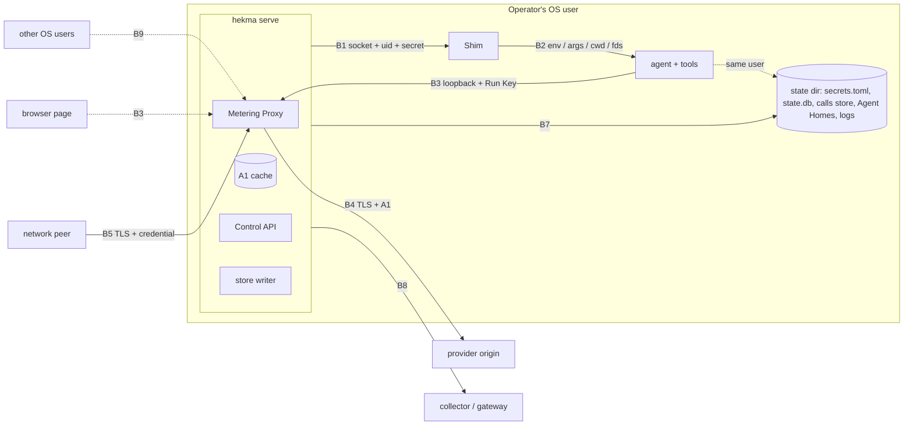

# Security review — key custody

**For Islam · 2026-11-02 · planning only, no code**

## 0. Summary

Key custody is worth shipping and can be documented as **supported** once the narrow claim in §10
holds and is tested. It does not need a sandbox. It does need honest wording. The agent runs as the
same OS user as Hekma, so custody is a **process-environment boundary**, not an OS-security
boundary: it keeps the real provider key out of everything the agent and its tools see and emit
(environment, arguments, Agent Home, logs, transcripts, crash reports, commits, vendor telemetry),
and it makes the agent's own credential useless anywhere but the Metering Proxy. It does not stop a
process that deliberately acts as the user, and today that includes the agent itself: its working
directory sits two levels below the secrets file, and `hekma agent config get --reveal` prints the
key to any caller.

Three findings change what AD-22 must say before 22-2 ships, and a fourth is an implementation
trap the story must not fall into (§8 has all fifteen proposals):

1. **A custodied key must only ever be spent by a credential Hekma issued** (P4). As written, a call
   on a labelled endpoint binding with no Run Key, or a Run created by an unauthenticated announce
   header, gets the binding's custodied key. On loopback that lets any local process — another OS
   user included, or a browser page that gets past the Host guard — spend the real key with no
   credential at all.
2. **The upstream origin a custodied key may go to must be pinned beside the key, not in the Agent
   Home** (P7). Today the upstream comes from the instance's `config.toml`, which is in the agent's
   own working directory. An agent that edits that file can point the custodied key at an origin it
   controls, and the "bound to its configured origin over https" rule then delivers it there
   faithfully. Where the key sits in a file the agent can read anyway this adds little; it is what
   makes keeping the key out of the agent's reach (the environment resolver, a keychain later) mean
   anything.
3. **A Restart Policy relaunch cannot re-deliver a hash-only Run Key** (P1). AD-22 says the Run Key
   lives for the Run (relaunches included) and is stored only as a hash; the engine therefore has
   nothing to hand the relaunched process. Recommendation: one Run Key per launch generation.
4. **The Run Key must stay masked through the config path** (P8, a trap rather than a gap). FR-53
   already makes Run Keys secrets under FR-14, but config masking keys on the `secret:` prefix, so a
   minted token delivered as an invocation override (the `metering.base_url` pattern AD-22 names)
   would be written in cleartext to `effective-config.json` unless 22-1 gives it a secret class.

The independent review pass also found two smaller AD-23/AD-26 gaps worth ruling with these: the
Shim's connection secret has the same hash-only re-delivery problem as the Run Key (P14), and a Run
Key reaches every path on the provider's origin, including asynchronous and key-management
endpoints the proxy cannot meter (P15).

None of these needs new architecture; each is a rule the story specs can test. §9 lists the
acceptance criteria per story, §10 the exact threat-model text for the user docs, §11 the verdict.

## 1. Scope and method

**In scope.** The key-custody promise of FR-53 and the surfaces it touches: Run Key, refresh,
announce-scoped and proxy-access credentials (mint, hash, store, deliver, refresh, revoke); the
Metering Proxy's identify-strip-swap-forward path; delivery to a supervised agent through the Shim;
Scent-Check Modes; bypass detection as a backstop; the proxy beyond loopback; every at-rest and
egress surface where a key could land (logs, events, outbox, state.db, calls store, OTLP,
`effective-config.json`, crash dumps).

**Out of scope.** Containing a compromised or hostile agent (NFR-6: Hekma is not a sandbox);
attackers with root or the operator's own OS account acting deliberately; Hub and Node credentials
(AD-24 is still reserved); the provider's own handling of the key; confidentiality of prompts and
responses from the provider; agents whose model access is an OAuth or subscription login rather
than an API key (they are "brings its own key" for custody, §11).

**Method.** Assets, actors and trust boundaries first (§3–§5); then a threat table per area named in
the brief (§7), each threat rated for likelihood and impact, with the mitigation that exists or is
planned (cited to an AD or story) and the gap that remains. Claims about today's code were checked
on `main` at 8ead5ec; where the review depends on behaviour not yet built, it says "planned" and
cites the story. Ratings:

| Rating | Likelihood | Impact |
|---|---|---|
| **H** | Expected in ordinary use, or by any prompt-injected agent that has a shell tool | The real provider key is disclosed, or spendable by a party the Operator did not issue a credential to |
| **M** | Needs a specific misconfiguration, or a deliberate local actor | A Run Key or other Hekma credential is disclosed, or attribution and governance are lost for a Run |
| **L** | Needs a privileged or unusual position (another OS user on a shared host, root, a network attacker past TLS) | Information disclosure with no spend, or noise |

## 2. What exists today (main at 8ead5ec)

Custody is not built. The relevant facts the stories inherit:

- **The agent holds the real key.** `apply_config_mapping` (`crates/hekma-engine/src/adapter/mod.rs`)
  calls `SecretString::expose_secret()` and places the cleartext in the agent's `env`, in `args`
  (a `Flag` target; a warn-only diagnostic since AI-39), or in a rendered file inside the Agent Home
  (a `File` target). Pass-through `agent.*` keys go to the environment verbatim.
- **The per-instance listener forwards the agent's key verbatim.** `forward()` in
  `crates/hekma-engine/src/metering/listener.rs` copies every request header upstream except `Host`
  and the hop-by-hop set, including `Authorization` and `x-api-key`; it never logs headers or bodies,
  buffers request bodies up to a cap, and builds the upstream URI as `<configured base> +
  <path-and-query>`. It binds `127.0.0.1` only and refuses a non-loopback address. The hyper client
  does not follow redirects. HTTPS upstreams use rustls with the `webpki-roots` store.
- **Secret masking keys on the `secret:` prefix.** `display_value` in
  `crates/hekma-engine/src/domain/config.rs` masks a string only when `is_secret_ref` matches
  `secret:NAME`. `SecretString` redacts `Debug`/`Display`, is not `Clone` or `Serialize`, and has no
  zeroize-on-drop (AD-10, recorded).
- **Secrets resolve from the process environment first, then `secrets.toml`** at the state base
  (`ports/secret_resolver.rs`). The file is checked for mode `0600` on Unix; on Windows the check is
  a documented no-op that relies on per-user profile ACLs (`backends/windows/mod.rs`).
- **`hekma agent config get <name> --reveal` prints resolved secrets live** to any caller
  (`crates/hekma/src/cli/agent.rs`). It is the one sanctioned un-mask and emits no event.
- **The Agent Home is inside the state directory, and is the agent's working directory.**
  `<state>/agents/<name>/` holds `config.toml` (the instance config layer, AD-9), `adapter.json`,
  `effective-config.json`, rendered native files and `logs/`; `spawn.rs` sets `working_dir` to the
  home. `secrets.toml`, `state.db` and the outbox sit two levels up. The state directory is created
  with the process umask (no `0700`), so on a default `022` umask its files and the Agent Homes are
  readable by other local users wherever the parent directories can be traversed (a Linux home that
  is `0755`, or a custom `HEKMA_STATE_DIR`; a macOS `~/Library` is `0700`, and Windows profiles are
  ACL-protected); only `secrets.toml` is held to `0600`.
- **The child-environment allowlist exists but is off by default.** `child_env_allowlist` (story
  17-2) clears the inherited environment before applying declared mappings, keeping an OS floor of
  `PATH` and `HOME` (Unix) — so a cleared agent still sees the user's home directory and every
  credential file in it.
- **The Control API bearer resolves through the same resolver** and is compared in constant time
  (`crates/hekma-host/src/control/auth.rs`). Any same-user process can resolve it the same way.

## 3. Assets

| ID | Asset | Where it lives under custody | Why it matters |
|---|---|---|---|
| A1 | **Custodied provider key** (the real key) | `secrets.toml` or the Service Host's environment; resolved into the proxy's in-memory cache (AD-10 amendment 2026-10-30) | Direct spend on the Operator's provider account, outside every Hekma control; long-lived; revocation needs the provider console |
| A2 | **Run Key** `hk_run_` | The agent's environment (supervised) or the announcing client's memory; SHA-256 hash in state.db and the published snapshot | Spends A1 through the proxy for its Run, under its Run's budgets; acts on its own Run through the Control API (heartbeat, close, open a child, tighten) |
| A3 | **Refresh credential** `hk_ref_` | The announcing process (or, as written, the launched process); hash at rest | Rotates A2 — so it can take a Run over from its legitimate holder |
| A4 | **Announce-scoped credential** `hk_ann_` | The framework client's configuration; hash at rest | Creates Runs and receives their Run Keys — so, on a binding with a custodied key, it mints spend capability |
| A5 | **Proxy-access credential** (format unspecified, §8 P6) | Base-URL-only clients beyond loopback; hash at rest | Swapped for the binding's custodied key — a long-lived virtual key |
| A6 | **Operator / Host bearer** | `secrets.toml` or the environment | Every Control API route: Policies, bindings, ceilings, Scent-Check Modes, revocation |
| A7 | **Shim connection secret** | Hash in the spawn record (AD-23) | Drives a supervised process |
| A8 | **Content in transit** — prompts and responses | Proxy memory, buffered whole (AD-26 Streaming) | Never stored (FR-43); a log or crash dump of the proxy would expose it |
| A9 | **Governance integrity** — attribution, budgets, Policies, Scent-Check Modes, holds | state.db, snapshot | Custody's second purpose: every call accounted to the right Run |

## 4. Actors

| Actor | Trust | Notes |
|---|---|---|
| **Operator** | Trusted | Runs `hekma`; owns the OS account; holds A6 |
| **Host** (embedding or Control API client) | Trusted with A6 | Same authority as the Operator on the Control API |
| **Supervised agent process and its tools** | **Cooperative, not trusted** | A third-party CLI that follows prompts, possibly injected ones, and usually has a shell tool. Runs as the Operator's OS user. Custody's primary subject |
| **Announcing framework client** (Caller) | Cooperative, holds A2–A4 for its own Runs | Can only tighten (FR-53, AD-20 matrix) |
| **Other processes running as the Operator's user** | Operator-equivalent | Can read `secrets.toml`, `state.db`, and run `hekma`. Nothing in v1 separates them from the Operator, and this review does not pretend otherwise |
| **Other local OS users** (shared host) | Untrusted | Reach loopback ports; can bind a free port; can read world-readable files |
| **Network peers** | Untrusted | Reach the proxy only when it binds beyond loopback (22.5) |
| **Web pages in the Operator's browser** | Untrusted | Can send requests to `127.0.0.1` (DNS rebinding, simple-request CSRF) |
| **Model provider; a gateway in front of it** (LiteLLM, Portkey) | Trusted for A1's own origin; gateways see identity headers | Providers may echo part of a presented key in an error body |
| **OTLP collector** | Trusted for metrics only | Receives what FR-46 and AD-21 allow |

## 5. Trust boundaries

| ID | Boundary | What crosses it | Enforced by |
|---|---|---|---|
| B1 | Service Host ↔ Shim | Spawn spec (including the Run Key), control RPCs | `0700` socket directory, peer-uid check, per-Shim secret (AD-23) |
| **B2** | **Shim ↔ agent** — the custody boundary | Environment, arguments, working directory, inherited file descriptors | Custody rules (AD-22): only the Run Key and the proxy URL cross; allowlist forced on |
| B3 | Agent or client → proxy on loopback | Requests with a Run Key | Run Key lookup; Host/Origin guard (AD-22) |
| B4 | Proxy → provider | Requests with A1 | Origin pin over `https` with certificate validation (AD-22) |
| B5 | Network peer → proxy | Requests with a credential | TLS and a credential, refused at start without them (AD-20, AD-26, 22.5) |
| B6 | Caller → Control API | Credential classes | Authority matrix (AD-20) |
| B7 | Hekma → disk | state.db, calls store, logs, Agent Homes | Hash-only tokens (AD-22), no-leak matrix (FR-14) |
| B8 | Hekma → telemetry and gateways | OTLP metrics, outbound identity headers | FR-46, AD-21, FR-51 (no tokens, no content) |
| B9 | OS user boundary | Loopback ports, world-readable files | OS only; Hekma adds nothing in v1 |

**The boundary that does not exist.** B2 separates what the agent is *given* from what Hekma keeps.
It does not separate what the agent can *reach*: as the same OS user it can read `secrets.toml`
(two directories above its working directory), read `state.db`, edit its own `config.toml`, run
`hekma` (which resolves the Operator bearer and can `--reveal`), and — where the OS allows — read
the Service Host's environment or memory. AD-22's Stated limit names the secrets file; §8 P10
extends it to the rest, and §10 says it to users.

## 6. The claim under review

Read precisely, FR-53 and AD-22 promise four things for a supervised Run whose provider key is
configured through Hekma:

- **C1 — Absence.** The real provider key never appears in the agent's environment, arguments or
  Agent Home, nor in anything Hekma writes or emits (logs, events, outbox, state.db, calls store,
  OTLP, Control API responses).
- **C2 — Confinement.** The real key is sent only to its pinned provider origin, over `https`, and
  only on behalf of a credential Hekma issued.
- **C3 — Attribution.** Every call that spends the real key is attributed to one Run, under that
  Run's Policies and budgets; a Run Key is revocable and refused from its next call.
- **C4 — Honest limits.** The docs say what custody does not do, and bypass detection never reports
  clean without having checked.

C1 is what makes custody valuable: the leaks that happen in practice — an agent printing its
environment, a transcript or crash report uploaded to the agent's vendor, a key committed with a
`.env` file, an injected prompt asking the agent to reveal its API key — all draw from what the
agent was *given*. C2 and C3 are what make the swap safe. The review finds C1 achievable as
specified once P8 and P9 land, C2 broken as written (P4, P7), C3 sound with P1 and P3, and C4 in
need of a fuller statement (P10, §10).

## 7. Threat model

Each table rates likelihood (L) and impact (I) per §1, cites the mitigation that exists or is
planned, and states the gap. "—" in the Gap column means none found. Proposals P1–P15 are in §8;
acceptance criteria R-ids are in §9.

### 7.1 Run Key minting, hashing, storage, refresh and revocation

| ID | Threat | L | I | Mitigation (existing / planned) | Gap |
|---|---|---|---|---|---|
| T1.1 | Predictable tokens from a weak or failed RNG | L | H | 256 bits from the OS CSPRNG via `getrandom` (AD-22, 22.1) | A `getrandom` failure must fail the mint closed, never fall back — R1.1 |
| T1.2 | Token recovered from state.db, the calls store or a backup | M | L | Stored only as unsalted SHA-256; adequate for 256-bit random tokens (AD-22). A hash cannot be presented | SQLite free pages and the WAL keep old bytes: the rule must be "the cleartext is never written", proven against raw file bytes — R1.2 |
| T1.3 | Token id mistaken for an identity | M | M | Token id = first 12 hex of the hash, used only to name a token (AD-22) | 48 bits give about a one-in-six chance of some collision at 10M tokens (NFR-4's design target, before P1 adds a token per launch), about 40% at 2^24 and even odds near 20M. The id must never be a lookup or uniqueness key — P12, R1.3 |
| T1.4 | Token disclosed after minting through a read surface | M | M | Shown once (AD-22); no read API returns it | Effective-config masking keys on `secret:` (§2), so an invocation-override delivery persists the cleartext in `effective-config.json` — P8, R1.14 |
| T1.5 | Token in a URL, logged by the client, a gateway or the provider | M | M | Never in a URL path or query (AD-22, FR-53) | Some SDKs put keys in a query string (`?key=`). The proxy must refuse, not forward, a request carrying an `hk_` token in its URL — R1.12 |
| T1.6 | Revocation not applied, or undone | M | H | Revoked when the Run ends or on demand; applies on the next call via the snapshot (AD-22, AD-25) | (a) An acked write flushes at once and the snapshot is published before the mutation returns (AD-25, AD-27), so the first call accepted after the acknowledgement must be refused: test it. (b) A call held before revocation and released after must be re-validated (AD-26 hold queue) — R1.7. (c) A revocation acknowledged before commit could come back after a crash — R1.6 |
| T1.7 | A long-lived Run Key outlives its need | M | M | No clock expiry by design (agents do not refresh API keys); revocation at Run end | A supervised Run can last months. Budgets bound the spend; the Run Key changes on every relaunch under P1. Accepted and documented — §10 |
| T1.8 | A leaked Run Key spends the real key | M | M | Spend goes through the proxy, attributed and budgeted; revocable; on loopback only local processes can use it | Beyond loopback, a supervised Run's key would be usable from the network — P5 |
| T1.9 | A Run Key holder exhausts resources by opening child Runs | L | L | 8-level nesting cap (AD-25) | No breadth cap per Run; a recommended bound for 23.2 (§9 notes) |
| T1.10 | A credential used on a surface its class does not allow | M | M | Authority matrix; typed refusal (AD-20) | — (test as a class × surface table, R1.11) |
| T1.11 | Proxy-access credential has no specified format | M | M | "Hashed" (AD-20) | Format, entropy, token id and show-once are unspecified — P6 |
| T1.12 | Revoking a leaked Run Key leaves the child Runs it opened live | M | M | Children outlive their parent's end (AD-25) | A child's Run Key minted under a revoked key keeps spending. On-demand revocation cascades to child Run Keys minted under it, by default — R1.6 |
| T1.13 | The Shim's connection secret cannot be presented after an engine crash | M | M | Random per Shim, stored hashed in the spawn record; "the engine presents [it] on connect" (AD-23) | The same hash-only re-delivery problem as T2.4: a restarted engine holds only the hash — P14 |

### 7.2 The refresh credential's binding to the launching process, including a relaunch

| ID | Threat | L | I | Mitigation (existing / planned) | Gap |
|---|---|---|---|---|---|
| T2.1 | Another process refreshes the Run Key | M | M | AD-22: "Possession is the binding; there is no OS attestation, and the docs say so" | **Contradiction.** FR-53's testable consequence says "a refresh from any other process fails". Possession cannot satisfy that: any process holding the credential succeeds. Either the PRD wording changes to possession or the binding needs a peer check — P2 |
| T2.2 | A stolen refresh credential takes over a Run (rotates the key and locks the holder out) | L | M | Rotation is an event | No reuse detection. Single-use refresh credentials with family revocation on reuse turn a silent takeover into a visible one — P3 |
| T2.3 | A supervised third-party agent is handed a refresh credential it cannot use | H | L | AD-22 sends it to "the process the Shim launched" | Third-party CLIs cannot rotate their own API-key variable mid-process, so the credential is pure exposure — P2 |
| T2.4 | A Restart Policy relaunch gets the old Run Key, or none | H | M | AD-22: "a relaunch gets a fresh one" (refresh credential); Run Key valid for the Run's life | **Ambiguity.** Hash-only storage leaves nothing to re-deliver to the relaunched process; the Shim never mints (AD-23). One Run Key per launch generation resolves it — P1, R1.9 |
| T2.5 | A relaunch races the old process: two generations live at once | M | L | Relaunch follows a confirmed exit (Restart Policy) | Revoke the previous generation when the old process is confirmed exited, before the new one launches — R1.9 |
| T2.6 | Handoff Mode reattach mints or re-delivers a key | L | M | A reattached process keeps running with its key; the Shim never mints (AD-23) | — (state that a reattach changes no credential, R1.9) |

### 7.3 The proxy swapping in the real provider key

| ID | Threat | L | I | Mitigation (existing / planned) | Gap |
|---|---|---|---|---|---|
| T3.1 | A local process spends the real key without any credential | **H** | **H** | "Never for an unattributed call" (AD-22) | **Unsafe as written.** A call on a labelled binding without a Run Key goes to the binding's Run and gets the binding's custodied key (AD-26); a Run created by an unauthenticated announce header (FR-52) gets a Run Key whose Run carries the binding's key. On loopback, any local process — or another OS user — spends A1 credential-free. Minting chains (refresh, relaunch, child Runs) must keep custody — P4 |
| T3.2 | The key is sent to an origin the attacker controls by editing config | **H** where the agent cannot read the key (environment resolver plus non-dumpable, P10); otherwise subsumed by T4.4 | **H** | "Bound to its configured upstream origin over https; never to another origin, including on reroute" (AD-22) | **Unsafe as written.** The upstream comes from the instance's `metering.upstream_base_url`, which lives in `config.toml` in the agent's own working directory (§2); a binding's origin needs the Operator bearer (AD-20), which a same-user process can also resolve. Pinning to a configurable origin pins to whoever edits it — P7 |
| T3.3 | The request target redirects the outbound URI to another authority | M | H | URI built as `<base> + <path-and-query>` (§2) | The outbound origin must equal the pinned origin after canonicalisation before the key is inserted; `CONNECT` and absolute-form targets with another authority refused — R2.6 |
| T3.4 | An upstream redirect carries the key to another origin | L | H | The hyper client does not follow redirects (§2) | Make it a tested rule, not an accident of the client — R2.6 |
| T3.5 | TLS downgrade or interception | L | H | `https` only for custody (AD-22); rustls + `webpki-roots` (story 12-3) | No `http://` upstream and no verification bypass on a custodied call, outside test-only builds — R2.6 |
| T3.6 | The Run Key reaches the provider or a gateway | M | L | Strip identity and credential headers, an enumerated set (AD-26 wire contract) | The upstream must never see an `hk_` token in any header — R2.5 |
| T3.7 | The provider echoes the real key in a response the agent reads | M | M | Responses are relayed faithfully and buffered whole (AD-26) | Some providers echo part of a presented key in 401 bodies. Redact exact occurrences of the custodied key in relayed headers and bodies — P11, R2.9 |
| T3.8 | The key leaks through `Debug` of a request or header | M | H | `SecretString` redacts (AD-10); the listener never logs headers (§2) | hyper's `HeaderValue` prints its value in `Debug` unless marked sensitive. Mark the inserted key and every presented credential header sensitive — R2.10 |
| T3.9 | DNS rebinding or a cross-site request from a browser page | M | H | Host and Origin guard (AD-22, 22.2) | No CORS headers, and preflights never answered permissively; with P4, a page without a Run Key cannot spend A1 even past the guard — R2.8 |
| T3.10 | Reroute spends one origin's key on another route | L | H | "A custodied key never leaves its origin" (AD-26) | Each route carries its own custodied key, or none — R2.6 |
| T3.11 | The resolver cache serves a stale key after the Operator rotates it at the provider | M | L | Cache added for the hot path (AD-10 amendment) | Functional, not a leak: state the pick-up bound — R2.11 |
| T3.12 | A Run Key reaches every path on the pinned origin | M | H | — | `build_upstream_uri` appends any path (`listener.rs`). A Run Key can start batch, fine-tune or file jobs whose spend arrives later and is never metered (breaks C3), and with an admin-scoped key it reaches key-management endpoints that return a new real key (breaks C1) — P15 |

### 7.4 The provider key never reaching the agent's environment, arguments or Agent Home

| ID | Threat | L | I | Mitigation (existing / planned) | Gap |
|---|---|---|---|---|---|
| T4.1 | The key is delivered through config alongside custody | M | H | "Never enters the adapter config mapping"; `File`/`Flag` targets refused for keys (AD-22) | The engine needs to know which leaf is the custodied key. A pass-through `agent.OPENAI_API_KEY = "secret:X"` would still deliver it. Name it by a reserved unified key and refuse any second delivery of the same secret — P9, R2.1 |
| T4.2 | The agent inherits the key from the Service Host's environment | H | H | Custody forces the allowlist on and strips provider variables (AD-22) | The env resolver puts the key in `hekma serve`'s environment; the Shim must be launched with a cleared environment too, and the provider-variable list must be enumerated — R2.3 |
| T4.3 | The agent inherits a file descriptor (secrets file, state.db, listening socket) | L | H | Rust opens descriptors close-on-exec | The upgrade handoff clears close-on-exec on the listening socket for the successor; prove the agent sees only its stdio — R2.4 |
| T4.4 | The key is readable in the Agent Home | H | H | Custody keeps it out of rendered files (AD-22) | The secrets file sits two directories above the agent's working directory; same-user read is the Stated limit — P10, §10 |
| T4.5 | The agent runs `hekma agent config get --reveal` | H | H | None today | Same-user limit (FR-14 treats `--reveal` as the acknowledgment, so it stays). Make it visible: a reveal of a custodied key emits an event — P10, R2.15 |
| T4.6 | The agent reads its own stored provider login in `HOME` | H | M | Bypass detection (FR-54, 22.4), best-effort | `HOME` is in the Unix allowlist floor (§2), so agents such as OpenCode or Codex find the user's own stored credentials by default and call the provider directly — P13 |
| T4.7 | The agent ignores the base URL and calls the provider with the Run Key | H | L | The Run Key is not a provider key: the provider refuses it | — (this is custody's fail-closed property; test it, R2.17) |
| T4.8 | The agent edits its own `config.toml` | H | H | None today | Changes the custody origin (T3.2) and its own ceilings, if a relaunch re-reads config. P7 freezes the custody origin; the ceiling half is a governance finding outside custody (§12) |
| T4.9 | Runs started before custody keep the real key | H | M | Custody applies at start | Surface per Run whether custody is on, and why not — R2.13 |

### 7.5 Loopback versus a non-loopback authenticated proxy

| ID | Threat | L | I | Mitigation (existing / planned) | Gap |
|---|---|---|---|---|---|
| T5.1 | Unauthenticated serving beyond loopback | L | H | Refused at start without TLS and a credential (AD-20, AD-26, FR-51, 22.5) | — (R5.1) |
| T5.2 | Another OS user squats the fixed port while no owner holds it, and collects Run Keys and prompts | L | M | Stated in AD-22: socket activation or a single-user host | Add a startup check that names the risk on a multi-user host, and document privileged ports via socket activation — R5.8 |
| T5.3 | Other OS users reach loopback and use a leaked Run Key | L | M | Run Key required for custody (P4) | — |
| T5.4 | A supervised Run's key used from the network | M | M | — | Supervised Run Keys are local by nature; refuse them from non-loopback peers — P5, R5.5 |
| T5.5 | Proxy-access credential is a shared, long-lived virtual key | M | H | Per binding, hashed (AD-20) | Must be revocable and rotatable, scoped to its binding's path prefix and origin — P6, R5.3 |
| T5.6 | Credential guessing or log flooding through failed auth | L | L | 256-bit tokens | Count failures; never log a presented value; rate-limit the diagnostic — R5.7 |
| T5.7 | `0.0.0.0`, `::` or a hostname is treated as loopback | L | H | Explicit bind, loopback by default (AD-20) | Treat anything but `127.0.0.0/8` and `::1` as non-loopback — R5.9 |
| T5.8 | TLS private key or certificate files leak | L | M | — | Permission-check them like `secrets.toml` — R5.2 |

### 7.6 Logs, telemetry and OTLP

| ID | Threat | L | I | Mitigation (existing / planned) | Gap |
|---|---|---|---|---|---|
| T6.1 | A token or key in engine logs, `instance.log`, `breaches.log`, events or SSE | M | H | FR-14 no-leak matrix; token id only (AD-22) | Extend the sentinel matrix to every token class and the custodied key — R1.15 |
| T6.2 | A token in the agent's own `agent.log` / `output.log` | H | L | The agent writes them, not Hekma | Under custody the agent can only print its Run Key (C1 holds for A1). Documented — §10 |
| T6.3 | A token or run detail in an OTLP payload | L | M | No secrets, no content (FR-46); no run id or label on metrics until v2 (AD-21) | Exemplars (v2) carry run ids only; never a token id — R1.15 |
| T6.4 | Outbound identity headers expose a token to a gateway | L | M | Run id and labels only, never content (FR-51, AD-26) | Never a token or token id — R5.10 |
| T6.5 | Typed error bodies echo the presented credential | M | M | Static error bodies today (Control API, fence) | Same for every proxy refusal (unknown, revoked, unscented) — R3.2 |

### 7.7 The export outbox and state.db at rest

| ID | Threat | L | I | Mitigation (existing / planned) | Gap |
|---|---|---|---|---|---|
| T7.1 | A token or key written to state.db, its WAL or the calls store | M | H | Hashes only (AD-22); bindings hold a custodied key *reference* | State it: a binding row holds `secret:NAME`, never a value; prove with raw-byte scans — R1.2, R2.1 |
| T7.2 | Outbox rows exported to a Host carry a token | L | M | Events carry token ids (AD-22) | Covered by R1.15 |
| T7.3 | Another local user reads the state directory | M | M | `secrets.toml` is `0600` | The directory is created with the umask (§2): state.db, logs and rendered files (which hold cleartext keys today, without custody) are readable by others on a `022` umask. A pre-existing finding — §12 |
| T7.4 | Backups and sync tools copy `secrets.toml` | M | H | — | Documented — §10 |
| T7.5 | The spawn record carries the Run Key | M | M | Spawn record holds the Shim's secret *hash* (AD-23) | Token id only — R1.16 |

### 7.8 Memory dumps, crash files and child processes

| ID | Threat | L | I | Mitigation (existing / planned) | Gap |
|---|---|---|---|---|---|
| T8.1 | A core dump of `hekma serve` holds A1 and content | L | H | No zeroize (AD-10, recorded; irrelevant for a cached key that lives as long as the process) | On Linux, set the Service Host and Shim non-dumpable (`PR_SET_DUMPABLE` 0) and `RLIMIT_CORE` 0; document macOS and Windows crash-report behaviour — P10, R2.12 |
| T8.2 | A same-user process reads the Service Host's environment or memory | M | H | Same-user limit | On Linux, non-dumpable also hides `/proc/<pid>/environ` and blocks `ptrace` attach; other OSes per §10 — R2.12 |
| T8.3 | A panic message prints a header or request | L | H | No request `Debug` today | Sensitive headers (R2.10) and a panic hook that prints no request data |
| T8.4 | The agent's children inherit the Run Key | H | L | Expected: the Run Key is theirs too | — |
| T8.5 | The Shim keeps the Run Key after launch | L | M | — | The Shim drops the spawn spec's environment after launch; a relaunch gets a new key from the engine (P1) |

### 7.9 Scent-Check Modes

| ID | Threat | L | I | Mitigation (existing / planned) | Gap |
|---|---|---|---|---|---|
| T9.1 | Scent-Check is read as access control | M | M | Mode governs identity only (FR-53) | Under `enforce`, an unauthenticated announce gives a caller an identity. The docs must say Scent-Check is attribution, not authentication; custody's protection comes from P4, whatever the mode — R3.7 |
| T9.2 | A Caller lowers the mode | L | M | Callers only tighten; labels never select Policies (FR-53, FR-60) | A Caller-opened child resolves Policies on bound labels it lacks and could land on a looser default. A child's mode is the strictest of its ancestors' — R3.4 |
| T9.3 | A revoked or unknown Run Key under `shadow` gets the custodied key | M | H | Unscented calls are served under `shadow` | Served means forwarded *with the client's own header*; never with A1 — R3.8 |
| T9.4 | The mode changes a Breach Action | L | M | "The mode never changes how Breach Actions behave" (FR-53, FR-43) | — (R3.3) |
| T9.5 | Unscented-call Anomalies or counters are flooded | M | L | Bounded label cardinality (AD-21 v2) | No client-supplied string or token as a label value — R3.5 |
| T9.6 | The Q9 default weakens custody | L | L | Seeded `off`; never overwrites an edited default Policy (AD-25, 22.3) | With P4, no mode weakens custody. Security has no objection to `off` or `shadow` as defaults; `enforce` by default would refuse calls nobody asked to refuse (NFR-9) |

### 7.10 Bypass detection limits

FR-54's detection is a backstop for one case custody cannot close: an agent with *another*
credential. With custody, a bypass using the Run Key fails at the provider (T4.7).

| ID | Limit | L | I | Mitigation (existing / planned) | Gap |
|---|---|---|---|---|---|
| T10.1 | Traffic through an HTTPS proxy, VPN or tunnel shows a connection to the proxy, not the provider | M | M | Best-effort (FR-54) | Docs list it — §10 |
| T10.2 | Provider hosts share CDN addresses: false positives and negatives | M | L | Resolved provider-host list (AD-23) | Docs list it; the Anomaly names the host, not a verdict |
| T10.3 | QUIC / HTTP/3 (UDP) is not a TCP connection | L | M | TCP connections only (AD-23) | Docs list it |
| T10.4 | A short-lived connection between polls is missed | M | M | — | 22.4 states its sampling interval |
| T10.5 | A process outside the tree makes the call (a scheduled job, another service, a remote shell) | M | M | Process-tree scope (AD-23) | Docs list it |
| T10.6 | An OS with no implementation | M | L | Reports "unavailable", never clean (FR-54) | — |
| T10.7 | OAuth or subscription agents (their model access is not an API key) | H | M | Not custody-capable; `supervised (no wire)` or refused at start (FR-53) | Docs say which agents custody covers — §10 |

## 8. Changes proposed to AD-22

Each proposal states the problem, the options and one recommendation (AI-58: Islam picks; the
spine and PRD are untouched). Where a proposal also needs PRD wording, it says so. The three marked
**blocking** must be ruled before 22-2's docs may say "supported" (§11); P8 is a clarification 22-1
must still honour (R1.14).

### P1 — One Run Key per launch generation *(blocking)*

**Problem.** AD-22 makes the Run Key "valid for its Run's life" and stores it only as a hash. A Run
includes its Restart Policy relaunches (AD-7, AD-25). The relaunched process needs a Run Key in its
environment, the engine has only a hash, and the Shim never mints (AD-23).

- **A (recommended).** Mint a new Run Key for every launch of a supervised Run (first start and
  each relaunch); revoke the previous generation once the old process is confirmed exited and
  before the new one launches. The Run, its run id, budgets and labels are unchanged; per-call
  records carry the generation's token id. A Handoff Mode reattach changes no credential.
- B. Keep the cleartext (or an encrypted copy) to re-deliver. Breaks "stored only as a hash" and
  creates a durable copy of a spend credential. Rejected.
- C. The Shim keeps the Run Key in memory and re-delivers it. Makes a long-lived process the key's
  second holder and fails when the Shim itself is replaced. Rejected.

**PRD wording.** FR-53's and the Glossary's "valid for the Run's life" become "valid for its
launch, within the Run's life" for supervised Runs; announced Runs are unchanged.

### P2 — Possession is the refresh binding; supervised agents get no refresh credential by default

**Problem.** FR-53 says "a refresh from any other process fails"; AD-22 says possession is the
binding with no OS attestation. Both cannot be tested true. And a third-party CLI cannot use a
refresh credential: it cannot change its own API-key variable mid-process.

- **A (recommended).** Keep possession (it is honest and portable). Change FR-53's wording to "a
  refresh presenting any other credential fails, and a used refresh credential is never accepted
  again" (with P3). Deliver a refresh credential to a supervised process only when its Adapter
  declares a variable that can carry it; otherwise none is minted, and rotation for a supervised
  Run happens by relaunch (P1).
- B. Add a peer check: refresh only over a Unix socket or named pipe whose peer pid lies in the
  Shim's process tree. Real binding on the OSes that support it, but it adds a second refresh
  transport, cannot cover announced (network) clients, and Windows and macOS peer-pid semantics
  differ. Possible later; not needed for v1.

### P3 — Single-use refresh credentials with reuse detection

**Problem.** A stolen refresh credential can rotate a Run's key and lock its holder out, silently.

- **A (recommended).** Each refresh returns a new Run Key *and* a new refresh credential, revokes the
  old Run Key at once (calls already forwarded complete; held calls are re-validated at release,
  R1.7), and retires the used refresh credential. Presenting a retired refresh credential revokes
  the Run's current Run Key and refresh credential and raises an Anomaly on the Run. This is the
  standard refresh-token-rotation pattern.
- B. A bounded overlap during which both Run Keys work. Friendlier to clients with calls in flight,
  but in-flight calls are already safe under A; adds a window for no gain.

### P4 — The custodied key is spent only on a credential Hekma issued *(blocking)*

**Problem.** AD-22 says "never for an unattributed call", but AD-26 attributes a call with no Run
Key on a labelled binding to that binding's Run, and FR-52's announce header is not required to
carry a credential. Either path lets an uncredentialed local caller (another OS user; a browser page
that passes the Host guard) spend the binding's custodied key.

- **A (recommended).** The proxy inserts a custodied key only for a call authenticated by a
  credential whose issuance chain starts at a credentialed mint: a Run Key minted at supervised
  start or by the Control API announce endpoint (which requires the announce-scoped credential),
  and every Run Key descended from one — by refresh (P3), by relaunch (P1), or for a child Run
  opened with such a key (FR-43, FR-49) — or, beyond loopback, the binding's proxy-access
  credential (AD-20). Every other call — a binding's Run reached with no credential, a Run created
  by the proxy's announce header, the unattributed Run — is forwarded with whatever key the client
  sent, never with the custodied key. This holds on loopback too and under every Scent-Check Mode.
  The announce header stays available for attribution; it just never unlocks custody. Each Run
  records at creation whether it is custody-eligible, so the hot path reads one flag from the
  snapshot. No authority-matrix change is needed: `hk_ann_` stays a Control API credential. (The
  alternative — accepting `hk_ann_` in the proxy's announce header — would amend AD-20's matrix;
  not recommended.)
- B. Require a credential on every call to a binding that holds a custodied key, refusing the rest.
  Stricter, but it turns attribution traffic into errors and overlaps Scent-Check `enforce`.

### P5 — A supervised Run's key is accepted from loopback peers only

**Problem.** Beyond loopback (22.5) the Run Key is a network credential. A supervised agent always
reaches the proxy locally, so its key has no legitimate network use.

- **A (recommended).** The proxy refuses, with the typed unknown-credential error, a supervised
  Run's Run Key presented by a non-loopback peer. Announced Runs' keys are unaffected.
- B. No restriction; rely on revocation and budgets. Leaves a leaked local key usable remotely.

### P6 — Proxy-access credentials and Shim secrets follow the token rules

**Problem.** AD-22 specifies `hk_run_`, `hk_ref_` and `hk_ann_` only. The proxy-access credential
(AD-20) and the Shim connection secret (AD-23) have no format, entropy or show-once rule.

- **A (recommended).** Add `hk_pxy_` for proxy-access credentials with the same rules (256 bits,
  Crockford base32, `SecretString`, shown once, SHA-256 at rest, 12-hex token id), revocable and
  rotatable through `hekma binding`, scoped to one binding's path prefix and its pinned origin. The
  Shim secret uses the same generator and hash, never shown.
- B. Leave both to their stories. Risks a third token format (what AD-22 exists to prevent).

### P7 — Pin the custodied key's origins beside the key, and freeze them for the Run *(blocking)*

**Problem.** "Bound to its configured upstream origin" pins the key to whatever origin the
configuration says, and the configuration is writable from the agent's working directory
(`config.toml`) or by any same-user `hekma binding` call. One edit routes the real key, over valid
TLS, to an attacker's origin.

- **A (recommended).** The allowed origins travel with the secret, in the same trust tier as the key
  itself: a `secrets.toml` entry may declare `origins = ["https://api.openai.com"]`, and a built-in,
  versioned table supplies defaults for well-known provider keys. The proxy inserts a custodied key
  only for an outbound origin on that list. An instance or binding that names another origin for a
  custodied key is refused at start or creation with a remediation. A supervised Run's custody
  origin is resolved at operator start and kept for the Run, not re-read from the Agent Home on a
  relaunch. Anyone who can edit `secrets.toml` already holds the key, so this closes the escalation.
  While the key sits in a file the agent can read, P7 adds little on its own; it is the rule that
  makes the environment resolver (P10) and a future keychain resolver worth having, and it is what
  §10's "goes only where you pinned it" relies on.
- B. Require interactive confirmation for an origin change. Same-user automation can drive a
  terminal; weaker than A.
- C. Leave it and document it. Leaves the cheapest exfiltration path open to any agent that edits a
  file in its own directory.

### P8 — The Run Key is masked as a secret everywhere config is rendered *(clarification)*

**Problem.** FR-53 already makes Run Keys secrets under FR-14, and FR-14 requires masked
effective-config output, so the rule exists. The trap is the mechanism: AD-22 delivers the Run Key "through a reserved invocation-override key … (the
`metering.base_url` pattern)". Overrides join the effective config, which is persisted to
`effective-config.json` in the Agent Home, and masking keys on the `secret:` prefix (§2). A raw
token would be persisted and rendered in cleartext.

- **A (recommended).** Add one sentence to AD-22 naming the mechanism, so 22-1 cannot satisfy the
  delivery wording and miss the rule: the reserved key carries an engine-minted secret class: rendered as the
  mask in `config get`, the snapshot and events; persisted as its token id only; delivered as
  cleartext only in the spawn environment. AD-22's "held in `SecretString` from mint to delivery"
  then holds through the config path.
- B. Bypass the effective config: inject the variable directly into the spawn environment. Simpler,
  but loses provenance in `config get` (FR-13) and needs an Adapter Contract change to name the
  variable.

### P9 — Name the custodied key with a reserved unified key, and refuse a second delivery

**Problem.** For "never enters the adapter config mapping" the engine must know which leaf is the
provider key. Pass-through keys (`agent.OPENAI_API_KEY = "secret:X"`) go to the environment
verbatim, and nothing ties them to custody.

- **A (recommended).** A reserved unified key (for example `provider.api_key`) holds the custodied
  `secret:` reference, and each Adapter maps it to its API-key variable, which then receives the
  Run Key. At start, custody refuses (with a remediation) if the same secret name is delivered by
  any other leaf, or if a pass-through key names a variable on an enumerated, versioned
  provider-variable list.
- B. Infer the provider key from a variable-name list. Fragile, and silent when it misses.

### P10 — Extend the Stated limit, and make same-user reach visible where it is cheap

**Problem.** AD-22's Stated limit names only the secrets file. The same OS user can also run
`--reveal`, run `hekma` with the Operator's authority, edit `config.toml`, and, where the OS allows,
read the Service Host's environment or memory.

- **A (recommended).** Extend the limit to that full list (§10 says it to users), and add three
  cheap hardenings in 22-2: a `--reveal` of a custodied key emits a `secret_revealed` event naming
  the secret (FR-14 makes `--reveal` itself the acknowledgment, so it is not gated further); on Linux the Service Host and every Shim set
  themselves non-dumpable and `RLIMIT_CORE` 0; the docs recommend the environment resolver over the
  file on single-purpose hosts. Running agents as a separate OS user stays Deferred.
- B. State the limit only. Honest, but leaves `--reveal` silent (an AI-18 gap).

### P11 — Redact the custodied key from relayed responses

**Problem.** A provider can echo a presented key in an error body; the proxy relays responses to the
agent faithfully.

- **A (recommended).** Before relaying, replace exact occurrences of the custodied key's value in
  response headers and the buffered body with the mask. Responses are already buffered whole (AD-26
  Streaming); when incremental streaming lands, the redaction moves to a sliding window.
- B. Accept partial echoes and document them. Partial (masked) echoes are accepted in A too; full
  echoes should not be.

### P12 — Token ids are labels, not keys

**Problem.** A 12-hex token id is 48 bits; collisions become plausible at Run-scale (T1.3).

- **A (recommended).** State that a token id is never a lookup, join or uniqueness key; records are
  keyed by run id (and call id), and authentication uses the full hash. Keep 12 hex for display.
- B. Lengthen to 16 hex (64 bits). Removes the collision concern but changes a convention already in
  the Consistency table.

### P13 — Let custody isolate the agent's home directory, as an opt-in

**Problem.** The allowlist floor keeps `HOME`, so a custodied agent can still read the user's own
stored provider logins (OpenCode, Codex and others keep them under `HOME`) and bypass custody with
a credential Hekma never saw.

- **A (recommended).** Add an opt-in per instance that points `HOME` (and the XDG base directories
  on Unix; `USERPROFILE` and the profile variables on Windows, where tools also use the known-folder
  APIs) at a directory inside the Agent Home. This keeps agents from *finding* stored logins by
  default; it does not hide them from a same-user shell that names an absolute path. Off by default:
  many agents need the user's Git and SSH configuration. The docs name the trade-off, and bypass
  detection remains the backstop.
- B. Make it the default under custody. Stronger, but breaks common agents silently on first use.
- C. Do nothing. Leaves the most common real-world bypass undocumented.

### P14 — Derive the Shim's connection secret instead of storing only its hash *(amends AD-23)*

**Problem.** AD-23 gives each Shim a random connection secret, "stored hashed in its spawn record,
which the engine presents on connect". After an engine crash the restarted engine holds only the
hash and cannot present the secret, so it cannot reattach — or the secret ends up stored in
cleartext to make reattach work.

- **A (recommended).** Derive each Shim's secret as an HMAC-SHA-256 of its spawn id under a host key:
  32 random bytes in an owner-only file in the state directory (`0600`, the secrets-file check),
  generated once. The spawn record keeps the hash for the Shim's own check; any engine that holds
  the host key can recompute the secret. Rotating the host key releases nothing silently: Shims
  that no longer verify are reported, never killed (AD-20's protocol rule).
- B. Store the secret in cleartext in the owner-only spawn record. Simpler, but puts a live
  credential in state.db, against the hash-only rule.

### P15 — Scope a custodied key to the paths its Runs need

**Problem.** The proxy appends any request path to the pinned origin. A Run Key can therefore
reach batch, fine-tune and file endpoints, whose spend arrives later and outside any metered
response, and, if the Operator custodies an admin-scoped key, key-management endpoints that return
a new real key to the agent.

- **A (recommended).** Each custodied key carries a path allow-list beside its origins (P7), with a
  built-in default per well-known provider covering its synchronous inference endpoints; the
  Operator can widen it. A path outside the list is refused with a typed error and not forwarded.
  The docs tell Operators to custody inference-scoped project keys, never admin keys.
- B. Docs only. Leaves unmetered spend possible through an ordinary Run Key.

## 9. Requirements per story — acceptance criteria to copy

Written so the story specs can copy them as they stand. Each names its test. Criteria that depend on
a proposal say so; if Islam rules a proposal differently, the criterion follows the ruling. A
**sentinel** is a unique test string placed where a secret would be, then searched for on every
surface; the existing FR-14/FR-43 no-leak matrix is the harness to extend.

Some criteria touch the shared proxy that story 23.1 builds. They are listed under the story whose
promise needs them; whichever story first touches the code lands them, and the listed story proves
them.

### 22.1 — Run Keys: minting, hashing, refresh and revocation

- **R1.1 Generation.** `hk_run_`, `hk_ref_`, `hk_ann_` (and `hk_pxy_`, P6) tokens are 32 bytes from
  `getrandom`, Crockford base32, prefix plus 52 characters. If the OS RNG fails, the mint fails with
  a typed error and the start or announce is refused; no other RNG is used. *Test:* format and
  length check; an injected RNG failure refuses the start with no state change.
- **R1.2 Hash-only at rest.** After a token is minted, used, refreshed and revoked, the raw bytes of
  `state.db`, its `-wal` and `-shm` files, the calls store and every file under the state
  directory contain no sentinel token. *Test:* byte scan of the directory tree after the scenario,
  including after a checkpoint and after a `kill -9`.
- **R1.3 Token ids.** A token id is the first 12 hex characters of the token's SHA-256 and is never
  used as a lookup, join or uniqueness key (P12). *Test:* two tokens forced to share a token id
  (test hook) authenticate and are recorded independently.
- **R1.4 Shown once.** The cleartext appears only in the mint result (the spawn environment, the
  announce response, the refresh response). No Control API route, SSE frame, CLI `--json` output or
  later response returns it. *Test:* after mint, every read route and CLI read command is scanned
  for the sentinel.
- **R1.5 In memory.** A token is a `SecretString` from mint to delivery; a presented token is wrapped
  on parse; every `HeaderValue` carrying a credential is marked sensitive. *Test:* `Debug` of the
  launch spec, the announce response struct and a parsed request contains no sentinel.
- **R1.6 Revocation is durable, immediate and cascades.** Revocation (on demand, at Run end, at
  generation change and on refresh-reuse) commits and is published to the snapshot before it is
  acknowledged; the first call the proxy accepts after the acknowledgement is refused; a revoked
  token stays refused after a `kill -9` of the Service Host and restart. An on-demand revocation
  also revokes, by default, every child Run Key minted under the revoked key. *Test:*
  revoke-then-call with no sleep; crash scenario; revoke a parent and call with its child's key.
- **R1.7 Held calls re-validated.** A call held at the proxy whose Run Key is revoked before release
  is rejected at release with the typed revoked-credential response, never forwarded with the
  custodied key. *Test:* hold, revoke, release.
- **R1.8 Lookup.** The proxy hashes the presented token and looks the hash up in the snapshot; an
  unknown or revoked token gets a typed response that does not echo the token. *Test:* error bodies
  scanned for the sentinel.
- **R1.9 Generations (P1).** Every launch of a supervised Run mints a new Run Key; the previous
  generation is revoked once the old process is confirmed exited and before the relaunch; a Handoff
  Mode reattach changes no credential; the spawn record and the Shim carry no token after launch.
  *Test:* force two relaunches; the first two Run Keys are refused, the third works; run id and
  budgets unchanged; reattach keeps the key working.
- **R1.10 Refresh (P2, P3).** A refresh presenting the Run's current refresh credential returns a new
  Run Key and refresh credential and revokes the old Run Key; any other credential fails; a used
  refresh credential presented again revokes the Run's current pair and raises an Anomaly. A
  supervised Run whose Adapter declares no refresh variable gets no refresh credential. *Test:* the
  three paths, plus the supervised no-refresh case.
- **R1.11 Authority matrix.** For every credential class and every surface (proxy, each Control API
  route family, OTLP intake), a class on a surface it may not use gets the typed refusal, and no
  class acts on another Run. *Test:* table-driven class × surface matrix.
- **R1.12 Never in a URL.** A Control API request carrying a token in its path or query is refused;
  a proxy request carrying an `hk_` token in its path or query is refused with a typed error and not
  forwarded. *Test:* both, with the upstream fake asserting no request arrived.
- **R1.13 Env delivery only.** A config mapping that would deliver a token, or a custodied key,
  through a `File` or `Flag` target is refused at configuration with a remediation. *Test:* manifest
  with each target type.
- **R1.14 Masked in config (P8).** The reserved Run Key key renders as the mask in `config get`,
  `effective-config.json`, events and logs, and `effective-config.json` records only the token id.
  *Test:* sentinel scan of the Agent Home and every config read surface after a start.
- **R1.15 No-leak matrix.** The FR-14/FR-43 sentinel matrix covers each token class and the
  custodied key across stdout, stderr, `--json`, engine and instance logs, `breaches.log`, events,
  the outbox, SSE, Control API responses, OTLP payloads (including exemplars), per-call records and
  the calls store. *Test:* the matrix, extended.
- **R1.16 Spawn record.** The spawn record (AD-5, AD-23) and Shim RPC logs carry token ids, never
  tokens. *Test:* sentinel scan of the spawn row and the Shim's diagnostics.
- **R1.17 Shim reattach after a crash (P14).** After a `kill -9` of the engine, a restarted engine
  reconnects to every live Shim without any Shim secret stored in cleartext. *Test:* crash and
  reattach; a byte scan of state.db for each Shim secret finds none. (Lands with the Shim story;
  listed here because it shares 22-1's token rules.)

### 22.2 — The Run Key in the API-key slot; key custody by default

- **R2.1 One custodied key, delivered once (P9).** The custodied key is named by the reserved
  unified key; a binding row stores the `secret:` reference, never a value. Start is refused with a
  remediation if the same secret name is also delivered by another leaf, or a pass-through key names
  a variable on the provider-variable list. *Test:* each refusal; a state.db byte scan for the
  custodied sentinel.
- **R2.2 Absence (C1).** With a sentinel custodied key, a conformance agent that dumps its
  environment, its argument vector, every file under its Agent Home (recursively) and its open file
  descriptors finds no sentinel, and finds the Run Key and the proxy URL in its API-key and base-URL
  variables. *Test:* the conformance fake agent, on Linux, macOS and Windows.
- **R2.3 Environment.** Custody forces the child-environment allowlist on; the Shim is launched with
  a cleared environment too; the provider-variable list is enumerated and versioned in the docs.
  With a sentinel `OPENAI_API_KEY` (and each listed variable) in the Service Host's environment, the
  agent's environment lacks it. *Test:* as stated.
- **R2.4 File descriptors.** The agent inherits only its standard streams and the descriptors its
  Adapter declares — never the listening socket (including during an upgrade handoff), `state.db`,
  the secrets file or a Shim socket. *Test:* the fake agent lists its descriptors (handles on
  Windows).
- **R2.5 Strip and insert.** The proxy removes the Run Key from every credential and identity header
  in the wire contract's stripped set and inserts the custodied key only in the provider's scheme
  (`Authorization: Bearer`, `x-api-key`, or the binding's declared header). *Test:* the upstream
  fake asserts no `hk_` token in any header, and exactly one credential header carrying the
  custodied sentinel.
- **R2.6 Origin confinement (P7).** Before inserting the custodied key, the proxy checks that the
  outbound scheme is `https`, that certificate verification is on, and that the outbound origin
  equals a pinned origin of that key after canonicalisation (scheme, lowercased host with no
  trailing dot, effective port — so `https://Host` and `https://host:443` match and nothing else
  does). `CONNECT`, absolute-form targets with another
  authority, and any outbound URI whose authority differs are refused. Redirects are relayed, never
  followed. A reroute uses its route's own custodied key or none. An instance or binding naming an
  origin not on the key's list is refused at start or creation. A supervised Run's custody origin
  does not change on a relaunch after `config.toml` is edited. *Test:* each refusal; a 307 from the
  upstream fake to a second fake origin never reaches it; edit `config.toml` and force a relaunch.
- **R2.7 Issued credentials only (P4).** The custodied key is inserted only for calls authenticated
  by a custody-eligible Run Key — minted at supervised start or by the Control API announce
  endpoint, or descended from one by refresh, relaunch or a child Run — or, beyond loopback, the
  binding's proxy-access credential. A call on a labelled binding with no credential, a call from a
  Run created by the proxy's announce header, and the unattributed Run's calls are forwarded without
  it, under every Scent-Check Mode. *Test:* each case against the upstream fake, including a child
  Run of a supervised Run (custody kept) and a child of a header-announced Run (no custody).
- **R2.8 Host and Origin guard.** A request whose `Host` is not a loopback literal or an
  Operator-configured name, or whose `Origin` is present and not on the Operator allow-list, is
  refused before any upstream dial. The proxy adds no CORS headers and answers no preflight
  permissively. *Test:* rebinding-shaped requests; an `OPTIONS` preflight.
- **R2.9 Response redaction (P11).** Exact occurrences of the custodied key in relayed response
  headers and bodies are replaced with the mask. *Test:* an upstream fake that echoes the presented
  key in a 401 body and a header.
- **R2.10 No debug leaks.** Credential headers are marked sensitive at parse and at insert; no code
  path formats a request or header map with `Debug`; the panic hook prints no request data. *Test:*
  forced panic inside the forward path; stderr and logs scanned for the sentinel.
- **R2.11 Key cache.** The proxy's custodied-key cache lives only in memory; a change to the secret
  is picked up within 30 s (the spec may tighten it, and the docs state it). *Test:* change the
  secrets-file entry; a call 30 s later carries the new sentinel.
- **R2.12 Dumps (P10).** On Linux the Service Host and each Shim are non-dumpable with `RLIMIT_CORE`
  0. On macOS and Windows the docs state what a crash report contains and how to turn off full
  dumps. *Test:* on Linux, `/proc/<pid>/environ` of the Service Host is unreadable to a same-user
  child and no core file is written on `SIGSEGV`.
- **R2.13 Custody is visible.** The Run detail and `hekma ps --json` say whether custody is on for
  each supervised Run and, when it is not, why (no Hekma-held key; started before custody; opted
  out). *Test:* each state.
- **R2.14 Brings its own key.** A `self-reported` agent without a Hekma-held key shows as `supervised
  (no wire)`; an `engine-observed` one is refused at start with the remediation. *Test:* both.
- **R2.15 Reveal (P10).** `config get --reveal` of a custodied key emits a `secret_revealed` event
  naming the secret (never its value) before printing. *Test:* the event is in the outbox and carries
  no sentinel.
- **R2.16 Docs.** The user docs carry §10's text, adapted only for final names and links, and the
  page stops saying "Planned" for custody only when §11's conditions hold.
- **R2.17 Fail closed on bypass.** An agent that sends its Run Key straight to the provider gets the
  provider's refusal, because the Run Key is not a provider key. *Test:* the fake agent dials the
  provider fake directly with its environment key and is refused.
- **R2.18 Path scope (P15).** A call whose path is outside its custodied key's path allow-list is
  refused with a typed error and not forwarded; the built-in defaults cover each verified provider's
  synchronous inference endpoints. *Test:* a batch or file path is refused with the upstream fake
  seeing nothing; an inference path is forwarded.

### 22.3 — Scent-Check Modes

- **R3.1 Mode matrix.** For each mode (`off`, `shadow`, `enforce`) and each caller state (no
  credential, unknown Run Key, revoked Run Key, valid Run Key, uncredentialed announce, credentialed
  announce), the call is served, served and recorded as unscented, or refused, per FR-53. *Test:*
  the 3 × 6 table.
- **R3.2 Refusal.** An `enforce` refusal is a typed response from the wire contract, is not
  forwarded, drains or refuses the body without buffering it, and echoes no credential. *Test:* the
  upstream fake sees nothing; the body is scanned.
- **R3.3 Breach Actions unchanged.** A configured `block` refuses under every mode; `warn`,
  `pause` and `stop` behave identically under every mode. *Test:* the Breach Action × mode table.
- **R3.4 Tighten only.** A Run Key on the Control API can tighten its Run's mode and never loosen
  it; a child Run's effective mode is the strictest of its own and its ancestors'. *Test:* a Caller
  tries to loosen (refused); a Caller-opened child under an `enforce` parent is `enforce`.
- **R3.5 Bounded signals.** The unscented Anomaly and OTLP counter use no client-supplied string or
  token as a label value. *Test:* 10,000 unscented calls with random headers keep the series count
  bounded.
- **R3.6 Q9.** The decided per-environment default is recorded in the default Policy, and a default
  Policy the Operator has edited is never overwritten. *Test:* upgrade over an edited default.
- **R3.7 Docs.** The docs say that Scent-Check is about attribution, not access control: under
  `enforce`, a call needs an identity, and on loopback any local process can obtain one by
  announcing. Custody's protection of the provider key does not depend on the mode.
- **R3.8 Never custody for the unscented.** Under `shadow`, a call with a revoked or unknown Run Key
  is forwarded with the client's own header and never with the custodied key. *Test:* the upstream
  fake sees the revoked token in the credential header, not the custodied sentinel.

### 22.5 — An authenticated proxy beyond loopback

- **R5.1 Refused without TLS and a credential class.** A non-loopback bind of the proxy (and of the
  Control API) without TLS is refused at start with a remediation. *Test:* each listener.
- **R5.2 TLS material.** Certificate and private-key files are permission-checked like
  `secrets.toml`; the private key is never logged; the minimum protocol is TLS 1.2. *Test:* a
  group-readable key file is refused on Unix; a TLS 1.1 client fails the handshake.
- **R5.3 Proxy-access credentials (P6).** Issued per binding through `hekma binding`, shown once,
  hashed with a token id, revocable and rotatable; accepted only on its binding's path prefix;
  swapped only for that binding's custodied key toward its pinned origin. *Test:* use on another
  binding's prefix is refused; a revoked credential is refused.
- **R5.4 Not a Scent-Check identity.** Under `enforce`, a call carrying only a proxy-access
  credential is refused unless it also carries a Run Key or announces. *Test:* as stated.
- **R5.5 Supervised keys stay local (P5).** A supervised Run's Run Key presented by a non-loopback
  peer is refused with the typed unknown-credential response. *Test:* as stated.
- **R5.6 Authenticate before dialing.** Beyond loopback, no upstream connection is opened and no
  request body is buffered past a small bound until a credential is valid. *Test:* an unauthenticated
  request with a large body is refused without an upstream dial and without reading the body.
- **R5.7 Failed authentication.** Failures increment a counter, never log the presented value, and
  raise a rate-limited diagnostic. *Test:* 1,000 bad credentials produce one diagnostic per interval
  and no sentinel in logs.
- **R5.8 Port squatting.** The docs explain the risk on a multi-user host and recommend socket
  activation (with a privileged port where the OS allows); the Service Host warns at start when it
  can tell the host has other interactive users, and says it cannot tell otherwise. *Test:* the
  warning path with a stubbed user list.
- **R5.9 Loopback means loopback.** Only `127.0.0.0/8` and `::1` count as loopback; `0.0.0.0`, `::`
  and hostnames are non-loopback. *Test:* each bind value.
- **R5.10 Identity headers carry no credential.** Outbound identity headers never carry a token or
  token id. *Test:* the gateway fake's received headers.

### Notes for other stories

- **23.1 (the shared proxy)** lands R1.8, R1.12's proxy half, R2.5, R2.6's URI check and R2.10 if
  it reaches that code first; 22-1 and 22-2 still prove them.
- **23.2 (self-announce)** should bound child-Run creation per Run (T1.9) and implements P4's
  credentialed-announce distinction.
- **22.4 (bypass detection)** states its sampling interval and lists §7.10's limits in its
  "unavailable"/"best-effort" wording; it reports a Run with custody off as such, not as a bypass.

## 10. The threat-model text the user docs carry

FR-53's last consequence asks the docs to state the threat model. This is the text, written for the
Run Keys and key custody page; 22-2 copies it, changing only final command names and links. It
assumes P1, P4, P7 and P10 as recommended; if a ruling differs, the matching sentence changes with
it. It carries no planning ids.

> ## Threat model
>
> Key custody keeps your provider key away from the agent. It is not a sandbox.
>
> ### What custody protects
>
> - **Your key never reaches the agent.** The agent's environment, command line and Agent Home hold
>   a Run Key and the proxy's address, never your provider key. So anything the agent prints,
>   writes, uploads or commits — its logs, a transcript sent to its vendor, a crash report, a `.env`
>   file pushed by mistake, an answer to a prompt that asks for its API key — can contain at most its
>   Run Key.
> - **Your key goes only where you pinned it.** The proxy sends it only over HTTPS, with certificate
>   checks, to the provider origins and paths listed beside the key in your secrets file (or the
>   built-in default for well-known providers). Changing an agent's configuration cannot send it
>   anywhere else.
> - **Your key is spent only with a credential Hekma issued.** A call reaches your key only with a
>   Run Key or a proxy-access credential. Any other call through the proxy is forwarded with
>   whatever key it carries, or none.
> - **A Run Key is worth less than your key.** It works only through the proxy, only for its Run,
>   under that Run's budgets and Policies, and you can revoke it at any time; it is refused from its
>   next call. It changes every time a supervised agent is relaunched, and it stops working when
>   the Run ends.
> - **Going around the proxy fails.** The Run Key is not a provider key, so an agent that calls the
>   provider directly with it is refused by the provider.
>
> ### What custody does not protect against
>
> - **Anything running as your OS user.** The agent runs as you. A process running as you — the
>   agent's own shell tool included — can read Hekma's secrets file, which sits in Hekma's state
>   directory beside the agents' homes; run `hekma` with your authority, including
>   `hekma agent config get --reveal`; and edit Hekma's configuration. A `--reveal` of a custodied
>   key is recorded as an event, but a determined process does not need it.
>   Running agents as a separate OS user is not supported yet.
> - **A compromised agent.** Custody limits what an agent can leak by accident or be talked into
>   leaking. It does not contain an agent that sets out to misuse your machine.
> - **Other credentials.** An agent that finds another way to reach a provider — a login stored in
>   your home directory, another environment, a different machine — is not using your custodied
>   key, and Hekma sees those calls only through bypass detection, which is best-effort.
> - **Hekma's own memory.** While `hekma serve` runs, it holds your key in memory. On Linux it
>   marks itself non-dumpable, so other processes running as you cannot read its environment or
>   memory and a crash writes no core file. On macOS and Windows, a process running as you, or a
>   full crash dump, may expose it; leave full crash dumps off for `hekma`.
> - **Copies of the secrets file.** Backups and sync tools copy Hekma's state directory like any
>   other. Exclude the secrets file, or keep your keys in the environment of `hekma serve` instead.
>
> ### Limits to know
>
> - **Agents that log in instead of using an API key** (a subscription or OAuth sign-in) cannot use
>   custody. Hekma meters them from their own reports where it can, and says so in `hekma ps`.
> - **Your home directory stays visible by default.** Many agents need your Git and SSH settings,
>   so the agent keeps your home directory. Turning on home isolation for an agent keeps it from
>   finding your other stored logins by default, at the cost of those settings; it does not stop a
>   shell command that reads them by full path.
> - **Custody inference keys, not admin keys.** Give Hekma a key scoped to the projects and models
>   your agents use. A key that can manage other keys is more than any agent needs.
> - **On a shared machine,** another user can listen on the proxy's port while Hekma is not running
>   and collect Run Keys and prompts. Use socket activation (systemd or launchd), or run Hekma on a
>   machine you do not share.
> - **Bypass detection is a signal, not a guarantee.** It watches the agent's process tree for
>   connections to known provider hosts. It can miss traffic through another proxy, a VPN or a
>   tunnel; HTTP/3 over UDP; very short connections; calls made by processes outside the tree; and
>   hosts that share addresses with other services. Where an OS gives no reliable signal, Hekma says
>   detection is unavailable and never reports a Run as clean. It never stops or pauses a Run.
> - **Scent-Check is about attribution, not access control.** `enforce` refuses calls that carry no
>   identity, but on your machine any process can announce itself and get one. Custody does not rely
>   on the Scent-Check Mode.
> - **Run Keys reach your agent's logs.** If an agent prints its environment, its Run Key lands in
>   its output log. Revoke it if that log leaves your machine.

## 11. Verdict

### Before 22-2's docs may say "supported"

All of the following must hold, each proven by the named tests in CI on Linux, macOS and Windows:

1. Islam has ruled on the three blocking proposals — **P1** (Run Key per launch), **P4** (custody
   only for issued credentials) and **P7** (origins pinned beside the key, frozen for the Run) —
   and the spine carries the rulings, with P8's clarifying sentence.
2. 22-1's criteria R1.1–R1.16 pass (with R1.9 and R1.10 as ruled; R1.14 carries P8).
3. 22-2's criteria R2.1–R2.18 pass, including the proxy criteria 23.1 lands.
4. The no-leak matrix (R1.15) covers every token class and the custodied key on every surface.
5. The docs carry §10's text, and list the agents and providers custody has been verified with.
6. The claim stays the narrow one in §6 and §10: no doc, release note or help text says or implies
   that custody contains an agent, protects against same-user processes, or makes Hekma a sandbox
   (NFR-6).

22-3 and 22-5 are not preconditions for 22-2: with P4, custody does not depend on the Scent-Check
Mode, and custody beyond loopback is a separate claim. Custody through a non-loopback proxy may be
called supported only when 22-5's criteria R5.1–R5.10 also pass. Bypass detection (22-4) is
documented on its own terms; custody does not depend on it.

### Out of scope

- Containing a compromised or hostile agent; any sandbox claim (NFR-6).
- Protection from processes running as the Operator's OS user, root, or a debugger the OS permits.
- Running agents as a separate OS user (Deferred in AD-22).
- An OS-keychain secret resolver (Deferred in AD-10); a later hardening worth considering, since a
  keychain item can be restricted to the `hekma` binary.
- Agents whose model access is an OAuth or subscription sign-in.
- Hub and Node credentials (AD-24, reserved).
- The provider's handling of the key, and confidentiality of prompts and responses from the
  provider.
- Peer-process attestation for refresh (P2 option B), mutual TLS for the proxy, and per-key
  provider-side scoping.

## 12. Related findings outside custody

These surfaced during the review and do not block custody. Each is worth its own decision.

- **The agent can edit its own instance config.** The Agent Home is the agent's working directory
  and holds `config.toml` (the instance layer). If a Restart Policy relaunch re-reads config — to be
  checked in 22-2 — an agent can raise its own Token Budget or Cost Cap, which FR-50 reserves to the
  Operator and Host. Options: launch the agent in a workspace subdirectory; or freeze governance
  keys for the Run at operator start, as P7 does for the custody origin.
- **The state directory is not owner-only.** It is created with the umask, so on a `022` umask
  `state.db`, logs and rendered native config files are readable by other local users. Rendered
  files hold cleartext keys today for agents without custody. Create the state directory `0700` on
  Unix and warn when it is wider.
- **The secrets file is not permission-checked on Windows.** The check relies on per-user profile
  ACLs (a recorded choice). Custody raises the stakes; a DACL check would match the Unix guarantee.
- **`--reveal` is silent today.** P10 adds the event for custodied keys; the same event for every
  revealed secret would close the AI-18 gap generally.
