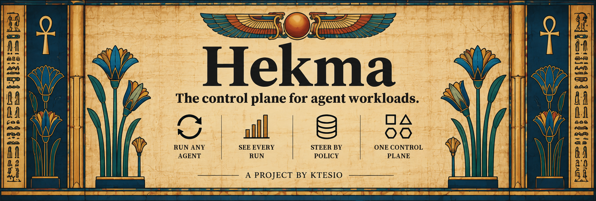

# Hekma Documentation

Welcome to the Hekma docs. Hekma is **the control plane for agent workloads**: one way to run, see and steer any agent — a coding agent, a personal agent, a CrewAI or LangGraph flow, or a raw model call — from a laptop to a fleet, built so that it is never the reason prod stops. Today, in 0.11.0, it supervises, meters and budgets the agents you run; Runs, Policies, Run Keys and wire control are being built in the open, and their pages below are tagged *in development* or *planned*.

The public docs live at [hekma.ktesio.dev/docs](https://hekma.ktesio.dev/docs/); the [roadmap](https://hekma.ktesio.dev/docs/status/#roadmap) shows what lands next.

By *agent* these pages mean a third-party program you run for yourself that calls a model on your behalf: a personal agent such as Hermes Agent or OpenClaw, or a coding agent such as OpenCode or GitHub Copilot CLI. Hekma runs that program as a supervised, metered process; it is not a framework for writing agents.

Hekma is a [Ktesio](https://ktesio.com) project, developed in the open at [ktesio.dev](https://ktesio.dev) and released under the [Apache License 2.0](https://github.com/Ktesio/hekma/blob/main/LICENSE).

## Start Here

- [Getting started](get-started.md)
- [Installation](installation.md)
- [Command reference](commands.md)
- [Troubleshooting](troubleshooting.md)

## The control plane (being built)

Nothing in this section is in 0.11.0 yet; names, commands and defaults may change before it ships.

- [Runs, Control Depth, ps and top](runs.md) — *in development*
- [Policies and the warn default](policies.md) — *in development*
- [Run Keys and key custody](run-keys.md) — *planned*
- [Attach and wire control](attach.md) — *planned*

## Concepts

- [Adapter Contract](adapter-contract.md)
- [Adapter manifest (`adapter.toml`)](manifest.md)
- [Adapter gallery](adapters.md)
- [Supported agents](agents.md)
- [Embedding the engine](embedding.md)
- [Governance conformance vectors](governance.md)
- [Architecture](architecture.md)

## Design

- [Metering agents you don't control](design/metering-agents-you-dont-control.md)

## Project Workflows

- [Testing](testing.md)
- [Contributing](contributing.md)
- [Release process](release-process.md)
- [GitHub repository audit checklist](github-repository-audit-checklist.md)
- [Release notes](RELEASE_NOTES.md)
