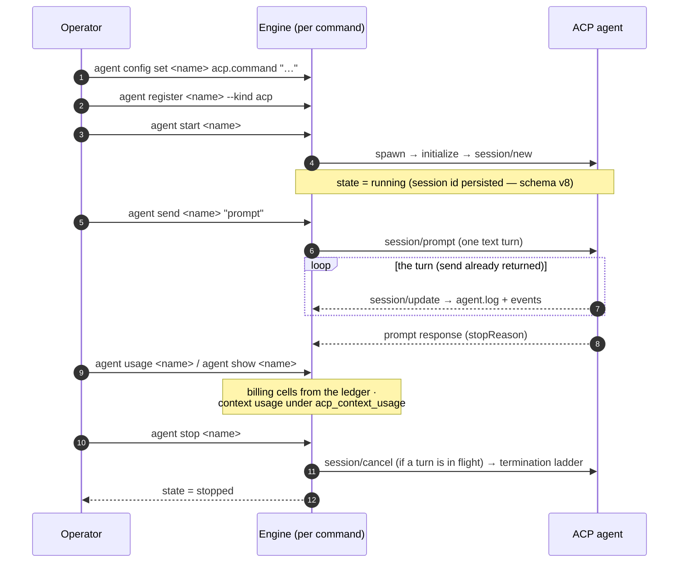

# Command Reference

The agent runner lives under `hekma agent`. Every command supports `--help`, and `hekma --version` prints the package version.

Output discipline: command results go to stdout, while notices and diagnostics go to stderr, so `--json` output on stdout is always machine-parseable.

## How the CLI reaches the Service Host

One process owns a state directory's data path: the **Service Host** (`hekma serve`). Every `hekma agent` command that **writes** — `register`, `remove`, `start`, `stop`, `pause`, `resume`, `drain`, `send`, `config set`, `memory attach`, `memory detach` — is one call to the host's local Control API endpoint. The command finds the host through `<state-dir>/control.json`; when no host serves the directory, the first write **starts one in the background** (`hekma serve --autostart`, its output appended to `<state-dir>/serve.log`) and waits up to 10 seconds for it. Concurrent commands share that one host. The commands that only **read** — `list`, `show`, `usage`, `logs`, `config get` (including `--reveal`, which resolves secrets in the command itself), `governance-vectors` and `ps` — open the state database read-only and never start a host; on a fresh machine `hekma agent list` prints the empty-fleet hint and creates nothing.

What this means day to day:

- **Agents outlive the terminal.** A started agent runs under the host, not under the command — it keeps running, supervised (crash detection, budget enforcement, events), after the command and its terminal exit, until `hekma agent stop` or the host's own shutdown.
- **The background host leaves on its own.** An auto-started host ignores SIGHUP (closing the terminal does not end it), and drains and exits once no agent is `starting`, `running`, `paused` or `stopping` and no command has reached it for 30 seconds — or when its state directory is deleted. An explicit `hekma serve` never idle-exits.
- **Messages and exit codes are unchanged.** The host returns the engine's typed error, and each command renders it exactly as before. The engine's own notes raised during a write (a start's delivery note, an adoption note) are printed on the command's stderr as before; notes the host raises on its own (its reaper's liveness and crash diagnostics) go to the host's stream — `serve.log` for an auto-started host. A host that cannot be found or started is exit code `1`, naming `serve.log`.
- **The agents' environment.** An auto-started host inherits the environment of the command that started it and passes it to the agents it starts, as the CLI always did — so `export KEY=…; hekma agent start x` keeps working in that shell. `secret:NAME` references resolve in the host (its environment, then `secrets.toml`). A variable exported AFTER the host started does not reach it: restart the host to pick up a changed environment (stop its agents and let it idle out, or end its process — `control.json` names the pid). An explicit `hekma serve` keeps its child-environment allowlist.
- **A host from another build** (after an upgrade) is used with one stderr note naming both versions; restart it to match.

## `hekma agent register <name> (--kind <kind> | --manifest <path>)`

Register a new Agent Instance under a Fleet-unique name.

```bash
hekma agent register demo --kind mock
hekma agent register my-agent --manifest ./my-agent
```

Arguments and options:

- `<name>` — Fleet-unique instance name matching `^[a-z0-9][a-z0-9_-]*$`.
- `--kind <kind>` — a native builtin adapter by kind (e.g. `mock`, `hermes`, `acp`). Mutually exclusive with `--manifest`.
- `--manifest <path>` — a manifest adapter loaded from a directory (or an `adapter.toml` file). Mutually exclusive with `--kind`.

Exactly one of `--kind` or `--manifest` is required. Registration validates the adapter's per-OS Capability Declaration and Metering Source **before** any state is written — an adapter with no capabilities or no viable metering source is rejected and nothing is created. On success it prints the engine-computed Agent Home path and the effective (current-OS) Capability Declaration.

The native `mock` kind is a fixture with no launch command; it registers and configures but cannot be started. Use a manifest adapter to run a real process, or the native `hermes` builtin to launch the real Hermes gateway (`hermes gateway run --external-supervisor`) under the engine's supervision — with filesystem Memory Backing attached, the gateway receives `HERMES_HOME` pointing at the instance's managed memory dir.

**Without filesystem Memory Backing the gateway receives no `HERMES_HOME` at all and falls back to the agent's own default home.** A fleet of multiple unbacked hermes instances therefore all resolve the **same** unmanaged default home (documented fallback, not an error); attach Memory Backing (`hekma agent memory attach <name> --kind filesystem`, from a terminal state) to give each instance its own isolated home.

The `acp` kind runs any agent that speaks the Agent Client Protocol (ACP) v1 — Hermes Agent among them, natively, via its `hermes-acp` entry point. The launch is per-instance configuration: set `acp.command` (required, the executable) and `acp.args` (optional) with `hekma agent config set`, then `start`/`send`/`stop` like any other instance; a `start` without `acp.command` is refused naming both keys.

The `acp` kind's lifecycle semantics, where they differ from a plain process:

- **`start` drives the handshake** — the engine spawns the configured executable and speaks the ACP v1 handshake over its stdio (`initialize` → the agent's capabilities → `session/new`) before the instance reaches `running`. An agent that counters with a protocol version outside the tolerated set (`{1}`) is refused: the connection closes and the instance lands `failed` with a surfaced, traffic-free reason. An agent whose agentCapabilities advertise `loadSession` supports session resume (below).
- **`send` is one ACP turn** — the text becomes one `session/prompt` request (one text content block), and the command returns immediately; the agent's streamed chunks and the final stop reason land asynchronously in `hekma agent logs <name>` and the event stream. A **second `send` while a turn is still in flight is refused** with a dedicated diagnostic (exit code `4`): ACP serializes turns per session, and the first turn is unaffected — wait for its stop reason (`hekma agent logs <name>`) or `stop` the instance.
- **`stop` cancels first** — when a turn is in flight, `stop` writes `session/cancel` before the ordinary graceful-then-forced termination ladder; the delivery is recorded as an `engine`-attributed line in the instance's output log (the child's own receipt, if any, lives in the child's stderr and races its death — the engine-side line is the durable record).
- **An agent request for permission is answered denied** (the offered denial option, or `cancelled` when none fits) with one surfaced diagnostic per request — the client advertises no capabilities in v1 (no filesystem, no terminal, no elicitation).
- **Sessions resume at the next start** — the established ACP session id is persisted at the handshake. If the engine dies (for a CLI start: the local Service Host), the next host to open re-adopts the record and says so on stderr (the command that started that host prints the note); the resume happens at the next `start`, which offers the persisted id via `session/load` when the agent advertised `loadSession`, and otherwise opens a fresh session with an honest note. A `send` to an adopted instance fails until that stop-and-start, because the ACP transport is a pair of pipes that died with the previous engine. For the same reason a `--detach` start of an `acp` instance cannot establish the transport: the launch lands `failed` with the reason on stderr (start it attached).
- **Usage is two grains, never mixed** — an agent's `usage_update` notification (its session context window) is surfaced as context usage on `show`/`list`/`--json` under the additive `acp_context_usage` field and its own `show` row, and is **never** written to the billing ledger. Billing-grade tokens (input/output/cached) come from the metering tiers: the self-reported sentinel (under `acp` it rides the agent's **stderr**, since its stdout is the protocol stream) or the `engine-observed` loopback channel (set `metering.upstream_base_url` — the acp kind resolves that source the same way a manifest agent does). When no tier has produced billing-grade usage, the token/cost cells show the honest `—` and the full tier breakdown rides `show`/`list` (a stderr note on `list`, the inline value on `show`) and the additive `usage_gap` field on `--json` — naming the tiers attempted and the context-usage state, never a fabricated figure.

> **Deprecation notice — the `hermes` kind.** The `hermes` builtin kind is **deprecated in favor of `--kind acp`**: Hermes Agent speaks the Agent Client Protocol natively (its `hermes-acp` entry point), and the generic `acp` kind runs it under the same supervision without a bespoke adapter. **New registrations should use `--kind acp`** (point `acp.command` at the `hermes-acp` executable). The `hermes` kind keeps working unchanged — this is an announcement, not a removal — and it will not be removed before a future **major** release, per the CLI-surface deprecation policy (announced ahead via these docs and the release notes; removal only at the stated major). Both migration parity items are shipped and tested with the `acp` kind: **metering** continues through the self-reported usage sentinel (under `acp` the sentinel channel is the agent's stderr, because its stdout is the ACP protocol stream), and **memory delivery** continues through `HERMES_HOME` — a `filesystem` Memory Backing attached to an `acp` instance is delivered into the agent's process environment exactly as under `hermes`. The service-mode successor the deprecation waited for **has landed**: a gateway-shaped agent now registers as a [manifest adapter](manifest.md#complete-example) declaring readiness, liveness, exit classes, the cooperative pause pair, and the drain — the shape the Conformance Test Kit proves end-to-end (see also [the adapter contract's successor note](adapter-contract.md#deprecation-policy)).

The whole journey, from registration to a clean stop (the engine runs for
the duration of each command; `send` returns immediately and the turn
streams in the background):



And what a session survives — the engine does not: the agent (and its
persisted session id) outlive any single command, and the resume happens
at the next `start`:

```mermaid
sequenceDiagram
    autonumber
    participant Op as Operator
    participant E1 as Engine (start #1)
    participant A as ACP agent (survives)
    participant E2 as Engine (a later command)

    Op->>E1: agent start <name>
    E1->>A: initialize → session/new
    Note over E1,A: session id PERSISTED on the spawn record (schema v8)
    Note over E1: the engine exits (crash — or the command simply ends)
    Note over A: the agent keeps running; the record survives
    E2->>A: re-adopt (fingerprint match) — stderr names the recorded session id
    Note over E2: the transport is not re-pipable: a send here fails honestly
    Op->>E2: agent stop <name>
    Op->>E2: agent start <name>
    E2->>A: initialize (fresh pipes)
    alt the agent advertised loadSession
        E2->>A: session/load (the persisted id) — the conversation RESUMES
    else resuming is not supported (or the load fails)
        E2->>A: session/new + an honest note on stderr
    end
```

## `hekma agent list [--json]`

List every Agent Instance in the Fleet.

```bash
hekma agent list
hekma agent list --json
```

The human table shows name, kind, state, the supervision indicator, restart count, the token budget (ceilings + remaining + Breach Action, or `—` when un-budgeted), the real usage totals (cumulative tokens plus — when a Rate is configured — the derived dollar cost), and the Agent Home, followed by a Fleet-wide totals footer. The **Supervision** column is a compact marker: `detached` (the process survives engine exits — a `--detach` spawn whose record is live), `session` (the process lives as long as the engine holding it — the local Service Host for a CLI start), or the honest `—` when no live spawn record exists — a stopped or never-started instance never implies supervised.

Both money-bearing columns are headed `Budget (tok, est. $)` and `Usage (tok, est. $)`: the `est. $` estimate qualifier lives in the HEADER because those cells are narrow and truncate — a truncated cell can never strip the label off a real dollar figure, so the cells render their dollar figures bare.

The active Metering Source is deliberately **not** a human-`list` column — the compact table is the ratified 80-column design, and a Metering column there overflows the default width and truncates cells. Read the Metering Source from `hekma agent show` (the detail row), `hekma agent list --json` (the `metering_source` field), or `hekma agent usage`. `hekma agent list` stays the supervised-instance projection; the Run-grain listing is [`hekma ps`](#hekma-ps---selector-sel--all---limit-n---cursor-c---json), and the two sit beside each other unchanged.

`--json` emits a versioned document (`schema_version`, `instances`, `totals`); dollar figures appear only when a Rate is configured (integer micro-dollars in JSON, labeled estimates). Token totals always equal the Usage Ledger exactly — see `hekma agent usage` below.

## `hekma agent show <name> [--json]`

Show one instance's effective per-OS Capability Declaration plus its runtime status.

```bash
hekma agent show demo
hekma agent show demo --json
```

The runtime status includes the Lifecycle State, Restart Policy, restart count, the token budget and dollar Cost Cap, real usage token totals (cumulative and current-run), the derived dollar cost when a Rate exists, the active Metering Source, the supervision indicator (the same `detached`/`session`/`—` marker the `list` table carries), and — for a failed instance — the failed cause. `--json` emits the same `FleetEntry` shape a `list` row uses, wrapped with the Fleet `schema_version`.

Four fields are **additive and conditional** on the `--json` document (absent when their condition does not hold, never fabricated): `acp_context_usage` — `acp`-specific, present only while a live ACP connection has reported the session context window (`used`/`size` plus its optional self-reported cost), a context-grain figure that is never part of the billing `usage` object; `usage_gap` — `acp`-specific, present only for an `acp` instance whose Usage Ledger holds no billing-grade usage at all, carrying the tiers attempted (`observed`/`sentinel`), whether context usage was reported, and a one-line `notice` naming all three; and `supervision` — present exactly when a live spawn record exists, carrying `detached` or `session` (a stopped or never-started instance omits the field rather than implying supervised). The fourth, `recorded_state`, appears only when the shown `state` differs from the stored one: reads write nothing, so when `list` or `show` finds a `running` or `paused` instance whose process is gone (the agent and its host were killed, or the machine went down), it shows the instance as `failed`, with a `failed_cause` naming the pid, omits `supervision`, and keeps the stored state in `recorded_state`. A stderr note says the same. The next `hekma` write starts the host, which records the change.

## `hekma agent usage [<name>] [--json]`

Read Usage Ledger totals for one instance, or for the whole Fleet.

```bash
hekma agent usage
hekma agent usage my-agent
hekma agent usage my-agent --json
hekma agent usage --json
```

- `<name>` — optional; with a name, reports that instance's usage. Omitted, reports the Fleet-wide totals.
- `--json` — emit a single versioned document (not newline-delimited; usage is a snapshot, not a stream).

The named form reports tokens by both scopes (cumulative and current-run), the derived dollar cost per scope, and the active Metering Source. The Fleet-wide form reports summed tokens plus the summed derived dollar cost across the instances that have a Rate — flagged as a lower bound, naming how many instances are unpriced, when some metered instance has no Rate.

Token totals equal the Usage Ledger exactly, and are the same numbers `list`/`show` report — this command is a focused surface over the same data, never a second, independently-summed figure. Dollar figures appear only when a Rate is configured and are always labeled estimates; with no Rate the dollar view is honestly inert (`—`), never a fabricated `$0.00`. An instance that has never started reports all-zero totals — zeros mean "no usage recorded", not "usage was lost".

Both `--json` forms carry the same Fleet `schema_version` as `list`/`show`, since they serialize the same fleet domain types:

```json
{
  "schema_version": 2,
  "instance": "my-agent",
  "usage": {
    "cumulative_input_tokens": 1200,
    "cumulative_output_tokens": 3400,
    "current_run_input_tokens": 120,
    "current_run_output_tokens": 340,
    "cumulative_dollars": 54600,
    "current_run_dollars": 5460,
    "estimate_label": "estimated"
  }
}
```

The Fleet-wide form (no name) is the same document family with `totals` in place of `instance`/`usage`:

```json
{
  "schema_version": 2,
  "totals": {
    "total_input_tokens": 1200,
    "total_output_tokens": 3400,
    "total_dollars": 54600,
    "dollars_partial": true,
    "unpriced_count": 1,
    "estimate_label": "estimated"
  }
}
```

`totals` is byte-identical to the `totals` object `hekma agent list --json` carries — one aggregate, two surfaces. `dollars_partial` is `true` when some metered instance has no Rate, making `total_dollars` a lower bound; `unpriced_count` then names how many instances were left out.

Dollars are **integer micro-dollars** (1,000,000 = $1.00) plus an `estimate_label` of `estimated` or `reconciled` — never a preformatted `$` string, so a caller formats its own currency.

Dollar fields are **omitted entirely** when no Rate is configured (`cumulative_dollars`, `current_run_dollars`, `estimate_label` on the named form; `total_dollars` and `estimate_label` on the Fleet form) — an honest absence rather than a fabricated `$0.00`. A parser must treat them as optional.

With no instances registered, the Fleet form still emits a valid document (all-zero totals) and prints a short registration hint to stderr, so an empty Fleet is never mistaken for instances that consumed nothing.

## `hekma agent start <name> [--detach]`

Start a registered Agent Instance.

```bash
hekma agent start my-agent
hekma agent start my-agent --detach
```

On success the instance transitions to `running` and the new state prints to stdout. A launch failure lands the instance in `failed` with a diagnostic on stderr. Before the process spawns, the start seam can emit one-line engine diagnostics on stderr (or the host sink): a report of every launch environment variable the config mapping **overwrote** (the config value wins), and a warn-only report of config keys whose `secret:` cleartext was delivered into a **flag** target (visible on the process argv) — neither ever rejects the start.

**The readiness gate.** When the instance's adapter declares a `[readiness]` section (see [the manifest docs](manifest.md#readiness--the-readiness-probe-added-at-contract-110)), the start WAITS — after spawning, after the startup watch, and after any ACP handshake — for that one probe to pass within its declared `timeout_ms`, on the engine's own poll cadence. A diagnostic on stderr names the probe as the wait begins, and a second names the pass (with the wait actually taken). `running` is committed only once the probe passes; a probe that never passes lands the instance `failed` (exit non-zero) with the probe description + the honest wait in the diagnostic, the lifecycle log (`readiness-timeout`), and `show`'s failed cause — and that failure is TERMINAL: the Restart Policy is not consulted. An agent that EXITS while the probe waits instead follows the ordinary crash path (Restart Policy consulted, `crashed` cause, restart scheduled on the engine cadence) — the restart is QUEUED for the next engine-cadence pass, so a short-lived command that exits before that pass runs does not execute it (the queue diagnostic says so when a plan is parked). Under `log capture = "off"` a `log-contains` probe is unsatisfiable and times out honestly.

Every start runs under the local Service Host (see [How the CLI reaches the Service Host](#how-the-cli-reaches-the-service-host)), so the agent **keeps running after the command exits**, supervised by the host. A note on stderr says so: `the agent runs under the local Service Host (pid N) and keeps running after this command exits; stop it with: hekma agent stop <name>`. If the host crashes with a surviving process, the next host to open re-adopts it, detects crashes, and applies the Restart Policy.

`--detach` keeps the meaning it has in the engine: the process handle is disarmed at spawn, so the agent survives even the **host's** exit, and the next host re-adopts the surviving process through the pid + start-time fingerprint path. A detached start still waits for the declared readiness probe (bounded by its `timeout_ms`) — it returns ready-or-failed, never wedged. While the host runs, a detached agent is supervised like any other; the notice on stderr names the honest **enforcement window** that remains: after a host exit, until the next host adopts it, there is no crash detection, no budget enforcement, and no usage/event delivery. Two further facts are pinned by design: a detached start refuses `engine-observed` instances (exit code 5) before anything changes — their loopback listener lives in the host, and a host exit would strand the agent's model traffic on a dead port — and a detached child is spawned with stdin closed regardless of its declared interaction level (`send` on it fails with the adopted-instance diagnostic, as for any adopted process).

**One Run across the whole detached life.** The Run id is persisted with the spawn record, and every later adoption **resumes** it instead of minting a fresh one — so a detached instance is a single Run from its `start` until a genuine `stop`/`start` opens a new one (a crash relaunch keeps it). Per-run token and dollar totals therefore keep accumulating across commands (`show`'s "this run" numbers no longer reset per command), and a budget breach that already fired for that Run is **spent**: the adoption-time re-evaluation still runs, but a breach already recorded in the instance's breach log for the resumed Run neither re-records a duplicate breach event nor re-fires the action — once per Run, not once per command. A genuine `stop`/`start` still resets both: a fresh Run mints and, if the cumulative total is still over a ceiling, the breach fires again under the new Run. A Restart Policy relaunch after a crash does not: it continues the same Run. A spawn record written before durable Run ids existed (pre-upgrade) is minted once, persisted back, and noted once on stderr — the next command resumes that minted id.

## `hekma agent stop <name|run-id|--selector <selector>> [--timeout <secs>] [--dry-run] [--yes] [--json]`

Stop a running Agent Instance: graceful shutdown, then a forced kill after the window.

```bash
hekma agent stop my-agent
hekma agent stop my-agent --timeout 10
hekma agent stop run_01JZ6Q9G3S8V2X7K4M1N5P0R2T
hekma agent stop --selector team=core --dry-run
```

`stop`, `pause`, `resume` and `drain` take an agent, a run id, or a Selector — see [Selectors on the lifecycle verbs](#selectors-on-the-lifecycle-verbs).

- `--timeout <secs>` — the graceful-shutdown window before a forced kill (default 30). No child process survives. The Service Host serves windows of `1` to `86400` seconds: `--timeout 0` is served as a 1-second window (SIGTERM, then a forced kill after at most one second), and a stderr note says so; a value above `86400` is served as `86400`, with the same note.

## `hekma agent pause <name|run-id|--selector <selector>>` / `hekma agent resume <name|run-id|--selector <selector>>`

Pause a running instance, or resume a paused one, with honest per-OS semantics.

```bash
hekma agent pause my-agent
hekma agent resume my-agent
```

A **guaranteed** pause suspends the process (SIGSTOP on Unix); a **best-effort** pause proceeds cooperatively and prints a visible qualifier note; an **unsupported** pause fails fast, quoting the Capability Declaration. The posture is per-OS, read from the adapter's declaration. `resume` shares the dispatch: a **guaranteed** resume wakes the suspended process (SIGCONT), a **best-effort** resume records its qualifier, and a resume of an instance that is `paused` while the CURRENT declaration reads `unsupported` (declaration/OS drift) fails fast with a dedicated diagnostic that names the paused state and the escape hatch — `stop` works without pause support, so `hekma agent stop <name> && hekma agent start <name>` recovers (exit code 5, the capability-unsupported class). A guaranteed pause OR RESUME of an instance this engine session holds no process handle for (e.g. started by a prior engine whose process is gone) still transitions, but the recorded cause is the honest best-effort qualifier naming the missing handle — nothing was signalled at all, so the cause never reads as a plain "paused"/"resumed" command that a real suspension would earn; a budget-driven override in that no-handle case is wrapped in the same qualifier rather than replacing it.

**The cooperative-first dispatch (adapter-declared lifecycle commands).** When the adapter's manifest declares the `[lifecycle.pause]`/`[lifecycle.resume]` command pair, `pause` RUNS THE COMMAND instead of dispatching the OS signal path — on every OS the same way, and even where the capability table says `unsupported` (the agent suspends itself under its own program; see [the manifest reference](manifest.md) for the pair rule and the 30 s standalone command cap). The `resume` direction is gated on WHICH KIND of pause is in place, because an instance can read `paused` three ways: OPERATOR (the engine's signal suspension), BREACH (the budget enforcement freeze), or COOPERATIVE (its declared pause command completed) — only a COOPERATIVE pause runs the declared resume command; a `resume` of a signal-frozen instance stays on the SIGCONT path even when the pair is declared, because the suspension to undo is the engine's, not the agent's (a command edge there would record `running` over a still-frozen process). A command that exits nonzero or cannot spawn rejects the verb with the state untouched (`PauseCommandFailed`, exit 1 — never a fake pause; the command's captured stderr tail rides along in the failure detail), and a command that outlives the 30 s standalone cap is killed and rejected the same way — a pause command stuck in an infinite loop fails the verb in bounded time rather than hanging it (a corpse that never confirms its kill gets its own honest note). The recorded causes are `pause-cooperative`/`resume-cooperative` naming the rendered command, and the stop of a cooperatively-paused instance SKIPS the OS resume signal (there is no suspension to undo) with a visible note saying so. One deliberate exception: a budget-breach pause keeps the real signal suspension — enforcement needs a process the engine actually froze.

## `hekma agent drain <name|run-id|--selector <selector>> [--timeout-ms <ms>]`

Drain a running instance: stop new work, wait — bounded — for the agent's in-flight work to reach zero, then stop it. The composite runs the adapter's declared `[lifecycle.pause]` command (cooperative, never an OS signal), polls the declared `[drain].idle_file` (when declared) for freshness while also watching the agent process itself, then drives the ordinary stop ladder.

```bash
hekma agent drain my-agent
hekma agent drain my-agent --timeout-ms 10000
```

The bound is three-tier: `--timeout-ms` (`1..=600000` ms — outside the range is a usage error, exit 2) wins; else the manifest's `[drain].timeout_ms`; else the engine default of 30 s. Both outcomes are command SUCCESSes (exit 0): a drain whose bounded wait COMPLETED prints the final state like a stop; a drain that outlived its bound STILL stopped the instance (the last step is unconditional) and prints a stderr note saying the wait did not complete, with the outcome recorded on the final `drain-stopped` transition either way. A manifest with neither lifecycle commands nor a `[drain]` section has nothing declared to wait for — the drain stops directly, reports a zero wait, and says so with a diagnostic. Refusals: the instance must be `running` (a registered or paused instance is refused, exit 4), and a declared pause command that exits nonzero or cannot spawn rejects the drain with the state untouched (`PauseCommandFailed`, exit 1 — the captured stderr tail rides along). An OVERRUN is different inside a drain: a pause command that outlives the drain's bound is killed, commits NO `pause-cooperative` edge (the row stays `running` — the bound, not the adapter, ended it), and the drain simply becomes the timed-out path: the stop still happens and the outcome is honestly recorded as not completed — unlike the standalone `pause`, which rejects with exit 1 on the same overrun. The agent itself is watched during the wait too: a process that ends on its own mid-drain (a crash or a declared exit) breaks the wait early with an "ended on its own" diagnostic, and the drain's outcome is honestly not-completed there as well — never a fabricated completion over a corpse.

One interaction with detach is worth knowing — **what happens to a paused detached agent when the engine holding it exits (for the CLI: the local Service Host) depends on WHY it is paused**. Below, "command" reads "host": every CLI start is held by the host, and the "between commands" window is the window between hosts. For an **operator pause** (you ran `pause`), the suspension holds for exactly as long as some engine session holds the agent: when the holding command exits, the engine **SIGCONTs the child before releasing it** and records the `paused → running` edge with a dedicated `detached-resumed` cause (visible in the lifecycle log and surfaced with a stderr note) — an operator-paused detached child is never left SIGSTOP-frozen and unwatched between commands, which was the old behavior. For a **budget-breach pause** (the default `breach_action: pause` crossed a ceiling), the engine deliberately does **not** resume at release: between commands there is no supervision or budget enforcement (the enforcement window), and resuming the agent there would let it run unsupervised past its ceiling while the resumed-run breach latch suppresses re-enforcement — so the freeze holds into the between-commands window, a stderr note names why, and the next command's adoption names the stranded-paused state again; an explicit `resume` (or `stop`) from a later command is the way out. For a **cooperative pause** (the adapter's declared pause command ran), release is the most hands-off of the three: the suspension lives in the agent, not the process, so there is **no OS resume to send** — no signal, no transition, the row keeps reading `paused`, and the stderr note names that plus the recovery (a later `resume` runs the declared resume command). This is the one shape that CAN stay paused across commands by design: the agent is not frozen, it is honoring its own pause. If the engine itself dies mid-pause (no clean exit), the next command's adoption keeps the row **paused** — adoption never auto-resumes — and says so on stderr with the matching release semantics named (operator: released at that command's exit; breach: held frozen; cooperative: left paused, the agent still honoring it). For the signal-frozen kinds there is still no v1 mechanism to hold a detached agent paused across a release — `stop` is the terminal alternative (it can always be resumed by a later `start`).

## Selectors on the lifecycle verbs

`hekma agent stop`, `pause`, `resume` and `drain`, and `hekma run close`, take one target or a set (see [Runs: verbs at scale](runs.md#verbs-at-scale)):

| Argument / flag | Meaning |
|---|---|
| `<name>` | An agent: today's command, unchanged |
| `<run-id>` | A Run: on the Run that owns an agent's process the verb is the agent's own; any other Run is refused, naming its depth. A registered agent whose name has an older run id's shape (`run-<digits>-<digits>`) is read as that agent |
| `--selector key=value[,key=value...]` | Every open Run carrying all these labels, bound or caller (at most 1000) |
| `--dry-run` | Show each Run's planned outcome (`would-stop`, or the refusal and its code); change nothing and start no Service Host |
| `--yes` | Do not ask before acting on several Runs |
| `--json` | Print `{"schema_version": 1, "verb", "dry_run", "matched", "results": [{"run_id", "outcome", "instance", "error"}]}` |

When a Selector matches more than one Run, the set is listed (run id, CONTROL, STATUS, agent) and you are asked to confirm, for example `Stop these 3 Runs? [y/N]`. Only a terminal is asked: without one the command is refused (exit 2) unless `--yes` is given, and stdin is never read. A child Run's lifecycle verbs act on its model calls, which Hekma cannot hold or reject yet, so a child is refused (exit 4) and the others still act; a child held because its parent is paused is refused naming the parent. Each Run reports its own result, and the exit code is the first failure's (`3` not found, `4` refused by the Run's state or depth, `2` an invalid request), with the count in its message. A Selector that matches nothing is a success with a note. A set is acted on in one call carrying a set token, so exactly the listed Runs act; a Run that ended in between is its own `run-ended` refusal. Stops and drains on a set wait out their windows one after another; the command waits at most 10 seconds plus each Run's bound (capped at 10 minutes), then says it stopped waiting while the acts may still be committing. `start` and `send` take no Selector: a Selector matches open Runs, so there is nothing to start, and `send` carries text to one agent.

## `hekma agent send <name> <text>`

Send text input to a running Agent Instance's native input channel (v1: the spawned child's OS stdin pipe).

```bash
hekma agent send my-agent "hello there"
```

A trailing newline is appended to `<text>` if it does not already end with one. Unlike `pause`/`resume`, `send` is not a lifecycle transition: the instance's state is unchanged, and only a confirmation prints to stdout.

The same three-way honesty as `pause`, with one difference: a **guaranteed** and a **best-effort** interaction level both deliver the input identically (there is no OS-conditional difference in writing to a pipe — best-effort is purely an adapter-author signal), while an **unsupported** interaction level fails fast, quoting the Capability Declaration.

`send` requires the instance to be genuinely `running`. It goes through the local Service Host, which holds the input pipe of every agent it started — so `send` reaches an agent a separate `hekma agent start` command started. A process the host ADOPTED (after a host restart, or a detached start) has no recoverable input channel — `send` on such an instance fails honestly (naming the cause) rather than silently dropping the input; stop and start it for a fresh channel.

Stdin is piped only for adapters that declare interaction support (`guaranteed` or `best-effort`); an adapter that doesn't declare interaction sees stdin exactly as before this command existed (`/dev/null`-equivalent), so it never blocks waiting on input that will never arrive.

If an agent stops draining its input (a stuck/deadlocked process), `send`'s write is bounded — it fails with a distinct diagnostic naming the timeout rather than hanging, and the instance's interaction channel stays unavailable for the rest of that session until it is stopped and started again.

## `hekma agent logs <name> [--follow] [--json]`

Read an Agent Instance's retained output, optionally following live output.

```bash
hekma agent logs my-agent
hekma agent logs my-agent --follow
hekma agent logs my-agent --json
hekma agent logs my-agent --follow --json
```

Every currently-retained line is printed to stdout as `<at> [<stream>] <text>`, in the order it was captured (append order — never re-sorted by timestamp, since same-second lines are common). `<stream>` is one of `agent-out`, `agent-err`, or `engine`: the spawned process's stdout and stderr are captured separately (so you can tell them apart), and a best-effort `engine` line is added at each lifecycle transition (start, stop, pause, resume, crash, restart), mirroring the same facts the structured transition log already records.

Log capture is **unconditional and capability-independent** — unlike `send`, it does not depend on the adapter's declared `interaction` support. Reading an instance's output always works, even for an adapter that declares `interaction: unsupported`; only writing to a process (`send`) is gated on that capability.

The captured output is bounded: each generation caps at 10MB, with the current generation plus its 2 most recent rotated predecessors retained (10MB × 3 total, fixed and non-configurable). `hekma agent logs` never errors due to rotation — a read that spans a rotation boundary returns whatever is currently retained, not a claim of the instance's entire lifetime history.

`--follow` (`-f`) prints the retained lines first, then keeps polling for new output and printing it as it arrives — exiting cleanly with a note once the instance stops, pauses, crashes to `failed`, or otherwise leaves `running` (never hanging). This works identically whether or not the current `hekma` process is the one that originally started the instance: reading only needs the instance's log file, not a live process handle, so `hekma agent logs --follow` also works against an instance recovered by crash adoption in a different `hekma agent start` session.

`--json` emits **newline-delimited JSON (NDJSON)**: one complete, self-contained log-line object per stdout line, each carrying its own `schema_version`. This is deliberately not a single wrapping document — `--follow` is an unbounded stream that a wrapper could never close — so the shape is identical for the one-shot and `--follow` forms, and a reader can process each line as it arrives:

```json
{"schema_version": 1, "instance": "my-agent", "stream": "agent-out", "at": "2026-07-20T12:00:00Z", "text": "hello"}
```

Lines are emitted in on-disk append order (never re-sorted by `at`, whose whole-second resolution makes ties common). An empty log emits nothing at all — zero lines, not `[]`. Under `--json`, stdout is pure NDJSON: the rotation notice and the follow-exit note go to stderr like every other diagnostic.

While following, `--follow` also watches the **raw `agent.log`** when no Service Host serves the state directory: a detached instance keeps writing to that crash-immune raw capture between hosts (after its host exited, before the next one adopts it), where no live engine tailer exists to attribute it into the rotated capture. While a host serves the directory, its tailer attributes that output itself, so the raw fallback is off. New raw lines stream as ordinary lines — human and NDJSON alike — with one honest qualifier printed to **stderr the first time** such a line appears in the session (never per poll): these are *un-attributed passthrough* lines, whose timestamps are when this command read them, not when the agent wrote them. The one-shot `logs` (no `--follow`) reads the attributed capture only; while an engine tailer is live in the session, the raw fallback is suppressed (the tailer is attributing those same bytes).

That raw fallback is **primed with a bounded backlog**: at follow start, the last `N` complete raw lines (default **200**, tunable via the `HEKMA_LOGS_BACKLOG_LINES` environment variable) stream too — so output the agent wrote between commands, before the follow began, is not silently invisible. If the gap exceeds the window, only its last `N` lines stream and the qualifier names how many earlier complete lines were skipped; a partial trailing line is never primed (it streams once it completes); a value that is not a positive integer falls back to the default with a stderr note naming the bad value; and when an engine tailer is live, nothing extra streams and nothing extra is noted. The one-shot `logs` remains attributed-capture-only.

## `hekma agent remove <name> [--delete | --retain] [--force]`

Remove an Agent Instance from the Fleet.

```bash
hekma agent remove demo
hekma agent remove demo --delete
hekma agent remove my-agent --force
```

- `--retain` — keep the Agent Home directory on disk (the default).
- `--delete` — delete the Agent Home directory as well. This includes the `filesystem` Memory Backing contents under `<home>/memory`: `--delete` removes **everything** in the Agent Home, not just registration metadata. (Detaching, by contrast, never deletes contents.)
- `--force` — remove even if the instance is running. Required for a running instance.

`--delete` and `--retain` are mutually exclusive; when neither is given, the safe default is to retain.

## `hekma agent memory attach <name> --kind <kind>`

Attach a Memory Backing to an Agent Instance. Two kinds exist, and each names its guarantee up front (NFR-7):

- **`filesystem`** — an engine-managed directory inside the instance's Agent Home whose contents persist under your control and survive stop/start cycles and engine restarts byte-identically.
- **`native`** — an explicit delegation marker: memory semantics belong to the agent's own native mechanism; Hekma guarantees only that the Agent Home itself persists. Attaching it creates no directory, and — because a `native` **backing** delivers nothing — the engine performs no config delivery at start for it, `HERMES_HOME`-style override included; the agent's own mechanism locates its home. (This is about the backing kind, not the adapter: a `hermes` or `acp` instance attached a `filesystem` backing DOES receive `HERMES_HOME` — see the attach section below.)

```bash
hekma agent memory attach demo --kind filesystem
hekma agent memory attach demo --kind native
hekma agent memory attach demo --kind filesystem --json
```

Arguments:

- `<name>` — the Agent Instance to attach the backing to.
- `--kind <kind>` — the backing kind: `filesystem` or `native`. The full vocabulary grows without a breaking change.
- `--json` — emit the attachment as a machine-readable JSON document (below) instead of the human confirmation.

The human confirmation names the kind and prints one boundary sentence stating exactly what is guaranteed versus delegated, then the managed directory path alone on the final stdout line (scripts can read the last line); diagnostics go to stderr. For `native`, that path is the computed location only — nothing was created there.

### `memory attach --json`

`--json` writes a single versioned document to stdout and nothing else there (diagnostics stay on stderr). The document carries the backing kind and guarantee level in their typed snake_case wire strings (frozen verbatim at the Adapter Contract v1 freeze), the engine-computed managed directory, and the delivery fact — whether the injected path will actually reach the agent. `declared` reads `true` when the attached backing is `filesystem` AND the adapter's declared config mapping targets the reserved `memory.dir` key (the builtin `hermes` does — its mapping delivers `memory.dir` as `HERMES_HOME` — and so does the `acp` builtin, so a hermes or acp instance with a filesystem backing reads `"declared": true`). It reads `false` when the mapping targets nothing, and also when the attached backing is `native` — for a `native` backing the `false` means "no delivery is offered", not "the adapter declined": nothing is delivered at start, so there is no delivery to declare.

```json
{
  "schema_version": 1,
  "instance": "demo",
  "kind": "filesystem",
  "guarantee": "managed_dir_byte_durable",
  "dir": "/home/you/.local/share/ktesio/agents/demo/memory",
  "declared": true
}
```

A `native` attach reads `"kind": "native"`, `"guarantee": "home_persistence_only"`, and `"declared": false` (no delivery is offered for a `native` backing — see above; this says nothing about the adapter, and a `hermes` or `acp` instance with a `filesystem` backing reads `true`). The `schema_version` is the memory document family's own (currently `1`); it is a compatibility surface — any key change is announced, never silent.

For `filesystem`, the engine creates and owns the managed directory (it prints the exact path), never touches its contents — they are yours — and hands the path to the adapter at every start through the reserved `memory.dir` config key. Whether the agent actually receives it depends on the adapter declaring a config mapping for that key; if it declares none, Hekma says so on stderr at start and the directory guarantee holds regardless. For `native`, nothing is injected at start — the agent's memory mechanism is entirely its own.

`memory.dir` is an engine-reserved delivery key, never operator configuration — do not set it yourself. Any hand-set value is stripped from the operator layers at resolve time: the engine removes it when resolving what applies at start, so it can be delivered only by the engine itself (when a `filesystem` backing is attached) and never lands in the persisted start snapshot as applied configuration.

Attach and detach require the instance to be in a terminal state (`registered`, `stopped`, or `failed`) — a Memory Backing cannot be hot-swapped under a live agent, and there is no `--force` escape. Re-attaching the same kind is an idempotent success; attaching a different kind over an existing one is rejected until you detach.

### Portability: moving an Agent Home to another machine

Both backing kinds travel with the Agent Home — the attachment lives in the state database inside the state dir, and `filesystem` contents are plain files under `<home>/memory`. To move an instance to another machine:

1. **Stop first.** Attach/detach aside, copy from a quiescent state: bring the instance to a terminal state (`registered`, `stopped`, or `failed`).
2. **Copy the whole state dir**, preserving the relative layout (`state.db`, `secrets.toml` if present, and everything under `agents/`). Do not reorganize or rename anything inside it.
3. **Open at the same relative location on the target machine** (or set `KTESIO_STATE_DIR` to the copied root).

The `filesystem` memory tree arrives byte-identical and the instance runs with memory intact; the delegation recorded for a `native` backing travels too. One caveat: a state database written by a NEWER Hekma version refuses to open on an older one with a clear schema-version error — upgrade before copying forward.

## `hekma agent memory detach <name>`

Detach an Agent Instance's Memory Backing.

```bash
hekma agent memory detach demo
hekma agent memory detach demo --json
```

Arguments:

- `<name>` — the Agent Instance to detach the backing from.
- `--json` — emit the detachment as a machine-readable JSON document instead of the human confirmation.

Detach is metadata-only: the attachment is removed, but the managed directory **and its contents remain on disk** — your data is never silently deleted, and re-attaching later re-adopts the existing contents. The same terminal-state requirement applies as `attach`.

With `--json`, stdout carries the versioned confirmation document and nothing else. It is intentionally minimal — the versioned proof that nothing is attached anymore; it carries no path (Hekma never constructs the managed-directory name itself, and after a detach the engine reports no attachment to quote):

```json
{
  "schema_version": 1,
  "instance": "demo"
}
```

## Memory guarantees at a glance

| Kind | Hekma guarantees | Delegated to the agent |
| --- | --- | --- |
| `filesystem` | The managed directory exists, its contents survive restarts byte-identically, and it travels with the Agent Home | What the agent does with the delivered path |
| `native` | Only that the Agent Home persists | All memory semantics (storage, retrieval, lifecycle) |

## `hekma agent config set <name> <key> <value>`

Concurrent `config set`s on the same instance are safe: the engine serializes each write's read-modify-write of the instance `config.toml` behind a per-instance advisory lock (`config.toml.lock` beside the file — the `host.lock` pattern, released by the OS if a writer dies), so parallel writes from multiple terminals or scripts all land instead of silently dropping each other's keys.

Set one config key on the Agent Instance layer. Validated at write time.

```bash
hekma agent config set demo model gpt-4
hekma agent config set demo budget.tokens.cumulative 500000
hekma agent config set demo agent.api_key secret:OPENAI_KEY
```

A known unified key or an `agent.*` pass-through key is accepted and persisted; an unknown key **outside** `agent.*` is rejected before anything is written, with the nearest valid key suggested. The value is stored verbatim — a `secret:NAME` reference is stored as-is and resolved + masked at start/read (never resolved or echoed by this write). Setting config on a **running** instance is allowed and never touches the live process: the change takes effect on the next start (budget/cost keys are an exception — they are re-read on each usage ingestion and apply immediately).

The write is **atomic**: the updated `config.toml` is written to a temporary file in the Agent Home and renamed into place, so a crash mid-write always leaves either the complete old or the complete new bytes — never a truncated file.

The `<value>` position accepts a leading-dash value (e.g. `-x`, `--model-x`) **literally** — no `--` separator is required (the separator still works for callers who prefer it).

**Warning (warn-only).** Setting a `secret:NAME` value on a key the agent's adapter maps to a **flag** target succeeds, but prints a warning to stderr: the resolved cleartext would ride the agent's command line, where argv is readable by other local users (`ps`, `/proc/<pid>/cmdline`). Prefer an **env** or **file** target for secret-carrying keys (see Architecture — Secrets); at **start** the same fact is reported as a one-line engine diagnostic.

## `hekma agent config get <name> [<key>] [--json] [--reveal]`

Read the effective (resolved) config with per-value provenance.

```bash
hekma agent config get demo
hekma agent config get demo model
hekma agent config get demo --json
hekma agent config get demo --reveal
```

- `<key>` — optional; omitted prints the whole effective config. With a key, prints just that value. A key with no effective value is rejected on stderr with a non-zero exit. When that key has no value of its own but **is a table prefix** of effective keys (e.g. `budget` while `budget.tokens.cumulative` is set), the diagnostic names the effective child leaves (the first eight, then an ellipsis) and suggests the `get` for one of them; a key that is neither a value nor a prefix gets the plain not-found diagnostic. The same diagnostic applies in `--json` mode (stderr carries it; stdout stays clean of a partial document).
- `--json` — emit a versioned document whose per-leaf objects carry `{ key, value, source, unvalidated }`.
- `--reveal` — the sole explicit un-mask for `secret:` values. It re-resolves secrets **live** (environment, then the secrets file) at read time, so a revealed value may differ from what a running instance resolved at its start. It never un-masks the persisted snapshot, logs, or events. When the instance holds its provider key under [key custody](run-keys.md#key-custody-preview--not-yet-supported) (a preview), the reveal first asks the Service Host to record a `secret_revealed` event naming the secret, never its value, and notes that on stderr; if the event cannot be recorded, nothing is printed.

Values resolve across four layers — engine defaults &lt; agent-kind defaults &lt; instance config &lt; invocation overrides — and each value names its winning source layer (a **Source** column, or a `source` field with `--json`).

## `hekma agent governance-vectors [--json]`

Print the governance conformance vectors — the versioned, SHA-256-checksummed
decision artifact (see [Governance conformance vectors](governance.md)) that a
Host pins to prove its external budget/cost guard matches the engine's rules.

```bash
hekma agent governance-vectors
hekma agent governance-vectors --json | sha256sum
```

Bare form prints a summary: the vectors version, the SHA-256 checksum, the
case count and mix, and the artifact path. `--json` prints the raw canonical
bytes — byte-for-byte the released `vectors-v1.json` (one trailing newline, no
added output), so piping the output into `sha256sum` reproduces the published
checksum exactly. The command reads the artifact embedded in the binary; it
touches no state directory, needs no registered instance, and works offline.
The same files ship as release assets with every release.

## `hekma run open --parent <run-id|agent> [...]` / `close <run-id|--selector <selector>>` / `show <run-id>`

Open, close and show Runs (see [Runs](runs.md)). Every started agent owns a
Run; `open` starts a **child Run** under it for one unit of a Host's work.
`open` and `close` are writes: like every `hekma agent` write they go through
the state directory's local Service Host (started in the background when none
runs). `show` only reads.

```bash
hekma run open --parent my-agent --label task=review --token-budget 20000 --json
hekma run show run_01JZ6Q9G3S8V2X7K4M1N5P0R2T
hekma run close run_01JZ6Q9G3S8V2X7K4M1N5P0R2T
```

| Flag (`open`) | Meaning |
|---|---|
| `--parent <run-id\|agent>` | The parent: a run id, or an agent name (its open Run) |
| `--label key=value` | A caller label (repeatable) |
| `--token-budget <tokens>` | A per-run token ceiling over the child and its own children |
| `--dollar-cap <dollars>` | A per-run dollar cap over the child and its own children (needs the agent's Rate) |
| `--breach-action warn` | The child's ceilings take `warn`; `pause`, `stop` and `block` are refused for a child Run |
| `--external-id <id>` | A retried `open` with the same id returns the same Run |
| `--print-key` | Issue the child's [Run Key](run-keys.md) and refresh credential and print them once (`run key: hk_run_…`, `refresh credential: hk_ref_…`; with `--json` a `credentials` object), with a stderr note that they are not shown again. Without it no credential is issued |
| `--json` | Print the Run as `{"schema_version": 1, "run": {…}}` |

`show` prints the Run's CONTROL depth (`supervised (no wire)` when its calls
skip the metering proxy), its CUSTODY when it owns a process (`on`, or `off`
with the reason: `no-held-key`, `opted-out` or `pre-custody`; see
[key custody](run-keys.md#key-custody-preview--not-yet-supported)), status, LEASE and LAST SEEN when it has them (an
[announced](announce.md) Run's Lease, and its last call or heartbeat), Anomalies, parent, instance, labels with
their source (`bound, config`, `bound, label-verb` or `caller`), limits, subtree usage and open children. A child's usage counts
on every ancestor, and every ancestor's ceilings apply to it. `close` ends a
child Run (closing an ended one changes nothing); a Run that owns an agent's
process is stopped with `hekma agent stop`, never closed. Exit codes: `3` when
no Run has the id, `4` when the agent has no open Run, the parent has ended or
the Run owns a process, `2` for a malformed flag, more than 8 levels of
nesting, or a Breach Action the child cannot execute. A Run compacted past
the [retention window](#hekma-run-retention) is not found by `close`, but
`show` answers its summary: its usage totals, labels, end cause, depth and
timestamps (`--json`: `{"schema_version": 1, "compacted_run": {…}}`). `close` also takes
`--selector`, `--dry-run`, `--yes` and `--json` like the
[lifecycle verbs](#selectors-on-the-lifecycle-verbs); a Run that owns an
agent's process is that Run's refusal.

## `hekma run retention [--runs <days>] [--calls <days>] [--json]`

How long ended Runs and per-call records are kept. With no option it reads
the state directory and starts nothing; with one it goes through the local
Service Host, like every write.

```bash
hekma run retention
hekma run retention --runs 30
hekma run retention --calls 90 --json
```

| Flag | Meaning |
|---|---|
| `--runs <days>` | Keep ended Runs in full for this many days (1 to 3650; default 7), then compact them |
| `--calls <days>` | Keep per-call records for this many days (1 to 3650; default 7), then delete their file whole |
| `--json` | Print `{"schema_version": 1, "settings": {"run_retention_days", "calls_retention_days", "updated_at"}, "compaction": {"last_pass_at", "runs_compacted", "segments_dropped"}}` |

The Run window is also `hekma ps`'s window: an ended Run is listed while it
is inside it. A compacted Run keeps its run id, usage totals, labels, end
cause, depth and timestamps (see [Runs](runs.md#retention)); a Run with an
open descendant waits for the last one to end. The Service Host compacts
when it starts and then once a day. Exit `2` for a window outside 1 to 3650
days.

## Run Keys

### `hekma run keys <run-id> [--json]` / `revoke-keys <run-id> [--no-cascade] [--json]`

`keys` lists a Run's credentials (see [Run Keys](run-keys.md)): each one's
token id, class (`run-key`, `refresh`), state (`active`, `retired`,
`revoked`), launch generation, the token id it was issued under, the issue
time and the revocation cause. Never a key. It reads `state.db` read-only and
starts nothing; for a live supervised Run with no key it says "This Run
started before Run Keys; it gets one at its next launch."

`revoke-keys` revokes the Run's active credentials and, by default, every
credential issued under any of them — the keys of child Runs opened with
them, and their refresh chains. `--no-cascade` revokes the Run's own only.
It goes through the local Service Host and returns once the revocation is
committed, so the next request presenting a revoked key is refused:

```text
✓ Revoked 2 credential(s) for run_01JZ6Q9G3S8V2X7K4M1N5P0R2T and 1 under its child Runs; calls presenting them are refused from now on.
  run_01JZ6Q9G3S8V2X7K4M1N5P0R2T  run-key  3f9a1c0b7d2e
  …
```

It also clears the Run's `credential-reuse` Anomaly. Revocation never ends a
Run. Exit codes: `3` when no Run has the id, `1` when the host cannot be
reached.

## `hekma ps [--selector <sel>] [--all] [--limit <n>] [--cursor <c>] [--json]`

The Runs that need you, newest first (see [Runs](runs.md)). A read-only
read: it opens the state database read-only, never starts a host, and on a
fresh state directory prints the empty note and creates nothing.

```bash
hekma ps
hekma ps --selector team=core,env=prod
hekma ps --all --limit 100 --json
```

| Flag | Meaning |
|---|---|
| `--selector key=value[,key=value...]` | Only Runs carrying all these labels, bound or caller |
| `--all` | List every Run inside the ended-Run window, not just the exceptions |
| `--limit <n>` | Page size: default 50, at most 1000; `0` means the maximum; above the cap it clamps with a note |
| `--cursor <c>` | Continue after a previous page (the footer prints the exact command: the same `--all`, `--selector` and `--limit`, plus the cursor) |
| `--json` | Print `{"schema_version": 1, "view", "selector", "items", "next_cursor", "counts"}` — one document |

The default view is **exception-first**: a Run is listed when it carries an
Anomaly (an ended Run only within the Run retention window, seven days
unless changed) or a `held`,
`silent` or `stale` status; healthy open Runs are counted in the footer,
not listed, and `--all` adds every Run inside the window. Rows are ordered
by run id, newest first, and the cursor pages without duplicates. The
columns: **RUN** (the agent's name on process-owning rows, the run id on
child Runs), **CONTROL** (the depth; `supervised (no wire)` for an agent
whose model calls skip the metering proxy; on a process-owning row it adds
the Run's [key custody](run-keys.md#key-custody-preview--not-yet-supported),
`· custody on` or `· custody off (<reason>)`), **STATUS**, **ANOMALIES**
(the `breach` Anomaly with each latched Breach Action — `breach[block]`),
**LABELS** (a caller label is suffixed `(caller)`), **Usage** (the Run's
subtree tokens and derived dollars — an estimate; a dollar figure appears
only where a Rate prices one) and **Headroom** (what remains against the
Run's resolved ceilings, naming the Policy that set them, plus the
cumulative token headroom on process-owning rows). `--json` carries every
figure whole, each row's labels with source and origin, its latches as
`latched: [{dimension, scope, action}]`, its resolved limits' sources and
the effective Breach Action, and the `kept_on_pause` marker where the
breach-default upgrade holds an agent on `pause`.

An empty page prints a note naming what was asked (the view, the Selector,
or a cursor past the last Run) and still prints the counts footer.

Exit codes: `2` an invalid selector, cursor or limit; `1` a store failure;
`0` otherwise — an empty listing included.

## `hekma label set|remove <run-id|agent|--selector <selector>> <labels>... [--dry-run] [--yes] [--json]`

Bind and unbind labels on Runs (see [Runs](runs.md#bound-labels)). `set`
takes `key=value` labels; `remove` takes keys.

```bash
hekma label set my-agent team=core
hekma label set run_01JZ6Q9G3S8V2X7K4M1N5P0R2T env=prod tier=gold --json
hekma label set --selector team=core,env=prod tier=gold --dry-run
hekma label remove --selector team=core tier --yes
```

| Argument / flag | Meaning |
|---|---|
| `<run-id\|agent>` | The target, unless `--selector` is given: a run id, or an agent name (its open Run) |
| `--selector key=value[,key=value...]` | Every open Run carrying all these labels, bound or caller (at most 1000) |
| `--dry-run` | Show each Run's planned change, and each refusal as `Run <id> would refuse (<code>): <reason>` on stdout like every set-taking verb; write nothing |
| `--yes` | Do not ask before acting on several Runs |
| `--json` | Print `{"schema_version": 1, "verb": "label", "dry_run", "matched", "results": [{"run_id", "outcome", "labels", "prior_labels", "error"}]}` |

A label set here is bound with origin `label-verb`: it outranks the agent's
`labels.<key>` configuration and any caller label on the key, and stays with
the Run across a relaunch.

## `hekma hold|release|reject <run-id|--selector <selector>>` / `hekma reroute <run-id|--selector <selector>> --via <binding>/<route>|--off` `[--dry-run] [--yes] [--json]`

Act on a Run's model calls at the [metering proxy](metering-proxy.md#hold-release-reroute-and-reject): hold them, release them, send them to another binding route, or refuse them. The process keeps running, and calls already sent complete and are billed.

```bash
hekma hold run_01JZ6Q9G3S8V2X7K4M1N5P0R2T
hekma reroute --selector team=core --via openai/backup --yes
hekma release --selector team=core --yes
hekma reroute run_01JZ6Q9G3S8V2X7K4M1N5P0R2T --off
hekma reject run_01JZ6Q9G3S8V2X7K4M1N5P0R2T --json
```

- Each verb sets or clears only its own reason, and prints the reasons standing afterwards. `release` leaves a reroute or a reject in place; a reject lasts until the Run ends.
- `reroute` takes exactly one of `--via <binding>/<route>` (a route stored with `hekma binding route add`) or `--off`.
- Held calls are released in the order they arrived, each checked again first. Each Run holds at most 32; past that, calls get a retryable `503 hekma_hold_full`.
- `--selector`, `--dry-run`, `--yes` and `--json` work as for every set-taking verb: the set is listed and confirmed when it holds more than one Run, and each Run reports its own result.
- Exit `3` for an unknown Run, `4` for a Run whose state refuses the verb (ended, `observed`, or calls that skip the metering proxy), `2` for an invalid request.

`hekma agent pause`, `resume`, `stop` and `drain` given such a Run's id act on its calls the same way (`pause` holds, `resume` releases, `stop` and `drain` reject and end the Run), with a note saying so.

## `hekma budget show|set <run-id|agent|--selector <selector>> [flags] [--dry-run] [--yes] [--json]`

Read and set the limits of Runs (see [Runs: limits on a Run](runs.md#run-limits)).

```bash
hekma budget show my-agent
hekma budget show --selector team=core --limit 20 --json
hekma budget set my-agent --tokens-per-run 500000
hekma budget set run_01JZ6Q9G3S8V2X7K4M1N5P0R2T --dollars-per-run 3.00 --breach-action pause
hekma budget set --selector team=core --clear tokens-per-run,breach-action --yes
```

| Flag (`set`) | Meaning |
|---|---|
| `--tokens-per-run <n>` | A per-run token ceiling on the Run |
| `--tokens-cumulative <n>` | A cumulative token ceiling (an agent's own Run only — it counts the agent's lifetime usage) |
| `--dollars-per-run <dollars>` | A per-run dollar cap (`3.00`; needs a Rate) |
| `--dollars-cumulative <dollars>` | A cumulative dollar cap (an agent's own Run only) |
| `--breach-action <action>` | The Run's Breach Action: `warn`, `pause`, `stop` or `block` |
| `--clear <limit>[,<limit>]` | Clear limits set on the Run: `tokens-per-run`, `tokens-cumulative`, `dollars-per-run`, `dollars-cumulative`, `breach-action` (repeatable) |
| `--dry-run`, `--yes`, `--json` | As for the [lifecycle verbs](#selectors-on-the-lifecycle-verbs); `--json` carries `verb: "budget"` and, per Run, the outcome (`raised`, `lowered`, `cleared`, `set`, `unchanged`, `would-set`), the limits before and after, the resolved limits with their sources, what fired or re-armed, `run_scoped: true` and a note |

A limit set here outranks the agent's `budget.*` configuration and every Policy for that limit, and it **belongs to the Run**: a crash relaunch keeps it, it ends with the Run, and a new `start` opens a new Run without it — every result says so. For limits every future Run should carry, use the agent's `budget.*` configuration or a [Policy](policies.md). A ceiling raised above the usage re-arms its breach and lifts a matching `block` fence at once; one lowered to or below the usage breaches at once and applies the Breach Action. Over a Selector, the command waits up to 45 seconds per Run (capped at 10 minutes), enough for a breach whose `stop` runs the default 30-second ladder inside the act. Refusals: a cumulative ceiling on a child Run (`scope-unavailable`, exit 2); a Breach Action the Run cannot execute, such as `block` with no wire path (naming the Metering Source) or `pause` on a child Run (exit 2); an ended Run (exit 4); no such Run or agent (exit 3).

`show` prints, per Run, each ceiling with its source (`run`, `instance`, `policy:<name>`, `default`, or `caller` where a Caller's tighter limit applies), its usage and headroom, the Breach Action, the latched breaches and the limits set on the Run itself. With `--selector`, or with no target at all, `show` lists Runs the way [`hekma ps --all`](#hekma-ps---selector-sel--all---limit-n---cursor-c---json) does — every open Run and those that ended in the last seven days, newest first — and pages with `--limit` (default 50, at most 1000) and `--cursor <cursor>` (the next page's cursor is printed on stderr, and is `next_cursor` in `--json`). `show` only reads and starts no Service Host.

## `hekma policy list|show|create|change|delete <name> [flags] [--dry-run] [--json]`

Manage Policies — standing limits that apply to every Run their Selector
matches (see [Policies and the warn default](policies.md)).

```bash
hekma policy create nightly-research \
  --selector team=research,env=prod \
  --tokens-per-run 2000000 --dollars-per-run 25 --breach-action pause
hekma policy change default --rate-for gpt-4.1 --rate-input 2.00 --rate-output 8.00
hekma policy change default --clear rate:gpt-4.1
hekma policy change nightly-research --clear dollars-per-run
hekma policy delete nightly-research
```

| Argument / flag | Meaning |
|---|---|
| `list`, `show` | Read Policies (read-only: no Service Host starts for these) |
| `create <name> --selector <selector>` | A new Policy; the name is 1-63 characters of lowercase letters, digits, `-` and `_` |
| `--tokens-per-run/-cumulative N`, `--dollars-per-run/-cumulative $X` | Token ceilings and Cost Caps (dollars parse like `25` or `0.0001`) |
| `--breach-action <warn\|pause\|stop\|block>` | The Breach Action for these ceilings |
| `--scent-check <off\|shadow\|enforce>` | The [Scent-Check Mode](run-keys.md#scent-check-modes) for these Runs: what the metering proxy does with a call that carries no credential Hekma issued |
| `--rate-input $X --rate-output $X [--rate-cached $X]` | A flat Rate for the Policy's matched Runs |
| `change <name> ...` | Set limits (a set field wins), `--clear <limit>[,<limit>]` removes one (`tokens-per-run`, `dollars-per-run`, `breach-action`, `rate`, …) |
| `change default --rate-for <model> ...` | Price a model in the default Policy's Rate table; `--clear rate:<model>` removes the entry |
| `--dry-run` | Report what the change would match (and how many matched Runs fall back to `warn` at their depth); write nothing |
| `--json` | The versioned documents `show`/`list`/the write answers render |

Every change applies at once to every matched open Run: a ceiling lowered to
or below a Run's usage breaches it now, and raising one re-arms the breach so
the next crossing fires again. The `default` Policy — no ceilings, Breach
Action `warn`, an empty Rate table you can fill — cannot be deleted or given
a Selector; change it instead. Exit codes: `3` when no Policy has the name,
`2` for a malformed request, a taken name, or the default Policy's reserved
shape. Writes route through the local Service Host like every write. `remove` takes back such a label; when the
configuration binds the same key, its value returns. Removing a label that
comes from configuration is refused, naming the `labels.<key>` key to change
with `hekma agent config set`; removing a caller label is refused; removing an
absent key changes nothing. When a Selector matches more than one Run, the set
is listed and you are asked to confirm; without a terminal the command is
refused unless `--yes` is given. Each Run prints one line (`labeled`,
`unchanged`, `would label`, or its refusal on stderr) and a refusal does not
stop the others. No match exits `0` with a note. The target and the Selector
are read from the state directory, and so is a `--dry-run`, which starts
nothing; each change goes through the local Service Host, started if none is
running, like every other write. Exit codes are the first failure's: `3` when
no Run has the id or no agent has the name, `4` when the agent has no open Run,
the Run has ended or the label cannot be removed, `2` for a malformed label
or Selector, a Selector matching more than 1000 Runs, or several matches with
no terminal and no `--yes`.

## `hekma calls list|show`

Read the [metering proxy's](metering-proxy.md#reading-the-records) per-call records. A read-only read, like `hekma ps`: it never starts a host and creates nothing.

```bash
hekma calls list
hekma calls list --run run_01KD7Q3Z8X4W6YB2C9N5HJTM0R --problems
hekma calls list --from 2026-11-13T09:00:00Z --to 2026-11-13T10:00:00Z --json
hekma calls show call_01KD7Q4A2B3C4D5E6F7G8H9J0K
```

| Flag | Meaning |
|---|---|
| `--run <run-id>` | Only this Run's calls; a listing never includes its child Runs' calls |
| `--token-id <id>` | Only calls that presented the Run Key with this 12-hex token id |
| `--outcome`, `--disposition`, `--status-class`, `--depth` | Only calls with this value. A value this build does not know is refused |
| `--model <name>`, `--binding <name>` | Only calls that named this model, or came through this binding |
| `--from <time>`, `--to <time>` | Only calls that started in this window (RFC 3339): `--from` inclusive, `--to` exclusive |
| `--problems` | Only the calls that did not pass cleanly |
| `--limit <n>` | Page size: default 50, at most 1000; `0` means the maximum; above the cap it clamps with a note |
| `--cursor <c>` | Continue after a previous page (stderr prints the exact command, every filter repeated) |
| `--json` | Print the same document as `GET /v0/calls`: `{"schema_version": 1, "filters", "skipped_segments", "items", "next_cursor", "scan_limited", "searched_back_to"}`, plus `skipped_files` when a calls file was skipped |

The table's columns are **CALL**, **RUN**, **OUTCOME** (with the disposition when the proxy did not pass the call, as in `refused (block)`), **STATUS**, **MODEL**, **TOKENS** (in/out, `?` when unknown) and **STARTED**. A page the scan budget stopped says so on stderr, with the command that continues the search. `hekma calls show <call-id>` prints one record field by field; `--json` prints the record as the listing's item.

Exit codes: `2` an invalid flag, cursor, call id, Run id or time; `1` an unknown call id or a store failure; `0` otherwise, an empty listing included.

## `hekma binding create|list|show|set|delete` / `route add|remove` / `credential issue|revoke|list`

Manage **endpoint bindings**, the routes the [metering proxy](metering-proxy.md) uses for clients Hekma did not start. A binding says: calls arriving on this path prefix forward to this upstream, and are charged to Runs that carry these labels. Reads open the state directory read-only and start nothing. Each change is one call to the local Service Host and one `binding` event.

```bash
hekma binding create openai --prefix /openai --upstream https://api.openai.com/v1 --label team=core
hekma binding list [--after <name>] [--limit <n>] [--json]
hekma binding show openai [--json]
hekma binding set openai --label team=platform
hekma binding set openai --clear-labels
hekma binding set litellm --identity-headers on
hekma binding delete openai
hekma binding route add openai backup --upstream https://backup.example.com/v1
hekma binding route remove openai backup
hekma binding credential issue openai --class proxy-access
hekma binding credential revoke openai --class proxy-access
hekma binding credential list openai [--json]
```

- `create <name> --prefix <prefix> --upstream <url> [--label k=v]... [--custodied-key secret:NAME] [--json]`:
  - The prefix is `/` plus segments of letters, digits and `._~-`, at most 128 characters, unique, and never under `/_hekma`. `/` alone catches every call no other binding matches.
  - The upstream is `http://` or `https://`, with no user info, query or fragment.
  - The custodied key is stored as a `secret:NAME` reference only. It is inert until key custody ships, and `create` says so.
- `show` prints the **client base URL**: the proxy's address plus the prefix, for example `http://127.0.0.1:8400/openai`. Point the client's base URL there. Before any host has served the state directory, no port is recorded yet, and `show` says so.
- `set` changes the prefix, the upstream, the labels (`--label` replaces the whole set; `--clear-labels` removes them) or the custodied-key reference (`--clear-custodied-key` removes it). A prefix or upstream change keeps the binding's Runs. A label change updates its open Runs.
- `set --identity-headers on|off|inherit` decides whether this binding's calls carry `x-hekma-run-id` and `x-hekma-labels`, whatever the proxy setting is; `inherit` follows the proxy setting again. It applies to the next call. `show` names a binding's own setting. See [`hekma proxy`](#hekma-proxy-show--set-identity-headers-onoff).
- `delete` ends the binding's Run and its split Runs with cause `binding-removed`. Further calls on its prefix get `404 hekma_no_route`.
- `route add|remove` manages up to 16 **reroute routes** per binding. They are stored and checked now, and used when reroute ships.
- `credential issue --class announce|proxy-access` prints the binding's credential once, on stdout, with a note on stderr: `hk_ann_…` for announce, `hk_pxy_…` for proxy-access. Only its hash is stored. Issuing again revokes the previous credential of that class. `revoke` works per class, and `list` shows token ids and states, never a value. The announce credential [announces](announce.md) Runs beneath its binding, and heartbeats or closes the Runs it created; the note says so. **Nothing accepts a proxy-access credential yet**; the release that adds the proxy beyond loopback will.

There are at most 256 bindings. A refusal names the field or the clash: a bad prefix, upstream or reference, a duplicate name or prefix, or a `/` binding while an upgraded agent holds the legacy route. A refusal exits `2`, and a missing binding or route exits `3`. The same operations are on the Control API under [`/v0/bindings`](control-api.md), for the Operator bearer only.

## `hekma proxy show | set identity-headers <on|off>`

Show or change the [metering proxy's](metering-proxy.md) settings. Today there is one: whether forwarded calls carry the **identity headers**, `x-hekma-run-id` and `x-hekma-labels` (the Run's id and labels, never content or a credential). They are on by default.

```bash
hekma proxy show [--json]
hekma proxy set identity-headers off [--json]
```

- `show` reads the state directory read-only and starts nothing. It prints the proxy's recorded address and `identity-headers on|off`. When a running host was started with a flag that overrides the stored setting, it says so.
- `set identity-headers on|off` goes through the local Service Host, like every write. The setting is stored in the state directory, so an auto-started host reads it too, and it applies to the very next forwarded call, with no restart. It is one `proxy_setting` event.
- A binding's own setting (`hekma binding set <name> --identity-headers`) wins over this one, and `hekma serve --identity-headers` or `--no-identity-headers` overrides it for one run.

The same setting is `PATCH /v0/proxy` on the [Control API](control-api.md#endpoint-bindings-and-the-metering-proxy). See [Hekma in front of a gateway](gateways.md).

## `hekma serve [--stop-window <secs>] [--metering-listen <port|ip:port> [--proxy-tls-cert <pem> --proxy-tls-key <pem>] [--proxy-public-host <name>]] [--no-identity-headers | --identity-headers] [--proxy-allowed-hosts <name,...>] [--proxy-allowed-origins <origin,...>] [--listen <addr> --bearer-secret <name> [--tls-cert <pem> --tls-key <pem>]] [--state-dir <dir>] [--log-capture <mode>] [--otlp-endpoint <url> [--otlp-headers <k=v,...>] [--otlp-flush-interval <secs>] [--otlp-exposition <v1|v2>] [--otlp-label-keys <key,...>] [--otlp-label-cardinality <n>] [--otlp-ca-file <pem>]]`

Run the long-running **Service Host**: one process that owns a state directory for its whole lifetime — it adopts every live agent at open, holds the single-writer host lock, and waits. On SIGTERM (or Ctrl+C / SIGINT) it stops every RUNNING agent through the bounded graceful ladder, surfaces each per-instance outcome, and only then exits. While it runs, stdout stays silent — the command's "result" is the long-running process itself, and everything of operator consequence is a `[hekma] `-prefixed diagnostic line on **stderr** (host startup naming the state root, the signal receipt, each per-instance stop outcome, shutdown complete), interleaved with the engine's own diagnostics on the same stream.

> Running the host inside a container — the static musl build, the host vs PID 1, the drain-vs-stop-grace mapping, and the volume-backed state directory — has its own page: [Running Hekma as a container supervisor](hosting.md).

```bash
hekma serve
hekma serve --stop-window 10
hekma serve --metering-listen 8400 --state-dir ~/agents-state
hekma serve --listen 127.0.0.1:8477 --bearer-secret CONTROL_BEARER
hekma serve --listen 0.0.0.0:8477 --bearer-secret CONTROL_BEARER --tls-cert cert.pem --tls-key key.pem
hekma serve --otlp-endpoint http://127.0.0.1:4318 --otlp-headers authorization=secret:OTLP_AUTH
```

Every serve — explicit or auto-started by a `hekma agent` write — binds a **loopback local endpoint** for the CLI and records it in `<state-dir>/control.json` (owner-only; removed at shutdown); a `local control endpoint on <addr>` notice names it. While a host serves the directory, every `hekma agent` write goes through it (see [How the CLI reaches the Service Host](#how-the-cli-reaches-the-service-host)). If an auto-started host already holds the directory, an explicit `hekma serve` there is refused like any second host — stop that host's agents and let it idle out (or end its process; `control.json` names the pid), then start yours.

- `--stop-window <secs>` — the graceful stop window, in whole seconds, each running agent gets to exit on before the stop ladder escalates to a forced kill (default `30`, the same default as `hekma agent stop`; bounded `1..=86400` — `0` and out-of-range values are refused as a usage error, on this flag and on every other serve surface).
- `--metering-listen <port|ip:port>` — the port of the host's **metering proxy** (a bare port binds `127.0.0.1`), or an IP literal and a port (`0.0.0.0:8400`, `[::]:8400`; a host name is refused). An address beyond loopback needs `--proxy-tls-cert` and `--proxy-tls-key`, and every call from another machine must then carry a credential; see [Beyond loopback](metering-proxy.md#beyond-loopback). It is the one listener every metered model call goes through (see [The metering proxy](metering-proxy.md)). Without it the host uses the port recorded for this state directory, or lets the OS pick one the first time and records it, so a restart binds the same port and adopted agents keep a live base URL. A port that is already in use never makes the host move to another: the host keeps serving the Control API, names the port and why in a diagnostic (and in `GET /v0/proxy`), and refuses `engine-observed` starts until you free the port or pass another.
- `--proxy-tls-cert <pem>` / `--proxy-tls-key <pem>` — the metering proxy's own TLS certificate chain and private key, for a `--metering-listen` address beyond loopback (both or neither; refused on a loopback bind). Both files must be readable only by their owner, as must `--tls-cert`/`--tls-key`. A bind beyond loopback without them is refused with exit code `2` before anything opens.
- `--proxy-public-host <name>` — the host name clients on other machines use for the metering proxy, shown in its `https://` address (display only; needs a bind beyond loopback).
- `--no-identity-headers` / `--identity-headers` — override the stored identity-header setting for this run only. By default every call the metering proxy forwards carries `x-hekma-run-id` and `x-hekma-labels` (the Run's id and labels) to the model provider, unless [`hekma proxy set identity-headers off`](#hekma-proxy-show--set-identity-headers-onoff) stored otherwise. `--no-identity-headers` sends neither until this host stops; `--identity-headers` sends both. The flag is never stored, a binding's own setting still wins, and the started notice says when the flag disagrees with the stored setting. Passing both is a usage error.
- `--proxy-allowed-hosts <name,...>` — `Host` header values the metering proxy accepts besides loopback addresses and `localhost` (comma-separated; a listed name matches with or without a port). Any other `Host` is refused with `403 hekma_bad_host`, which stops DNS-rebinding pages.
- `--proxy-allowed-origins <origin,...>` — `Origin` values the metering proxy accepts, as a browser sends them (`https://app.example`). By default a request carrying any `Origin` is refused; SDKs send none.
- `--listen <addr>` / `--bearer-secret <name>` — expose the **Control API** (v0, unstable) on an operator address too: an HTTP/JSON surface over the hosted fleet — registration, lifecycle, config, budgets and usage, input, memory, live SSE events — guarded by the resolved bearer token. Both flags or neither (a half-configured API is a usage error); the secret NAME resolves like every Hekma secret (env var, then the state root's `secrets.toml`), and an unresolvable name — or a secret that resolved to an EMPTY value — refuses the startup before anything binds. Operator tooling for a trusted operator — not a multi-tenant service. See [the Control API reference](control-api.md).
- `--tls-cert <pem>` / `--tls-key <pem>` — serve `--listen` over HTTPS with this PEM certificate chain and private key (both or neither; they need `--listen`). **Required for a non-loopback `--listen`**: `--listen 0.0.0.0:8477` without them is refused with exit code `2` before anything binds or opens, and so is an unreadable PEM file or a key that does not match the certificate (the error names the path). The local endpoint never uses TLS.
- `--state-dir <dir>` — serve this state directory instead of the resolved default (`HEKMA_STATE_DIR`/`KTESIO_STATE_DIR`, else the platform data dir; same resolution order as every other command).
- `--log-capture <mode>` — the log-capture posture for EVERY agent this host supervises (default `full`; one posture per host, not per-instance config):

  | Mode | While running | At rest | Reads | Metering |
  |------|---------------|---------|-------|----------|
  | `full` | Crash-immune direct file redirects (`agent.log` / `agent-stderr.log`) plus the tailer-attributed `output.log` — today's behavior, byte-identical | The same files, bounded: EITHER raw log truncates to 0 at the 10MB capture bound once both of its consumers are past the cut — checked on every mid-run drain tick AND once more at the terminal drain (after a forced final tailer pass), before the at-rest handoff (surfaced per truncation, metering double-count-free) | Everything readable | Full |
  | `metadata` | The same raw redirects exist TRANSIENTLY (the crash-immune direct redirect is what keeps a killed host's last lines recoverable and the pipeline live — a pipe here is a known liveness regression), but the attributed `output.log` receives only `{record:"metadata", ts, stream, attribution, byte_len, sha256}` records — never line content | The raw files are UNLINKED at stop (and when the engine observes a terminal crash) after the final usage drain — best-effort, a failed unlink is announced on stderr | The attributed `output.log` read is a typed refusal naming `--log-capture metadata`; a raw-file read proceeds (after a stop it honestly reports the file's absence) | Full — the sentinel/observed drain parses before any unlink |
  | `off` | Nothing is captured, ever: both streams go to the OS null device — no raw files, no tailer, no `output.log` | Nothing, at any point | Every capture read is a typed refusal naming `log capture is off` — honest absence, never a fabricated empty file | Log-sentinel metering is DEGRADED: sentinels live in the agent output the engine no longer has. The start says so once on stderr, and the Fleet row's sentinel tier reads `capture-off` instead of a fabricated number |

  **The metadata-mode crash window, stated plainly.** Metadata mode keeps agent content off persistent disk *at rest* — content still touches disk WHILE the agent runs (the raw redirects above), and the unlink that removes it happens at a CLEAN stop. If the host machine dies uncleanly (power loss, `kill -9` of the host, a vanished container), that unlink never runs and the raw files — agent output included — remain on the volume for whoever picks it up. A Host that needs content gone EVEN on unclean death cannot get it from any direct-redirect design (the alternative trades away crash-recovery of the agent's own last output); treat the volume itself as sensitive, or use `off` and accept degraded sentinel metering.

  **The `hekma-host` binary.** The container-oriented `hekma-host` binary (the bin+lib shape the host crate ships in) takes the SAME flags and values — `--log-capture <full|metadata|off>` included — so a container image can reach every capture posture without the `hekma` CLI present; an unparseable mode is the same usage refusal naming the three values. Its full operator surface (flags, env wiring, health exposure) is a future host-release scope.

- `--otlp-endpoint <url>` / `--otlp-headers <k=v,...>` / `--otlp-flush-interval <secs>` / `--otlp-exposition <v1|v2>` / `--otlp-label-keys <key,...>` / `--otlp-label-cardinality <n>` / `--otlp-ca-file <pem>` — **opt-in OTLP telemetry export**: POST the host's governance metrics (token usage, budget breaches, derived cost, lifecycle state) to your collector over OTLP/HTTP+JSON, on a bounded flush cadence (default 10s). With NO `--otlp-endpoint` the exporter does not exist — no task, no dial, nothing leaves the machine. Header values may be `secret:NAME` references (resolved at startup; an unresolvable one refuses the startup naming the secret) and are never logged. The collector may be `http://` or `https://` (`--otlp-ca-file` adds a root to trust). The default exposition is `otlp-metrics v2`, grouped by Control Depth, Policy and the label keys you allow-list with `--otlp-label-keys` (none by default; each key capped at `--otlp-label-cardinality` distinct values, 200 by default), with Run ids only in exemplars; `--otlp-exposition v1` keeps the deprecated Run-keyed exposition. Every flag but `--otlp-endpoint` requires it. The full versioned exposition (metric names, types, attributes, histogram bounds, the mandatory estimate label on every dollar, and the drop/diagnostic honesty rules) lives in [Telemetry export](telemetry.md).

### Placing the state directory on a Host-chosen volume

`--state-dir <dir>` puts the ENTIRE durable state under the directory you name — nothing of consequence stays behind on the platform default. On the volume you will find the single-writer host lock (`host.lock`), the secrets file, the state database, the per-agent log families, and the export outbox with its durable ack cursor (inside the state database). This is the ephemeral-host posture: mount a volume you control, point `--state-dir` at it, and everything the engine durably writes — supervision record, metering, export journal, ack cursor — lives and dies with that volume, so a replacement host re-mounting it resumes (the export ack cursor included). A second `hekma serve` on the same directory is refused naming the live holder's PID (the single-writer lock above), including one started against a DIFFERENT spelling of the same mounted path.

### Single-writer lock

The host takes `<state-root>/host.lock` before anything opens. A second `hekma serve` on the same state directory is refused (exit code `2`) naming the live holder's PID and the remediation — **stop that host first, or serve a different state directory**. The refusal never advises deleting the lock file: a dead host releases the OS lock by itself (a crashed host's stale lock re-acquires cleanly — the file's contents are never trusted to mean a live holder), and deleting a LIVE holder's lock would let a third `serve` mint a fresh lock inode and put two hosts on one state root. The lock releases when the host process exits.

### Control API (v0, unstable)

Every serve answers the local HTTP/JSON surface on its loopback local endpoint (the token is in `control.json`); with `--listen` + `--bearer-secret` it also answers on the operator's address: `GET /v0/version` (self-describing), the Fleet and per-instance reads, `POST`-registration, removal, the start/stop/pause/resume/drain verbs, `send`, the memory attach/detach, the Restart Policy, masked config get/set, the per-instance cursor pull, the global outbox export (`GET /v0/export` + `POST /v0/export/ack` — the ack-cursor-resumable record an ephemeral host replays after a restart), and the live SSE event stream. Every route requires a bearer — the local token or the `--bearer-secret` value, both operator credentials, resolved by hash (401 otherwise, with a `WWW-Authenticate: Bearer` challenge) — every payload is schema-versioned, and errors are versioned JSON bodies with typed `kind`s plus the engine's typed error. The surface is marked **unstable** — additive-only until a second hosting platform validates it — and it is operator tooling, served from the host process itself, not a hardened multi-tenant service. The full route table, the event contracts, and the shutdown order live in [the Control API reference](control-api.md).

### Hosted children: the environment allowlist

Agents started under an explicit `serve` run with a **child-environment allowlist**: a hosted child inherits ONLY the environment variables its adapter declares — plus a minimal **OS-baseline floor** of process plumbing — never the host shell's full ambient environment (no credentials, shell exports, or CI variables pass). This is always on under an explicit serve; it cannot be turned off. The background host a `hekma agent` write auto-starts is the exception: it passes the starting command's environment through, exactly as the CLI's own engine always did (see [How the CLI reaches the Service Host](#how-the-cli-reaches-the-service-host)).

The floor exists because a strictly cleared environment breaks real children outright (no `PATH` → no program resolution or shelling out; on Windows, stripped `SystemRoot`/`ComSpec` break process startup). It is OS plumbing, not host-environment leakage:

- **Unix:** `PATH`, `HOME`
- **Windows:** `SystemRoot`, `SystemDrive`, `ComSpec`, `TEMP`, `TMP`, `PATH`, `HOME`

The floor values come from the host's own environment; everything beyond the declared mappings and this floor is still cleared. The declared-env contract is unchanged for every other variable.

### Shutdown drain

On the shutdown signal (or, for an auto-started host, its idle exit) the Control API stops accepting first, `control.json` is removed, and its open SSE streams end — a client sees the API go away before any agent is touched — then every LIVE agent (Running AND Paused) is stopped through the same bounded ladder `hekma agent stop` uses, each with the configured `--stop-window`; a paused agent is first RESUMED by the engine's stop path (a suspended process cannot receive the graceful signal) so it gets the same graceful-then-escalate treatment instead of being killed outright by the engine's exit teardown — with one exception: a COOPERATIVELY-paused agent's suspension lives in the agent itself, so there is no OS resume to send and the ladder proceeds directly against the un-frozen process (the same note `stop` prints). The stops are **issued concurrently** and each outcome is surfaced the moment its ladder settles. The wall clock, honestly: the engine's stop ladder runs under its supervision lock, so agents that must run out the full window before the force-kill escalation queue behind each other (worst case one window per escalated agent); agents that exit promptly on the graceful signal settle fast. The plan is re-checked after the pass: an instance that entered a live state mid-drain (a concurrent `agent start`) gets one extra ladder pass, and anything still alive after that is named honestly on stderr (it will be terminated by the engine's exit teardown WITHOUT the bounded ladder). Signals arriving DURING the drain are swallowed and noted — a second SIGTERM from an impatient operator or service manager never kills the host mid-ladder; the drain already running completes.

Every outcome is surfaced on stderr (stopped gracefully / force-killed after the window / ended on its own before the ladder reached it / failed to stop, with the reason). Even a failed per-instance stop does not fail the host's exit: the drain ran and the host's contract was kept, so `hekma serve` exits `0` on shutdown either way — the stream, not the exit code, carries the failure. Note the service-manager consequence: because a failed per-instance stop still exits `0`, a `Restart=on-failure` unit will NOT restart the host over it — the diagnostic stream is the record (deliberate; revisited when the container recipe lands).

## Unified Config Keys

Set these with `hekma agent config set <name> <key> <value>`.

| Key | Value | Meaning |
|-----|-------|---------|
| `model` | string | Model name or identifier passed to the agent through its declared config mapping (if any; the builtin `mock` maps it to the `MODEL` env var, `hermes` does not map it) |
| `budget.tokens.per_run` | integer | Per-run token ceiling |
| `budget.tokens.cumulative` | integer | Cumulative token ceiling |
| `provider.api_key` | `secret:NAME` only | The agent's provider key, held by Hekma. With it set, [key custody](run-keys.md#key-custody-preview--not-yet-supported) (a preview) is on by default: the agent receives its Run Key in this key's mapped variable, never the real key. An adapter may map it only to an `env` target. An `engine-observed` agent without it is refused at start |
| `provider.custody` | `on` \| `off` | `off` delivers the real key to the agent instead (default `on` when `provider.api_key` is set) |
| `provider.isolate_home` | `off` \| `on` | `on` points the agent's home-directory variables (`HOME` and the XDG variables; `USERPROFILE`, `APPDATA` and `LOCALAPPDATA` on Windows) at a directory inside its Agent Home (default `off`) |
| `budget.breach_action` | `pause` \| `stop` \| `warn` \| `block` | Action on any budget/cap breach (default `pause`). `warn` records the breach event only — it performs no lifecycle transition. `block` keeps the agent running but the metering proxy refuses its further model calls (any Run whose calls go through the proxy — see below) |
| `cost.rate.input` | dollar string (e.g. `3.00`) | Input price per 1M tokens |
| `cost.rate.output` | dollar string | Output price per 1M tokens |
| `cost.rate.cached` | dollar string | Cached-token price per 1M tokens (optional; unset prices cached tokens at the input rate) |
| `budget.dollars.per_run` | dollar string | Per-run dollar Cost Cap (needs a Rate to enforce) |
| `budget.dollars.cumulative` | dollar string | Cumulative dollar Cost Cap (needs a Rate to enforce) |
| `metering.upstream_base_url` | URL | Real upstream endpoint for an `engine-observed` instance |
| `agent.<key>` | any | Pass-through namespace delivered verbatim to the agent (bypasses known-key validation) |
| `labels.<key>` | label value | A bound label on the agent's Runs (keys: a lowercase letter then up to 62 of `a-z 0-9 _ . -`; values: 1–128 of letters, digits, `_ . : / @ + -`, never `secret:`). Merged per key across layers; applied at start, and at once to a running agent's Run when set with `config set`. Never delivered to the agent |

Two additional known keys are **engine-reserved and never operator-set**: `metering.base_url` (the loopback proxy endpoint the engine injects at start for an `engine-observed` instance) and `memory.dir` (the managed Memory Backing directory the engine injects at start for a `filesystem` backing). Hand-set values are stripped from the operator layers at resolve time, so these can only ever be delivered by the engine itself. Two more are reserved for the launch's [Run Key](run-keys.md): `run.key` and `run.refresh_key`. Setting either is refused (`config set` exits `2` without echoing the value), a hand-edited value is stripped at start, and they never appear in `effective-config.json`; every agent receives its Run Key in `HEKMA_RUN_KEY`.

Both Rate directions are required for dollars to be derived; with no Rate, dollar features are inert (no fabricated `$0.00`). The cached price is OPTIONAL: when set, an event's cached tokens (the subset the provider served from its prompt cache) price at the cached rate and the remaining input at the input rate; when unset, cached tokens price AT the input rate — a deliberate conservative default that can only overstate the cost, never understate it. Cached tokens ride inside `input_tokens` (the input is inclusive), so token budgets count them once, through the ordinary totals, and surfaces show a `/ cached N` suffix only when a known non-zero subset exists. Dollars are integer micro-dollars internally and always labeled estimates. A config value of the form `secret:NAME` (on any key) is a secret reference — resolved at start, masked everywhere Hekma displays it.

### Budget breaches and the pause action

When a token ceiling or dollar Cost Cap is crossed, the recorded breach names its scope (`per_run`/`cumulative`), the limit, and the observed value. With the default `breach_action: pause`, the enforcement pause on a **best-effort**-pause adapter carries the budget cause (`BudgetExceeded`, naming the token or dollar scope that crossed first) — the same honest cause surfaces whether the pause was operator-initiated or enforcement-initiated. When both a token ceiling and a dollar cap are set and both breach in the same enforcement pass, the token breach wins the pause (the dollar breach is still recorded); enforcement evaluates token ceilings before dollar caps. A `pause` breach on an already-paused instance does not abort the run — the breach is recorded and a diagnostic notes the pause could not be honored.

### The wire fence: `block`

`block` is for any Run whose model calls go through the [metering proxy](metering-proxy.md): a supervised `engine-observed` agent, and the Runs of endpoint bindings and their child and split Runs. On a breach, the proxy refuses every further model call with HTTP `402` and a `hekma_budget_block` error that common SDKs do not retry. The agent process keeps running, and its state does not change. `GET`, `HEAD` and `OPTIONS` requests still pass. The fence lifts when the Run ends, or as soon as the matching ceiling is raised above the totals on the live Run — with `hekma budget set`, an agent `budget.*` configuration write or a Policy change — reason by reason: a fence still holding another latched `block` reason stays up. A Run that starts or relaunches at or over a `block` ceiling is fenced before its first call. `config set ... budget.breach_action block` is refused on an instance whose calls skip the proxy (for example a `self-reported` one), naming its metering source. `block` is never a default, and it is cooperative: an agent that calls its provider directly is not fenced. The refusal's exact shape (`proxy-wire v1`) and the full rules are in [Hosting: the wire fence](hosting.md#the-wire-fence-block-refuses-further-model-calls).

## Global Behavior

### Exit codes

Every `hekma` command returns one of these numeric exit codes, so failures can be branched on in a script without parsing stderr:

| Code | Meaning | Typical causes |
|------|---------|----------------|
| `0` | Success | The command completed; `--help` and `--version` also exit `0` |
| `1` | General error | An internal or unexpected failure: filesystem/IO, state store, config load, launch failure, an invalid or unreadable adapter manifest, an adapter manifest whose `contract_version` major does not match this engine's (the FR-30 negotiation gate — the error names both versions and the rule), an adapter declaring no capabilities or no metering source, a failed self-update, a `hekma serve` that could not START (state-dir creation, lock I/O, engine open, runtime build, signal registration — an environment/system failure, not an invocation error), or a local Service Host that could not be found, started, or stopped answering for a write (the diagnostic names `<state-dir>/serve.log`) |
| `2` | Usage error | An invalid invocation: an unknown flag or a missing/invalid argument, an invalid instance name, an unknown adapter kind, an unknown config key, a duplicate instance name, a `hekma serve` on a state directory another host already serves (the diagnostic names the live holder PID and the stop-it-or-switch-roots remediation), or a serve option value outside its documented bounds (e.g. `--stop-window` outside `1..=86400`, a non-loopback `--listen` without `--tls-cert`/`--tls-key`, or an unreadable TLS PEM file) |
| `3` | Not found | The named Agent Instance does not exist, no `adapter.toml` was found at the given `--manifest` path, or no Run has the given run id |
| `4` | Invalid state | The instance is not in a state that permits the operation: not running, an invalid lifecycle transition, removing a running instance without `--force`, attaching/detaching a Memory Backing on a non-terminal instance, attaching a different kind than the one already attached, a stop that could not be confirmed, or a second `send` to an `acp` instance while an ACP turn is still in flight (the first turn is unaffected) |
| `5` | Unsupported capability | Either the agent's Capability Declaration forbids the operation on this OS (e.g. `pause` or `send` declared `unsupported`), or the operation needs a live interaction channel this session cannot reach — `hekma agent send` to an instance adopted from an earlier session has no recoverable stdin pipe. `hekma agent resume` of a `paused` instance whose CURRENT pause declaration reads `unsupported` lands here too (the dedicated resume diagnostic names the state + the `stop`/`start` recovery), and so does `hekma agent start --detach` of an `engine-observed` instance (its loopback listener dies with the starting command — the refusal fires before anything changes) |
| `6` | Timed out | A bounded operation exceeded its deadline (e.g. `send` when the agent is not draining its input) |

A script branches on the code directly — no stderr parsing:

```bash
hekma agent show my-agent --json > status.json
code=$?
if [ $code -eq 3 ]; then
  hekma agent register my-agent --kind mock
elif [ $code -eq 4 ]; then
  hekma agent start my-agent
elif [ $code -ne 0 ]; then
  echo "unexpected failure (exit $code)" >&2
  exit 1
fi
```

Every command that writes machine-readable output to stdout keeps that output pure, so `hekma agent logs my-agent --json | head -5` is safe: a consumer that stops reading ends the command cleanly with `0` rather than an I/O failure.

These codes are a **v1 compatibility surface**, governed by the same deprecation policy as the `--json` schemas: a breaking change is announced in the release notes, carries at least a one-minor notice window, and is removed only at a major version. Compatibility tests assert each documented condition returns its documented code, so an unannounced change fails CI.

### Environment variables

Two environment variables control `hekma`'s own behavior (they are never injected into the agent's environment):

| Variable | Meaning |
|----------|---------|
| `KTESIO_STATE_DIR` | Overrides the state directory location. Precedence: explicit CLI path (where supported) → `KTESIO_STATE_DIR` → the platform data dir. A relative path is refused with a diagnostic. |
| `KTESIO_NO_UPDATE_CHECK` | Set to `1` to disable the GitHub Release update check. The check is also skipped automatically when `CI=true`. |

### Update checks

When a `hekma` subcommand runs, Hekma checks whether a newer GitHub Release is available, using an hourly cache. If an update is available, it prints a short stderr notice asking you to run `hekma self-update`. Machine-readable JSON on stdout is unaffected. `hekma serve` is exempt — a long-running host is not a point-in-time command, and its stderr stream carries host diagnostics, not update notices. Disable checks with `KTESIO_NO_UPDATE_CHECK=1` (also skipped when `CI=true`).

### `hekma self-update`

Update the `hekma` binary itself, preserving the current install channel (Homebrew, Cargo, or a manual release binary). Running instances already hold their own process image: they keep executing the binary they were started with until their next start, so a self-update does not interrupt them — restart agents to pick up the new version.

```bash
hekma self-update
```
